# RetailOps - Engineering Handover

RetailOps is Brand Central's internal marketplace operations platform for Amazon and Ajio. It is a single-page React application backed by an Express 5 API on SQL Server, with Redis for caching, queues, locks and shared rate limiting, and Socket.IO for real-time updates. It covers ASIN and catalogue intelligence, advertising analytics, GMS and commercial reporting, marketplace data acquisition, a rules/automation engine, and the PEMS task system including the OOS reconciliation workspace.

This document is the primary handover artefact. It is written to be read in order by a new engineer, and used afterwards as a reference for running, deploying and debugging the system.

> **Document status:** verified against `main` at commit `74b6346`, 26 October 2026.
> **Source of truth:** when this document and the code disagree, the code wins - and this document should be corrected in the same pull request.

---

## Quick facts

| Item | Value |
| --- | --- |
| Repository | `https://github.com/Brandcentral-Pvt/RetailOps` |
| Default branch | `main` (production) |
| Integration branch | `develop` |
| Production host | `https://data.brandcentral.in` |
| API base path | `/api` |
| Frontend package | `gms-dashboard` (React 19.3, Vite 8.3) |
| Backend package | `gms-backend` (Express 5.3) |
| Database | SQL Server, database `RetailOps`, 60 base tables + migrations |
| Cache / queues | Redis (`REDIS_URL`), Bull queues, distributed locks, rate gate |
| Realtime | Socket.IO with Redis adapter, JWT handshake |
| Node version | 20 LTS target (CI), 22/24/26 tolerated with caveats |
| Process manager | PM2 cluster, 4 workers, port 3001 |
| Deploy path | `/var/www/retail-ops` |
| Static frontend | `/var/www/retail-ops/dist`, served by Nginx |
| Logs | `/var/www/retail-ops/logs` (PM2) and `backend/logs` (Winston) |
| API health | `GET /api/health` (deep), `/api/health/liveness`, `/api/health/readiness` |
| Test suites | Jest (backend), node:test (planner), Playwright (auth) |
| CI/CD | GitHub Actions: `ci.yml`, `cd.yml`, `staging.yml`, `security.yml` |

### If you only have ten minutes

1. Read [System overview](#1-system-overview) and [Architecture](#2-architecture).
2. Read [Authentication and authorization](#6-authentication-and-authorization) - almost every bug report ends up here.
3. Read [Known issues and technical debt](#16-known-issues-and-technical-debt) before trusting any subsystem.
4. Read [Deployment and operations](#14-deployment-and-operations) before touching production.
5. Do not run `git rebase` on `main`; it has already caused a 900-commit divergence once. Use `git pull --ff-only`.

---

## Table of contents

- [Quick facts](#quick-facts)
- [1. System overview](#1-system-overview)
  - [1.1 What the product does](#11-what-the-product-does)
  - [1.2 Who uses it](#12-who-uses-it)
  - [1.3 Capability map](#13-capability-map)
- [2. Architecture](#2-architecture)
  - [2.1 System context](#21-system-context)
  - [2.2 Containers and deployment](#22-containers-and-deployment)
  - [2.3 Request lifecycle](#23-request-lifecycle)
  - [2.4 Technology stack](#24-technology-stack)
  - [2.5 Runtime topology notes](#25-runtime-topology-notes)
- [3. Repository map](#3-repository-map)
- [4. Frontend](#4-frontend)
  - [4.1 Boot sequence](#41-boot-sequence)
  - [4.2 Provider tree](#42-provider-tree)
  - [4.3 Routing table](#43-routing-table)
  - [4.4 Data layer](#44-data-layer)
  - [4.5 Realtime client](#45-realtime-client)
  - [4.6 Design system](#46-design-system)
  - [4.7 Build and tooling](#47-build-and-tooling)
- [5. Backend](#5-backend)
  - [5.1 Middleware pipeline](#51-middleware-pipeline)
  - [5.2 Module inventory](#52-module-inventory)
  - [5.3 Response and error conventions](#53-response-and-error-conventions)
- [6. Authentication and authorization](#6-authentication-and-authorization)
  - [6.1 Login and OTP sequence](#61-login-and-otp-sequence)
  - [6.2 Tokens, cookies and refresh](#62-tokens-cookies-and-refresh)
  - [6.3 Password reset and setup wizard](#63-password-reset-and-setup-wizard)
  - [6.4 Trusted devices](#64-trusted-devices)
  - [6.5 RBAC model](#65-rbac-model)
  - [6.6 Permission catalogue](#66-permission-catalogue)
  - [6.7 Role matrix](#67-role-matrix)
  - [6.8 Seller scoping](#68-seller-scoping)
  - [6.9 Auth risks](#69-auth-risks)
- [7. Data model](#7-data-model)
  - [7.1 Core ER diagram](#71-core-er-diagram)
  - [7.2 Tasks and OOS ER diagram](#72-tasks-and-oos-er-diagram)
  - [7.3 Table inventory](#73-table-inventory)
  - [7.4 Connection and pooling](#74-connection-and-pooling)
  - [7.5 Migrations](#75-migrations)
- [8. Data acquisition and automation](#8-data-acquisition-and-automation)
  - [8.1 Live Sync sequence](#81-live-sync-sequence)
  - [8.2 Creators API rate gate](#82-creators-api-rate-gate)
  - [8.3 Live Data Inspector](#83-live-data-inspector)
  - [8.4 Scrapers](#84-scrapers)
  - [8.5 Scheduler](#85-scheduler)
  - [8.6 Bull queues](#86-bull-queues)
  - [8.7 Socket.IO events](#87-socketio-events)
  - [8.8 Exports](#88-exports)
  - [8.9 Advertising analytics](#89-advertising-analytics)
  - [8.10 Rules engine](#810-rules-engine)
  - [8.11 Alerts and webhooks](#811-alerts-and-webhooks)
- [9. Tasks, PEMS and OOS](#9-tasks-pems-and-oos)
  - [9.1 Task lifecycle](#91-task-lifecycle)
  - [9.2 Template anatomy](#92-template-anatomy)
  - [9.3 Generation and recurrence](#93-generation-and-recurrence)
  - [9.4 View registry](#94-view-registry)
  - [9.5 My Day, reviews and SLA](#95-my-day-reviews-and-sla)
  - [9.6 OOS reconciliation](#96-oos-reconciliation)
  - [9.7 OOS policy rules](#97-oos-policy-rules)
- [10. API reference](#10-api-reference)
- [11. Configuration reference](#11-configuration-reference)
- [12. Local development](#12-local-development)
- [13. Testing and quality gates](#13-testing-and-quality-gates)
- [14. Deployment and operations](#14-deployment-and-operations)
- [15. Handover checklist](#15-handover-checklist)
- [16. Known issues and technical debt](#16-known-issues-and-technical-debt)
- [17. Troubleshooting](#17-troubleshooting)
- [18. Glossary](#18-glossary)
- [19. Contributing](#19-contributing)
- [20. License and ownership](#20-license-and-ownership)

---

## 1. System overview

### 1.1 What the product does

RetailOps is the operational back office for a marketplace agency. A seller (brand) is onboarded, its ASINs are catalogued, and those ASINs are monitored continuously for price, availability, buy-box, rank, reviews and content quality. Signals flow into dashboards, reports and an automation engine. When a signal needs a human, the rules engine opens a task, and the PEMS task workspace drives that task through assignment, execution, evidence, review and approval.

Three properties shape the architecture:

1. **Data is fetched, not entered.** Amazon data arrives through the Creators API, Playwright scrapers, GMS uploads and seller/vendor reports. Every ingestion path writes to the same catalogue tables.
2. **Everything becomes a task.** Operational work is modelled as a template plus instance plus evidence plus review. OOS reconciliation is the most complex instance of this pattern.
3. **The same API serves web and mobile.** Cookie-based auth for the browser, token/OTP flows for the mobile client; both consume `/api`.

### 1.2 Who uses it

| Persona | Primary surfaces | Scoping |
| --- | --- | --- |
| Admin / super admin | Everything, including users, roles, API keys, settings | Global |
| Operational manager | All operational modules, dashboards, tasks, automation | Global, minus security administration |
| Brand manager | Dashboard, ASIN manager, ads, reports, targets, GMS, tasks | Assigned sellers/brands |
| Catalog manager | ASIN manager, catalog hygiene, tasks, GMS | Assigned sellers |
| Listing team | ASIN manager, keywords, listing quality, tasks | Assigned sellers |
| Seller client | Own ASINs, own ads, own reports, own tasks | `self` |
| Reviewers | Review queue, task workspace | Assigned tasks |

### 1.3 Capability map

| Domain | Capability | Main code | Backend mount |
| --- | --- | --- | --- |
| Dashboards | Ops Center, KPI strip, marketplace aggregates, live feed | `src/pages/opsCenter/` | `/api` (data), `/api/ads` |
| Catalogue | ASIN manager, parent/child, tags, buy box, BSR, sub-BSR, trend | `src/pages/AsinManagerPage.jsx` | `/api/asins`, `/api/asins-table` |
| Sellers | Onboarding, configuration, seller-scoped tracking | `src/pages/SellersPage.jsx`, `SellerAsinTrackerPage.jsx` | `/api/sellers`, `/api/seller-tracker` |
| Ads | Performance, efficiency, ASIN table, reports, AI analyst, targets | `src/pages/ads/` | `/api/ads` |
| Reporting | SKU, parent ASIN, month-wise, P&L, inventory, targets | `src/pages/*Report*.jsx` | `/api/revenue-engine`, `/api/targets` |
| GMS | Upload, ingest, matrix export, tracking | `src/pages/GmsTrackerPage.jsx` | `/api/export`, `/api` |
| Keywords | Research, compare, watchlist, AI analysis | `src/pages/keywords/` | `/api/keywords`, `/api/keyword-analysis` |
| Live data | Live Sync, Live Data Inspector, per-ASIN inspection | `src/pages/LiveSyncPage.jsx` | `/api/market-sync`, `/api/live-data` |
| Scraping | Playwright/Ajio jobs, scheduler, history | `src/pages/ScraperDashboardPage.jsx` | `/api/scraper`, `/api/scheduled-runs` |
| Automation | Rule sets, alert rules, webhooks, scheduled tasks | `src/pages/RuleSetsPage.jsx`, `RulesetBuilderPage.jsx` | `/api` (rulesets), `/api/alerts`, `/api/webhooks` |
| Tasks / PEMS | Templates, instances, workspace, reviews, analytics, My Day | `src/modules/tasks/` | `/api/tasks`, `/api/pems` |
| OOS | Out-of-stock reconciliation workspace | `src/modules/tasks/views/oos/` | `/api/oos`, `/api/pems` (task-bound) |
| Admin | Users, roles, teams, API keys, files, settings, activity log | `src/pages/UsersPage.jsx` etc. | `/api/users`, `/api/roles`, `/api/teams`, `/api/keys`, `/api/files`, `/api/settings`, `/api/logs` |
| AI | Chat assistant, listing analysis, LQS scoring | `src/pages/AIChatPage.jsx` (disabled in nav) | `/api/ai`, `/api/ai/chat` |
| Platform | Auth, OTP, setup wizard, maintenance mode, health | `src/contexts/AuthContext.jsx` | `/api/auth`, `/api/setup-wizard`, `/api/health` |

---

## 2. Architecture

### 2.1 System context

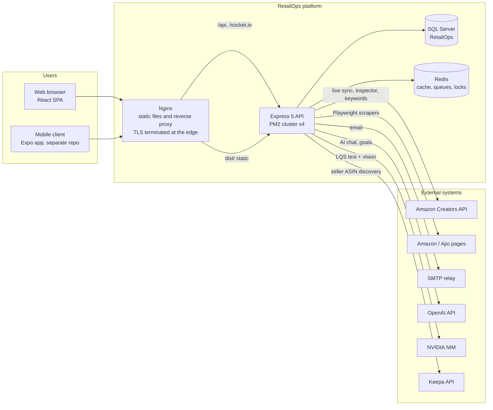

### 2.2 Containers and deployment

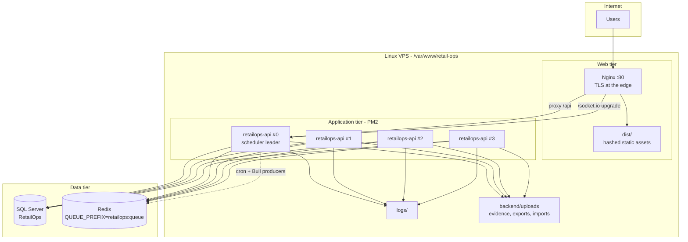

Deployment reality checks:

- PM2 runs 4 cluster workers on a single port. Node's cluster module load-balances connections, but there is **no sticky-session configuration** in `ecosystem.config.js` and no `ip_hash` in `nginx.conf`. Socket.IO therefore relies on the **WebSocket transport only** (the client forces `transports: ['websocket']`), and the Redis adapter is required for rooms to work across workers.
- Nginx terminates plain HTTP on port 80 in the repository config. TLS is expected to be terminated by an upstream proxy or a host-level certificate that is not in this repository. Verify before assuming HTTPS works from the repo config alone.
- `ecosystem.config.js` declares a second application, `grownext`, running `npx next start` from `/var/www/grownext.in` on port 3000. It is unrelated to RetailOps but shares the same PM2 log directory. Do not remove it without confirming with the owner.

### 2.3 Request lifecycle

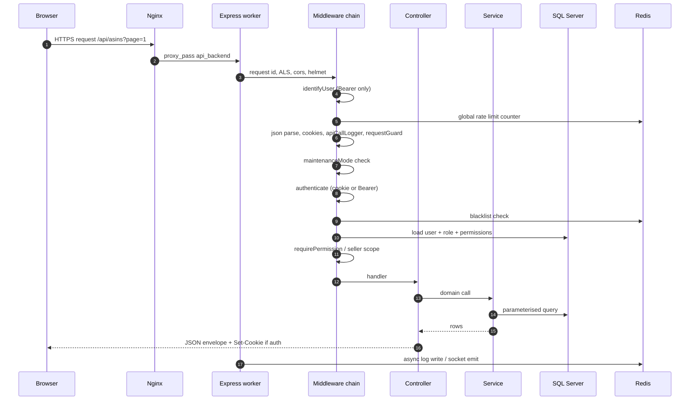

Key properties:

- Request IDs are generated or accepted from `x-request-id`, stored in `AsyncLocalStorage`, returned in the response header, and included in error bodies.
- `identifyUser` runs **before** `cookieParser`, so only Bearer tokens contribute the user identity used by the global rate limiter; cookie traffic is limited per IP.
- Access logging is asynchronous and 2xx-only for `/api` calls, excluding reads and health/download endpoints.
- Every successful mutation can emit a `new_system_log` Socket.IO event for the activity feed.

### 2.4 Technology stack

| Layer | Choice | Notes |
| --- | --- | --- |
| UI framework | React 19.3 | Function components, hooks only |
| Build | Vite 8.3 | Manual vendor chunking, `@` alias, dev proxy to `:3001` |
| Routing | React Router 7 | Lazy routes, permission guards |
| UI kit | Ant Design 6.6 + Tailwind 4 | Two coexisting styling systems; see design debt |
| Charts | Recharts 3, ApexCharts 8, MUI X Charts, VChart | Multiple chart libraries in use |
| Server state | TanStack Query 5 | 4 min stale time, 15 min gc, retry 2 |
| Client state | Zustand 5, React Context | One persisted store (`dash-cache`) |
| HTTP | native `fetch` (primary), axios (legacy) | Cookie auth in `services/api.js` |
| API | Express 5.3 | 45 routers, Joi validation |
| Auth | JWT access + refresh, httpOnly cookies, OTP | bcrypt, trusted devices, blacklist |
| DB | SQL Server via `mssql` 12 | Pool 200, reader replica optional, retry on 1205 |
| Cache / queue | Redis via `ioredis` 6, Bull 4 | Locks, TPS/TPD gate, queues |
| Realtime | Socket.IO 4 | Redis adapter, JWT handshake |
| Files | ExcelJS, multer, xlsx | Exports in `backend/uploads/exports` |
| Scraping | Playwright 1.64, Puppeteer 25 | Adaptive concurrency, circuit breaker |
| AI | OpenAI 7, NVIDIA NIM | Chat, goals, LQS text/vision |
| Email | Nodemailer 10 | HTML templates in `backend/emails` |
| Logging | Winston 3 | Rotating files, 30/90/365 day retention |
| Tests | Jest 30, Supertest, node:test, Playwright | See [Testing](#13-testing-and-quality-gates) |
| CI/CD | GitHub Actions | Lint, typecheck, tests, audit, Docker, SSH deploy |

### 2.5 Runtime topology notes

- **Scheduler leader.** `schedulerService.init()` and `recurringTaskScheduler.start()` run only when `NODE_APP_INSTANCE` is unset or `0`. Every other worker still registers Bull processors.
- **Redis is not optional in a cluster.** Queue producers, job state, Live Data Inspector jobs, rate-gate budgets and cron locks all live in Redis. Without it, rate limiting falls back to per-process and multiplies real API throughput by the worker count.
- **Uploads are local disk.** Evidence, imports, exports and scrape artifacts live under `backend/uploads`. In a multi-host deployment this requires shared storage (NFS/EFS); currently it is a single-host assumption.
- **Time zone.** SQL Server runs with `useUTC: false`; a `dbo.GetEnvDate()` UDF is created on pool connect using the offset from `AUTOMATION_TIMEZONE` (default `Asia/Kolkata`, +330). Application dates are IST-first.

---

## 3. Repository map

```text
retail-ops/
|-- src/                          React application
|   |-- api/                      Legacy axios client
|   |-- components/               Shared UI: ui/, common/, header/, ads/, dashboard/, onboarding/
|   |-- constants/                Permissions, nav, status vocabularies
|   |-- context/  contexts/       Auth, socket, sidebar, date range, page title, toast, onboarding
|   |-- hooks/                    Feature data hooks (dashboard, ads, keywords, growth)
|   |-- icons/                    Offline Fluent icon set + generator output
|   |-- lib/                      api-client.ts (legacy), utilities
|   |-- models/                   Client-side models
|   |-- modules/tasks/            PEMS module: pages, components, views, registry, services, utils
|   |-- pages/                    Route screens, grouped: ads/, corp/, keywords/, opsCenter/
|   |-- services/                 api.js (primary), authRequest, realtimeService, apiCache, db.js (legacy)
|   |-- store/                    Zustand dashboard store, event bus
|   |-- styles/                   tokens.css, index.css, promptkit.css, DESIGN-SYSTEM.md
|   |-- theme/                    Ant Design theme
|   |-- utils/                    Formatting, dates, export helpers
|   `-- App.jsx                   Providers + route table with guards
|-- backend/                      Express API
|   |-- config/                   env.js, proxies.json
|   |-- controllers/              Request handlers, grouped: pems/, liveData, exports, uploads
|   |-- database/                 db.js pool + migrate.js runner
|   |-- emails/                   Templates: auth, task notifications, welcome credentials
|   |-- jobs/                     Bull queue definitions + processors, OTP cleanup
|   |-- lib/                      Password policy and shared backend helpers
|   |-- middleware/               auth, RBAC, rate limits, logging, maintenance, PEMS access
|   |-- migrations/               Numbered schema migrations 001-034 + _helpers.js
|   |-- prompts/                  AI prompt templates
|   |-- routes/                   Feature routers + pems/ subdirectory
|   |-- scripts/                  One-off and operational scripts (imports, seeds, backfills)
|   |-- services/                 Domain logic; oos/ and pems/ subdirectories
|   |-- sockets/                  chatSocket.js
|   |-- utils/                    logger, errors, LQS analyzers, seller scope, SQL helpers
|   |-- __tests__/                Jest unit and integration tests
|   `-- server.js                 Bootstrap, mounts, health, error handler, Socket.IO
|-- docs/                         Engineering, API, module and design documentation
|-- tests/                        Playwright specs
|-- scraper-package/              Standalone Amazon.in page scraper (file output only, no DB)
|-- scripts/                      git-flow.sh, generate-fluent-icons.mjs
|-- .github/workflows/            ci.yml, cd.yml, staging.yml, security.yml, design-system.yml
|-- nginx.conf                    Reverse proxy config
|-- Dockerfile.backend            Multi-stage backend image
|-- docker-compose.yml            Backend + nginx (development compose)
|-- docker-compose.db.yml         SQL Server 2022 for local development
|-- init-database.sql             Bootstrap schema, seeds, indexes, UDF
`-- ecosystem.config.js (backend) PM2 process definitions
```

Generated and ignored: `dist/`, `node_modules/`, `backend/logs/`, `backend/uploads/`, `.env*` except examples.

---

## 4. Frontend

### 4.1 Boot sequence

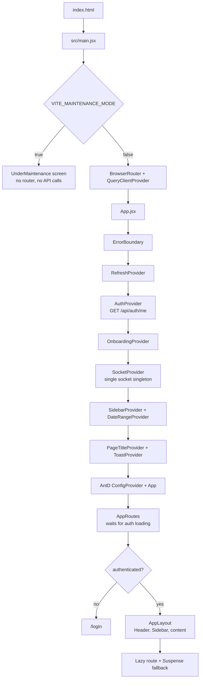

Bootstrap facts:

- `src/main.jsx` imports Bootstrap, RSuite, the token stylesheet, `index.css` and `global-overrides.css`. Multiple UI foundations coexist; see [4.6](#46-design-system).
- `HomeRoute` sends non-global users with `tasks_view` to `/tasks/my-day` once per browser session (`sessionStorage.landing.myday`); everyone else lands on Ops Center. This is deliberate: task execution is the daily entry point for operational staff.
- Unknown paths inside the layout have **no catch-all route**, so the outlet renders empty. Treat missing 404 handling as a known gap.

### 4.2 Provider tree

```text
ErrorBoundary
`-- RefreshProvider
    `-- AuthProvider            (session, permissions, user)
        `-- OnboardingProvider  (first-run empty-state wizard)
            `-- SocketProvider  (one socket, browser notifications)
                `-- SidebarProvider
                    `-- DateRangeProvider  (global reporting window)
                        `-- PageTitleProvider
                            `-- ToastProvider
                                `-- ConfigProvider (antd theme, compact)
                                    `-- AntdApp
                                        `-- AppRoutes
                                            `-- AppLayout
                                                |-- GlobalHeader (command palette, notifications, date range)
                                                |-- Sidebar (permission-filtered nav)
                                                `-- Suspense + RouteProgress
```

Context responsibilities:

| Context | File | Responsibility |
| --- | --- | --- |
| `AuthContext` | `src/contexts/AuthContext.jsx` | Session bootstrap via `/auth/me`, `hasPermission`, login/logout state, role normalization |
| `OnboardingContext` | `src/contexts/OnboardingContext.jsx` | Shows first-run wizard when there are no sellers/ASINs |
| `SocketContext` | `src/contexts/SocketContext.jsx` | Reuses `realtimeService`, adds browser notifications, tears down on logout |
| `SidebarContext` | `src/context(s)/SidebarContext` | Collapse state, responsive drawer |
| `DateRangeContext` | `src/contexts/DateRangeContext.jsx` | Shared reporting period across pages |
| `PageTitleContext` | `src/contexts/PageTitleContext.jsx` | Document title and breadcrumb |
| `ToastContext` | `src/contexts/ToastContext.jsx` | Ant Design message wrapper |
| `RefreshContext` | `src/contexts/RefreshContext.jsx` | Manual global refresh trigger |

### 4.3 Routing table

All routes render inside `AppLayout` except the auth and wizard pages.

| Route | Component | Permission | Notes |
| --- | --- | --- | --- |
| `/login` | `LoginPage` | public | Password + optional OTP stage |
| `/forgot-password` | `ForgotPasswordPage` | public | Emails reset link |
| `/reset-password` | `ResetPasswordPage` | public | Token in query string |
| `/setup-wizard` | `SetupWizardPage` | authenticated | 5 steps, forced for first login |
| `/` | `HomeRoute` -> `OpsCenter` | `dashboard_view` | Redirects task users to My Day |
| `/dashboard` | `OpsCenter` | `dashboard_view` | Main command center |
| `/dashboard-v2` | `DashboardV2.tsx` | `dashboard_view` | **Demo data only** - see debt register |
| `/sku-report` | `SkuReport` | `skureport_view` | |
| `/parent-asin-report` | `ParentAsinReport` | `parentreport_view` | |
| `/month-wise-report` | `MonthWiseReport` | `monthlyreport_view` or `targets_view` | |
| `/ads-manager` | `AdsManagerPage` | `adsreport_view` | `/ads-report` redirects here |
| `/keyword-research` | `KeywordResearchPage` | authenticated | Nav hidden without `keywords_view` |
| `/asin-tracker` | `AsinManagerPage` | `asinmanager_view` | Primary catalogue surface |
| `/gms-tracker` | `GmsTrackerPage` | `gms_tracker_view` | |
| `/profit-loss` | `ProfitLossPage` | `pnlreport_view` | |
| `/inventory` | `InventoryPage` | `inventoryreport_view` | |
| `/sellers` | `SellersPage` | `seller_view` | |
| `/seller-tracker`, `/seller-tracker/:sellerId` | `SellerAsinTrackerPage` | `asintracker_view` | |
| `/upload-export` | `UploadExport` | `asinmanager_import` | Bulk imports |
| `/alerts` | `ActivityLog` | `activitylogs_view` | Notifications + audit |
| `/activity-log` | `ActivityLog` | `activitylogs_view` | Same component |
| `/alert-rules` | `AlertRulesPage` | `rules_view` | |
| `/rule-sets` | `RuleSetsPage` | `rules_view` | |
| `/rule-sets/new`, `/rule-sets/:id` | `RulesetBuilderPage` | `rules_manage` | |
| `/scrape-tasks` | `ScrapeTasksPage` | `scraping_view` | |
| `/scraper` | `ScraperDashboardPage` | `scraping_view` | |
| `/live-sync-tracker`, `/live-data-inspector`, `/live-sync` | `LiveSyncPage` | `scraping_view` | **All three render the same page** |
| `/scheduled-runs` | `ScheduledRunsPage` | `scraping_view` | |
| `/target-achievement` | `TargetVsAchievement` | `monthlyreport_view` or `targets_view` | |
| `/target-achievement/dashboard` | `TargetVsAchievementDashboard` | `monthlyreport_view` or `targets_view` | |
| `/target-achievement/create` | `TargetCreationPage` | `monthlyreport_edit` | Permission is not seeded - see debt |
| `/revenue-calculator` | `RevenueCalculatorPage` | `calculator_view` | |
| `/users` | `UsersPage` | `users_view` | |
| `/roles` | `RolesPage` | `roles_view` | |
| `/team-management` | `TeamManagementPage` | `roles_view` | |
| `/settings` | `SettingsPage` | `settings_manage` | |
| `/api-keys` | `ApiKeysPage` | `apikeys_manage` | |
| `/file-manager` | `FileManagerPage` | `files_manage` | |
| `/webhooks` | `WebhookSettingsPage` | `rules_manage` | |
| `/tasks` | redirect | `tasks_view` | Redirects to `/tasks/tasks` |
| `/tasks/my-day` | `MyDayPage` | `tasks_view` | Daily planner, opens workspace |
| `/tasks/dashboard` | `TaskPerformanceDashboard` | `tasks_view` | |
| `/tasks/templates`, `/tasks/templates/:id` | `TaskTemplatesPage`, `TemplateDetailPage` | `tasks_manage` | |
| `/tasks/tasks` | `TaskInstancesPage` | `tasks_view` | Main task list |
| `/tasks/reviews` | `ReviewQueuePage` | `tasks_view` | |
| `/tasks/analytics` | `TaskAnalyticsPage` | `tasks_view` | |
| `/pems/*` | redirects | - | Legacy URLs preserved |
| `/profile`, `/profile/:id` | `ProfilePage` | authenticated | |
| `/unauthorized` | `Unauthorized` | authenticated | |

Routes present in code but **not routed** (dead surfaces): `/ai-chat`, `/actions/templates`, `/actions/achievement-report`.

### 4.4 Data layer

There are four client data paths. Know which one a screen uses before debugging it.

| Path | File | Used by | Auth | Notes |
| --- | --- | --- | --- | --- |
| Primary fetch client | `src/services/api.js` | Most pages | Cookies (`credentials: same-origin`) | 22 exported namespaces, `API_BASE = VITE_API_URL or /api` |
| Cached fetch wrapper | `src/services/apiCache.js` | Hot dashboard/list calls | Cookies | 5 min memory cache + in-flight dedupe |
| Legacy axios | `src/lib/api-client.ts` | A few older modules | `localStorage.authToken` | Redirects to `/login` on 401, no refresh |
| Legacy `db.js` | `src/services/db.js` | Settings, activity log, revenue calculator, task instances | `localStorage.authToken` | Named `db` but is a fetch wrapper |
| Tasks client | `src/modules/tasks/services/tasksApi.js` | Task module | Cookies | Targets `/pems/*` directly, heavy duplication |

TanStack Query defaults (`src/main.jsx`):

```js
staleTime: 4 * 60 * 1000
gcTime: 15 * 60 * 1000
retry: 2 (exponential backoff, capped 32s)
refetchOnWindowFocus: false
refetchOnReconnect: true
mutations: { retry: 1, gcTime: 5 * 60 * 1000 }
```

Local persistence keys: `localStorage.user` (cached profile only), `retailops_onboarding_complete`, `myday.workday`, `myday.deferred.<date>`, `dash-cache` (Zustand), keyword saved/watch lists, and `sessionStorage.landing.myday`.

### 4.5 Realtime client

`src/services/realtimeService.ts` owns the single socket:

- URL derived from `VITE_API_URL` with `/api` stripped; `transports: ['websocket']`.
- Auth token from `localStorage.authToken` in the handshake.
- Infinite reconnect from 1s backoff to 30s.
- Every server event is mirrored onto the internal event bus as `realtime:<event>`, with aliases `realtime:systemLog`, `realtime:notification`, `realtime:userStatus`.
- Channel subscriptions are re-attached after reconnect.
- `SocketContext` adds browser notifications for `receive_message` and `incoming_call`, and disconnects on logout.

Dashboard invalidation mapping (`useRealTimeDashboard`): `dataUpdate` -> dashboard metrics, `asinUpdated` -> ASIN table, `targetReached` -> goals, `alerts` -> alerts, `sellerSynced` -> sellers, `taskUpdated` -> tasks.

### 4.6 Design system

| Layer | Location | Notes |
| --- | --- | --- |
| Tokens | `src/styles/tokens.css` | `--bc-*` primitives, semantic surface/text/border/status, module accents, marketplace colours, spacing, radius, shadows, z-index, dark-mode hooks |
| Tailwind | `src/index.css` | Tailwind 4 via `@import "tailwindcss"`, Iconify and typography plugins. **No `tailwind.config.js`** |
| Chat tokens | `src/styles/promptkit.css` | `@theme inline` + `oklch()` values for chat components |
| Ant Design | `src/theme/antdTheme.js` | Primary `#1976D2`, Inter 13px, radius 8, control height 32, compact tables |
| Fonts | `tokens.css` | DM Sans (display), Inter (UI), Barlow Condensed, JetBrains Mono |
| Icons | `src/icons/fluent.jsx` | Offline Fluent set, plus lucide, antd, Tabler, MUI and bootstrap-icons |
| Shared primitives | `src/components/ui/`, `src/components/common/` | Two parallel sets (Tailwind/Radix-style and AntD-style) |

Documented CSS debt lives in `src/styles/DESIGN-SYSTEM.md`: competing variable systems, hardcoded hex values, duplicated selectors, roughly 5.7k lines of bespoke CSS. New UI should use `--bc-*` tokens and existing primitives rather than adding a fourth system.

### 4.7 Build and tooling

`vite.config.js`:

- Alias `@` -> `./src`.
- Dev server on `0.0.0.0`, proxying `/api` and `/socket.io` (ws) to `http://localhost:3001`.
- Manual vendor chunks: core, antd, ui, query, charts, common, xlsx, forms, misc.
- `target: es2020`, source maps disabled.
- `ALLOWED_HOSTS`/E2B hosts allow-list for hosted preview environments.

Quality tooling:

- ESLint 10 flat config, ignores `dist`, `node_modules`, `backend`; only `**/*.{js,jsx}`.
- `no-unused-vars` ignores identifiers matching `^[A-Z_]`, which hides unused component imports.
- TypeScript is non-strict (`strict: false`, no unused checks) and **not run by `build`**.
- Playwright config runs Chromium against a Vite server on 5173.

---

## 5. Backend

### 5.1 Middleware pipeline

Order matters. This is the actual sequence in `backend/server.js`.

| # | Middleware | File | Behaviour |
| --- | --- | --- | --- |
| 1 | Request ID + ALS | `server.js` | `x-request-id` or UUIDv4, `AsyncLocalStorage` context |
| 2 | `trust proxy = 1` | `server.js` | Correct client IP behind one proxy hop |
| 3 | CORS | `server.js` | Credentials enabled, configured origins |
| 4 | Helmet | `server.js` | Security headers (CSP disabled for the SPA) |
| 5 | `identifyUser` | `middleware/identifyUser.js` | Bearer-only decode, no DB hit, **runs before cookies** |
| 6 | Global limiter | `middleware/rateLimiter.js` | `createLimiter('READ')`, Redis store, fail-open |
| 7 | `httpsRedirect` | `middleware/httpsRedirect.js` | Enforces HTTPS when enabled |
| 8 | Body parsers | `server.js` | JSON and urlencoded, 10 MB limit |
| 9 | `cookieParser` | `server.js` | Enables cookie auth from here on |
| 10 | `apiCallLogger` | `middleware/apiCallLogger.js` | 2xx non-read `/api` calls to `SystemLogs`, secrets masked |
| 11 | `requestGuard` | `middleware/requestGuard.js` | Rejects malformed/abusive requests, timeout guard |
| 12 | Static | `server.js` | `/uploads`, `/tools` |
| 13 | `maintenanceMode` | `middleware/maintenanceMode.js` | 503 for all `/api/*` when enabled |
| 14 | Routers | `backend/routes/*` | Per-mount limiters and auth |
| 15 | `/api/health` | `server.js` | Declared after routers, exempt from rate limits |
| 16 | Error handler | `server.js` + `utils/errors.js` | `SystemLogs` write, JSON envelope, request ID |

Route-level auth and authorisation:

| Middleware | File | Purpose |
| --- | --- | --- |
| `authenticate` | `middleware/auth.js` | Verify token (cookie or Bearer), blacklist, DB user, fingerprint, 428 gate, access profile |
| `requirePermission(name)` | `middleware/auth.js` | Exact permission or `*` |
| `requireAnyPermission([...])` | `middleware/auth.js` | Any-of or `*` |
| `requireRole(...)` | `middleware/auth.js` | Role-name gate for privileged operations |
| `checkSellerAccess` | `middleware/auth.js` | Requested seller vs allowed scope |
| `checkUserHierarchyAccess` | `middleware/auth.js` | Supervisor/subordinate access |
| `requireTaskAccess`, `requireTaskView`, `requireGlobalPemsRole` | `middleware/pemsAccess.js` | Task-level and global PEMS gates |

Rate limit tiers (`middleware/rateLimiter.js`, all 60 second windows):

| Tier | Requests / minute | Applied to |
| --- | --- | --- |
| `PUBLIC` | 100 | Unauthenticated utility endpoints |
| `AUTH` | 20 | `/api/auth` mount |
| `READ` | 300 | Global default |
| `WRITE` | 50 | Mutations |
| `BULK` | 10 | `/api/bulk` |
| `IMPORT` | 5 | Heavy import endpoints |
| `STRICT` | 30 | `/api/users`, `/api/roles` |

Login has an additional per-IP limiter (10/min) and a per-email failure limiter (5 failures / 15 min, progressive delays, email alert on lockout).

### 5.2 Module inventory

| Router | Mount | Responsibility |
| --- | --- | --- |
| `authRoutes` | `/api/auth` | Login, OTP, refresh, logout, profile, password reset |
| `userRoutes` | `/api/users` | User CRUD, credentials email, supervisors |
| `roleRoutes` | `/api/roles` | Roles, permissions, overrides |
| `teamRoutes` | `/api/teams` | Teams and members |
| `apiKeyRoutes` | `/api/keys` | External API keys |
| `securityRoutes` | `/api/security` | OTP audit, trusted devices |
| `setupWizardRoutes` | `/api/setup-wizard` | First-login onboarding |
| `sellerRoutes` | `/api/sellers` | Seller CRUD, configuration |
| `sellerAsinTrackerRoutes` | `/api/seller-tracker` | Seller-scoped ASIN tracking, Keepa discovery |
| `asinRoutes` | `/api/asins` | ASIN detail, tags, history, trends |
| `asinTableRoutes` | `/api/asins-table` | Server-paginated ASIN grid |
| `uploadRoutes` | `/api` | Bulk imports, file ingestion |
| `bulkRoutes` | `/api/bulk` | Bulk status/tag operations |
| `dataRoutes` | `/api` | Dashboard and aggregate data |
| `adsRoutes` | `/api/ads` | Ads analytics, targets, AI analyst |
| `targetRoutes`, `targets.js` | `/api/targets` | Target tracking (`targets.js` is orphaned) |
| `revenueRoutes`, `revenueCalculatorRoutes` | `/api/revenue-engine`, `/api/revenue` | P&L and calculator |
| `goalRoutes`, `objectiveRoutes` | `/api/goals`, `/api/objectives` | Goals and OKRs |
| `rulesetRoutes` | `/api` | Rulesets and execution logs |
| `actionRoutes` | **disabled** | Legacy Actions module, commented out |
| `alertsRoutes` | `/api` | Alerts and alert rules |
| `webhookRoutes` | `/api/webhooks` | Webhook CRUD and delivery logs |
| `scheduledRunRoutes` | `/api/scheduled-runs` | Cron run history |
| `scraperRoutes` | `/api/scraper` | Scraper jobs, health, stats |
| `marketDataSyncRoutes` | `/api/market-sync` | Live Sync and legacy sync |
| `liveDataRoutes` | `/api/live-data` | Live Data Inspector v1/v2/v3 |
| `exportRoutes` | `/api/export` | ASIN, GMS and Ads exports |
| `fileRoutes` | `/api/files` | File manager |
| `chatRoutes`, `messagingRoutes` | `/api/chat`, `/api/messaging` | Internal chat |
| `notificationRoutes`, `pushRoutes` | `/api/notifications`, `/api/push` | In-app and push notifications |
| `taskRoutes`, `pems/pemsRoutes`, `pems/taskViewRoutes` | `/api/tasks`, `/api/pems` | Tasks, templates, views, OOS task binding |
| `oosRoutes` | `/api/oos` | Standalone OOS engine |
| `keywordRoutes`, `keywordAnalysisRoutes` | `/api/keywords`, `/api/keyword-analysis` | Keyword research and analysis |
| `listingQualityRoutes` | `/api/listing-quality` | LQS scoring |
| `growthExecutionRoutes` | `/api` | Growth execution (largely dormant) |
| `aiRoutes`, `aiChatRoutes` | `/api/ai`, `/api/ai/chat`, `/api/strategy` | AI chat, goals, listing analysis |
| `systemLogRoutes` | `/api/logs` | Activity and system logs |
| `systemSettingRoutes` | `/api/settings` | Runtime settings |
| `seedRoutes` | `/api/seed` | Seeding helpers |

> `targets.js` is dead code and `pems/dashboardRoutes.js` is required but never mounted. See the debt register.

### 5.3 Response and error conventions

Success envelope (`utils/responseHandler.js`):

```json
{
  "success": true,
  "timestamp": "2026-10-26T10:00:00.000Z",
  "message": "Optional message",
  "data": {}
}
```

Error envelope (global handler):

```json
{
  "success": false,
  "error": "Human readable message",
  "code": "MACHINE_CODE",
  "requestId": "uuid",
  "details": {}
}
```

Error classes in `utils/errors.js`:

| Class | Status | Code |
| --- | --- | --- |
| `AppError` | 500 default | `INTERNAL_ERROR` |
| `NotFoundError` | 404 | `NOT_FOUND` |
| `ValidationError` | 400 | `VALIDATION_ERROR` |
| `AuthError` | 401 | `AUTH_ERROR` |
| `ForbiddenError` | 403 | `FORBIDDEN` |
| `ConflictError` | 409 | `CONFLICT` |
| `RateLimitError` | 429 | `RATE_LIMITED` |
| `TransitionError` | 400 | `INVALID_TRANSITION` |
| `DependencyError` | 502 | `DEPENDENCY_ERROR` |

HTTP conventions: 200/201 success, 400 validation, 401 unauthenticated, 403 scope or role, 404 missing, 409 conflict, 413 payload too large, 428 credential update required, 429 throttled, 502 dependency failure, 503 maintenance or not ready.

Known inconsistencies to preserve in mind:

- `responseHandler.js` emits `message` while the global handler emits `error`; clients tolerate both.
- There is **no JSON 404 handler** for unmatched routes; Express returns HTML. Add one before relying on `error` parsing.
- Only 400 responses include `details`; 5xx include `stack` in development.

---

## 6. Authentication and authorization

### 6.1 Login and OTP sequence

Browser login is a two-factor flow for untrusted devices: password, then a 6-digit emailed OTP. Trusted devices skip the OTP for 12 hours.

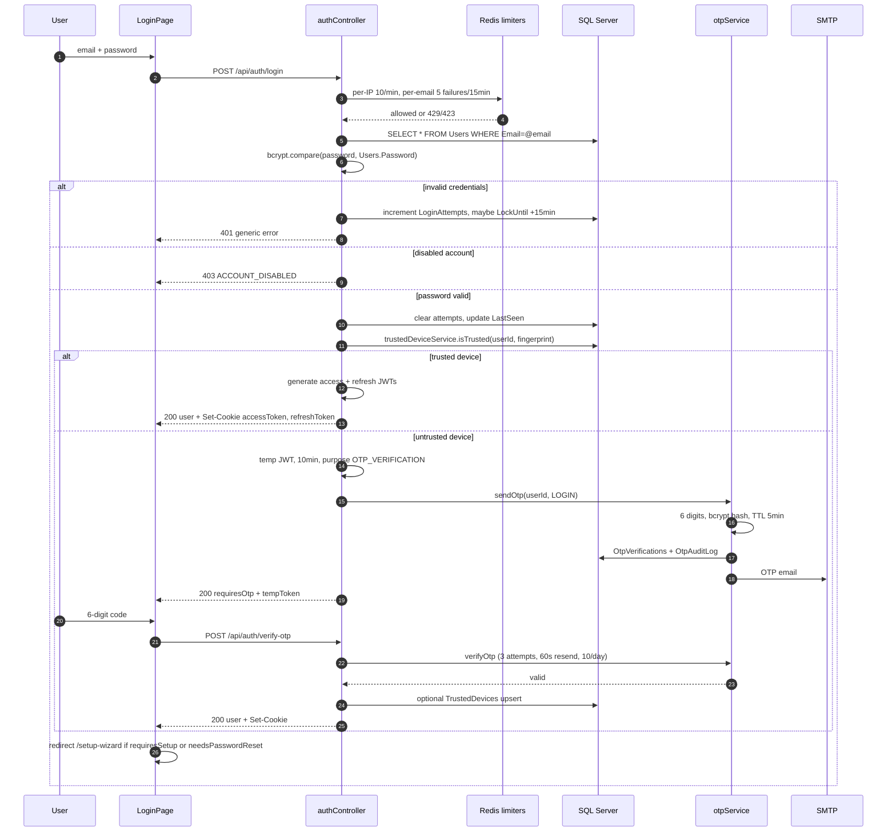

Auth endpoints:

| Method + path | Purpose | Notes |
| --- | --- | --- |
| `POST /api/auth/login` | Password login | IP 10/min, per-email lockout |
| `POST /api/auth/request-otp` | Passwordless / mobile OTP request | Email + at least one active seller, no password proof |
| `POST /api/auth/verify-otp` | Exchange temp token + OTP for session | 3 attempts, 5 min TTL |
| `POST /api/auth/resend-otp` | Resend code | 60s cooldown, 10/day |
| `POST /api/auth/refresh-token` | Rotate access + refresh tokens | Reads refresh cookie |
| `POST /api/auth/logout` | Revoke session | Clears DB refresh token, blacklists access token |
| `GET /api/auth/me` | Current user + permissions | Session bootstrap |
| `PUT /api/auth/profile` | Update own profile | |
| `POST /api/auth/forgot-password` | Send reset link | Always returns success |
| `GET /api/auth/validate-reset-token` | Check reset token | |
| `POST /api/auth/reset-password` | Set new password | bcrypt 12, reuse check |
| `POST /api/auth/register` | **Disabled** | Always 403 |

OTP policy: 6 digits from `crypto.randomInt`, bcrypt cost 10, 5 minute TTL, 3 verification attempts, 60 second resend cooldown, 10 sends per user per day. Each new OTP invalidates unused codes for the same purpose. Audit rows go to `OtpAuditLog`.

### 6.2 Tokens, cookies and refresh

| Item | Value |
| --- | --- |
| Access JWT claims | `userId`, `type: access`, `fp` (device fingerprint) |
| Access JWT TTL | 12 hours (`config/env.js`) |
| Refresh JWT claims | `userId`, `type: refresh`, `fp` |
| Refresh JWT TTL | 7 days |
| `accessToken` cookie | httpOnly, `sameSite: Strict`, `secure` in production, maxAge **2 hours**, default path |
| `refreshToken` cookie | httpOnly, `sameSite: Strict`, `secure` in production, maxAge 7 days, path `/api/auth/refresh-token` |
| Storage | `Users.RefreshToken` holds the only valid refresh token per user |
| Revocation | Redis `bl:<token>` until expiry; `ubl:<userId>` for user-wide revoke |

> The access JWT lives 12 hours but its cookie lives 2 hours. There is no automatic refresh interceptor in the current clients, so a browser session effectively ends after 2 hours of use. This is a known issue; see [6.9](#69-auth-risks).

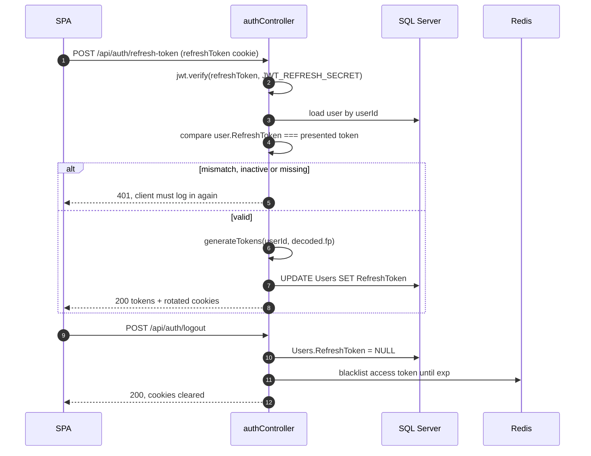

### 6.3 Password reset and setup wizard

Password reset:

1. `POST /api/auth/forgot-password` looks up the email and creates a 64-byte token (128 hex characters) stored **in plaintext** in `PasswordResets.Token` with a 1 hour expiry.
2. The email links to `${DASHBOARD_URL}/reset-password?token=...` (mobile may use `MOBILE_RESET_URL`).
3. `POST /api/auth/reset-password` validates the token, enforces policy (12-128 characters, upper, lower, number, symbol, no `<`), rejects the current and last five passwords, sets `PasswordExpiresAt = now + 90 days`, nulls the refresh token and blacklists the user.
4. Password history is retained in `PasswordHistory`.

Setup wizard (`/api/setup-wizard`, all authenticated):

| Endpoint | Purpose |
| --- | --- |
| `GET /status` | Current step and completion state |
| `POST /step/:stepName/complete` | Mark a step complete |
| `POST /password` | Set the first password |
| `POST /complete` | Finish onboarding, set `IsFirstLogin = 0` and `SetupCompletedAt` |

Steps: `welcome`, `security_tips`, `change_password`, `accept_policies`, `complete`.

While `ForcePasswordReset` is set, or `PasswordExpiresAt` has passed, or first login is incomplete, `authenticate` returns **428 `CREDENTIAL_UPDATE_REQUIRED`** for every route except a small allow-list (`/auth/me`, `/auth/logout`, password change endpoints, and `/setup-wizard/*`). New routes that must work before onboarding need to be added to that allow-list in `middleware/auth.js`.

Admin-created users receive the default password `Welcome@123`; credentials are emailed only when an admin triggers `POST /api/users/:id/send-credentials`.

### 6.4 Trusted devices

| Property | Value |
| --- | --- |
| Table | `TrustedDevices` (`UserId`, `DeviceFingerprint`, `DeviceName`, `UserAgent`, `IpAddress`, `LastUsedAt`, `ExpiresAt`, `IsRevoked`) |
| Trust duration | 12 hours |
| Fingerprint source | `utils/requestFingerprint.js` (user agent + IP) |
| Management | `GET /api/security/trusted-devices`, `DELETE /api/security/trusted-devices/:deviceId`, `/others`, `/all` |
| Cleanup | Expiry is enforced on read (`ExpiresAt > GETDATE()`); no dedicated cleanup job exists in the repository |

Trusted-device state is a convenience only. It is not a security boundary; UA/IP-based fingerprints can change on mobile networks and can be spoofed.

### 6.5 RBAC model

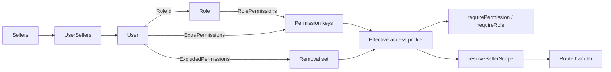

Resolution order in `services/accessProfileService.js`:

1. Start with role permissions.
2. Add `Users.ExtraPermissions`.
3. Remove `Users.ExcludedPermissions`.
4. Ignore unknown override keys.
5. `*` short-circuits every check.

Role names are normalised in `utils/roleUtils.js`. Global roles: `admin`, `super_admin`, `developer`, `operational_manager`. `seller_client` is scoped to `self`; other roles default to `assigned` seller scope.

Frontend enforcement mirrors the backend but is **not** a security boundary:

- `ProtectedRoute` blocks routes by permission and redirects to `/unauthorized`.
- `AuthContext.hasPermission` bypasses checks for admin/super admin names and grants `operational_manager` everything except settings, users, roles and API keys.
- `useNavigationItems` independently filters the sidebar, so a visible link and a route guard can disagree.

### 6.6 Permission catalogue

61 keys are seeded by `controllers/roleController.js` and `scripts/seed-roles-permissions.js`.

| Area | Keys |
| --- | --- |
| System | `*` |
| Analytics | `dashboard_view`, `alerts_view`, `activitylogs_view` |
| Reports | `skureport_view`, `skureport_export`, `parentreport_view`, `parentreport_export`, `monthlyreport_view`, `monthlyreport_export`, `adsreport_view`, `adsreport_export`, `adsreport_import`, `pnlreport_view`, `pnlreport_export`, `inventoryreport_view`, `inventoryreport_export`, `goalsreport_view`, `goalsreport_manage` |
| Marketplace | `seller_view`, `seller_manage`, `marketplace_amazon`, `marketplace_ajio`, `asinmanager_view`, `asinmanager_manage`, `asinmanager_import`, `asinmanager_export`, `asintracker_view`, `keywords_view`, `keywords_export`, `keywords_manage`, `calculator_view`, `calculator_manage` |
| Automation | `scraping_view`, `scraping_manage`, `rules_view`, `rules_manage`, `templates_manage`, `tasks_view`, `tasks_manage`, `tasks_submit`, `tasks_approve` |
| Operations | `actions_view`, `actions_manage`, `chat_view`, `teams_manage`, `files_manage` |
| Security | `users_view`, `users_manage`, `roles_view`, `roles_manage`, `apikeys_manage`, `settings_manage` |
| Targets | `targets_view`, `targets_create`, `targets_edit`, `targets_delete`, `targets_export` |
| GMS | `gms_tracker_view`, `gms_tracker_import`, `gms_tracker_export` |

Permissions referenced in code but **not seeded**: `roles_create`, `roles_edit`, `roles_delete` (only `*` holders pass), and `monthlyreport_edit` (used by the target creation route). `sellers_delete` and `marketplace_myntra` exist only in the frontend constants.

### 6.7 Role matrix

Group-level grants; individual keys follow the catalogue above.

| Role | Analytics | Reports | Marketplace | Automation | Ops | Security | Targets | GMS |
| --- | --- | --- | --- | --- | --- | --- | --- | --- |
| `admin` | all | all | all | all | all | all | all | all |
| `operational_manager` | all | all | all | all | all | none | all | all |
| `Brand Manager` / `brand_manager` | view | view + ads export | view, export, import, keywords | tasks, actions view | chat | none | view/create/edit | view/import/export |
| `catalog_manager` | view | inventory view | view, export, keywords | tasks | chat | none | view | view |
| `listing_team` | view | none | view, keywords export | tasks, actions view | chat | none | view | view |
| `seller_client` | view | view + ads export | own view/export, keywords view | submit/approve tasks | chat | none | view | view/export |

`Brand Manager` and `brand_manager` are duplicate rows kept in sync manually; drift between them is a known risk.

### 6.8 Seller scoping

`utils/sellerScope.js` resolves the user's data boundary:

```text
resolveSellerScope(user, requestedSellerId)
  -> { isGlobal, allowed, requested, sellerIds, denied, unrestricted, empty }
```

Rules:

- Global roles and admins see everything.
- `seller_client` is restricted to sellers linked in `UserSellers` (`self`).
- Other roles are restricted to assigned sellers, plus direct reports where hierarchy applies.
- An explicit out-of-scope `sellerId` is denied rather than clamped.
- `bindSellerFilter` fail-closes with `AND 1=0` when the scope is empty, so a misconfigured user sees nothing instead of everything.

PEMS has a second implementation in `services/pems/sellerScope.js` plus `middleware/pemsAccess.js`. Both must be kept in sync; a fix in one is not automatically a fix in the other.

### 6.9 Auth risks

Read these before changing auth, and treat them as accepted risk unless the owner says otherwise:

1. **Passwordless login.** `request-otp` only needs an email with an active seller and returns a temp token; `verify-otp` then issues a full session. Anyone who controls the mailbox gets in.
2. **Session dies at 2 hours.** Access cookie TTL (2h) is shorter than the JWT TTL (12h) and no client refreshes automatically.
3. **Frontend logout is local only.** `AuthContext.logout` clears state and redirects without calling `POST /api/auth/logout`, so server-side tokens remain valid until expiry.
4. **Blacklist fallback is per-process.** Without Redis, a revoked token can still pass on another PM2 worker. The SQL `TokenBlacklist` table exists but is unused.
5. **Refresh token has no `type` claim check.** Validity relies on exact equality with `Users.RefreshToken`.
6. **Reset tokens are stored in plaintext** in `PasswordResets`.
7. **`/api/security/otp-logs` requires only `authenticate`**, not an admin permission, and returns audit data across users.
8. **`identifyUser` runs before `cookieParser`**, so the global limiter keys cookie-authenticated traffic by IP, not user.
9. **Fingerprint mismatch only warns** outside production.
10. **Default password** `Welcome@123` is assigned on user creation.
11. **Setup-wizard gate is a path allow-list regex**; new credential-sensitive endpoints must be registered there deliberately.

---

## 7. Data model

### 7.1 Core ER diagram

Logical relationships; foreign keys exist for the tables shown unless noted. OOS tables (next diagram) deliberately have none.

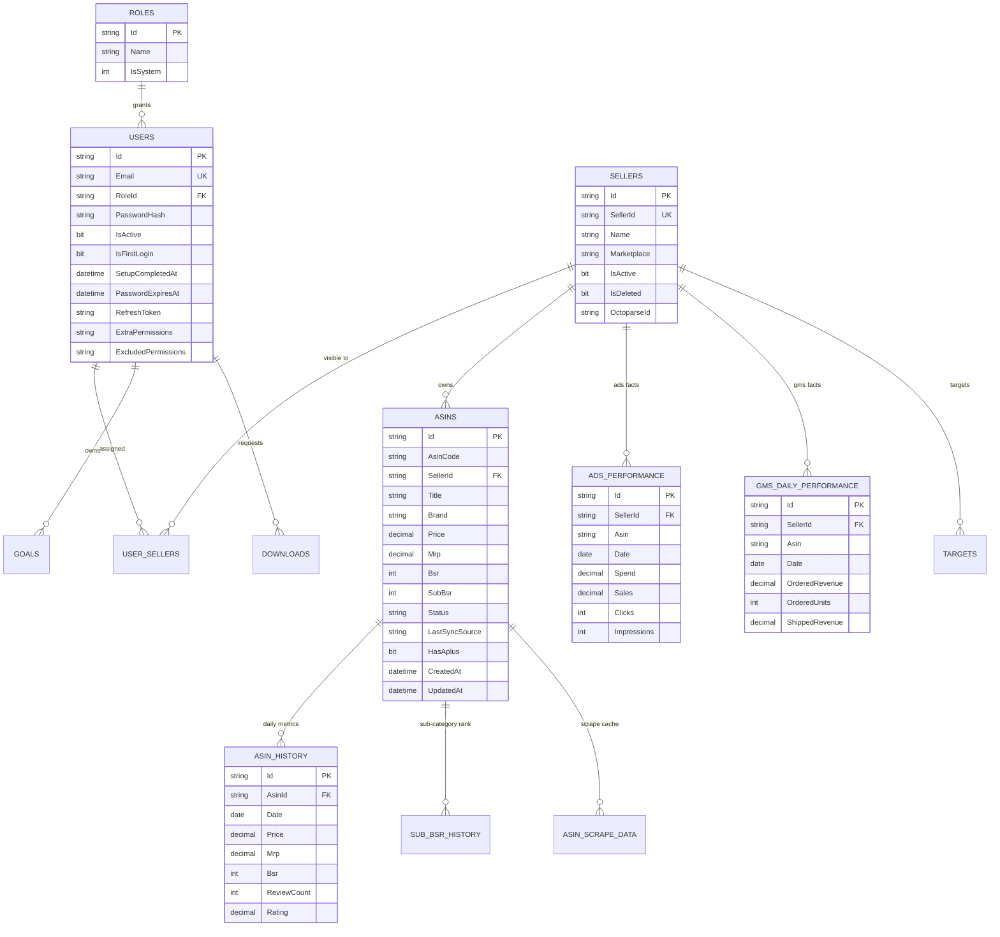

`ASINS` has `UNIQUE (AsinCode, SellerId)` and `FK SellerId -> Sellers(Id) ON DELETE CASCADE`. `Sellers` is soft-deleted (`IsDeleted`, `DeletedAt`, `DeletedBy`). `Users` is a mixed schema: older auth columns (`Password`) and newer ones (`PasswordHash`) are both maintained by migrations.

### 7.2 Tasks and OOS ER diagram

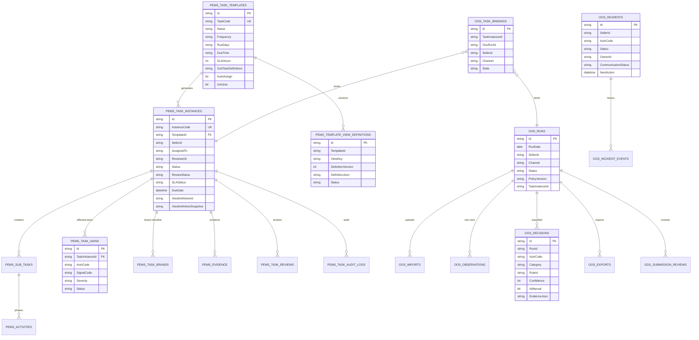

Two task generations coexist in the database: the legacy `Task*` family (`TaskTemplates`, `TaskInstances`, `TaskSubTasks`, ...) and the PEMS family (`PemsTaskTemplates`, `PemsTaskInstances`, ...). The running application uses **PEMS** tables for templates, instances, subtasks, activities, evidence, reviews and audit; the `Task*` tables are older and must not be assumed to hold live data. Confirm against the service you are touching.

OOS tables have **no declared foreign keys**; referential integrity is application-only. Unique and filtered indexes (for example one open incident per seller/channel/ASIN episode) enforce idempotency.

### 7.3 Table inventory

Approximately 60 tables come from `init-database.sql`, with further tables added by the 36 migration files. The inventory below, not a count, is the reliable reference.

**Identity and security**

| Table | Purpose |
| --- | --- |
| `Roles`, `Permissions`, `RolePermissions` | RBAC catalogue and join table |
| `Users` | Accounts, credentials, overrides, setup state |
| `UserSellers` | User to seller scoping |
| `UserSupervisors`, `UserBrandManagers` | Reporting lines |
| `Teams`, `TeamMembers` | Team grouping |
| `PasswordHistory` | Password reuse prevention |
| `PasswordResets` | Reset tokens (plaintext) |
| `OtpVerifications`, `OtpAuditLog` | OTP issue, verification, audit |
| `TrustedDevices` | 12-hour device trust |
| `TokenBlacklist` | Unused legacy revocation table |

**Catalogue and sales**

| Table | Purpose |
| --- | --- |
| `Sellers` | Marketplace accounts, soft delete, sync config |
| `Asins` | Catalogue item per seller |
| `AsinHistory` | Daily per-ASIN metrics |
| `AsinWeekHistory` | Weekly rollups |
| `SubBsrHistory` | Sub-category BSR time series |
| `AsinScrapeData` | Latest scrape payload / 24h cache |
| `AsinTable` | Legacy denormalised table |
| `AdsPerformance` | Daily advertising facts |
| `GmsDailyPerformance` | Daily GMS and P&L facts |
| `Targets`, `Goals`, `Objectives`, `KeyResults` | Commercial targets and OKRs |
| `ApiKeys` | External API keys |
| `UploadedFiles` | Import registry |
| `Downloads` | Export artifacts and expiry |

**Tasks and PEMS**

| Table | Purpose |
| --- | --- |
| `PemsTaskTemplates` | Template definition, recurrence, SLA, JSON SOP |
| `PemsTaskInstances` | Work item, status, assignment, view snapshot |
| `PemsSubTasks`, `PemsActivities` | Phases and steps materialised from template JSON |
| `PemsEvidence` | Uploaded evidence per task/activity |
| `PemsTaskReviews` | Review decisions and quality scores |
| `PemsTaskAuditLogs` | Status changes, comments (`Action='COMMENT'`) |
| `PemsTaskAsins` | Affected ASINs and signal severity |
| `PemsTaskBrands` | Brand checklist state |
| `PemsTemplateViewDefinitions` | Versioned published views |
| `PemsAssignmentRules` | Auto-assign strategy and escalation |
| `PemsRecurrenceLog` | Idempotency ledger for occurrence generation |
| `PemsNotifications` | In-app task notifications |
| `PemsScorecards` | Aggregated performance per entity/period |
| `PemsEscalationRules` | SLA escalation configuration |
| `PemsTaskEvents` | Append-only event store (**created lazily at runtime**) |
| `TaskTemplates`, `TaskInstances`, `TaskSubTasks`, `TaskActivities`, `TaskComments`, `TaskAuditLogs`, `TaskWatchers`, `TaskEscalationPolicies`, `TaskEscalations`, `TaskNotifications`, `TaskSlaPolicies`, `TaskAttachments`, `TaskRecurrenceLog`, `UserNotificationPreferences` | Legacy task family |

**OOS reconciliation**

| Table | Purpose |
| --- | --- |
| `OosWorkflowPolicies` | Versioned freshness, Pareto and vocabulary policy |
| `OosRuns` | One reconciliation run per seller/channel/date |
| `OosImports` | Uploaded Brand Central / Vendor Central files |
| `OosObservations` | Raw parsed rows, preserved verbatim |
| `OosDecisions` | Per-ASIN classification with rule and confidence |
| `OosIncidents` | Open/resolved discrepancy episodes |
| `OosIncidentEvents` | Incident timeline |
| `OosResyncJobs` | Verification jobs for disputed cases |
| `OosExports` | Immutable export versions with hash |
| `OosSubmissionReviews` | Independent reviewer decisions |
| `OosTaskBindings` | Task instance to OOS run mapping |

**AI, chat and messaging**

| Table | Purpose |
| --- | --- |
| `AIConversations`, `AIChatMessages` | AI assistant history |
| `Conversations`, `ConversationParticipants`, `Messages`, `MessageReactions`, `MessageStatus` | Internal chat |

**Operations, logging and integrations**

| Table | Purpose |
| --- | --- |
| `SystemLogs` | Activity and system audit feed |
| `CallLogs` | API call log |
| `ScheduledRuns`, `ScheduledRunDetails` | Cron and scheduler history |
| `LiveSyncRunLogs`, `LiveSyncRunAsinLogs` | Live Sync run detail |
| `ScrapeJobHistory`, `ScrapeJobDetails` | Playwright job history |
| `Alerts`, `AlertRules` | Alerting |
| `Webhooks`, `WebhookLogs` | Outbound integration |
| `Actions` | Legacy Actions module |
| `CreatorsApiQuota` | Daily TPS/TPD ledger per account |
| `SystemSettings` | Runtime configuration overrides |
| `SetupWizardProgress` | Onboarding step state |
| `SchemaMigrations` | Applied migration registry |
| `Rulesets`, `RulesetExecutionLogs`, `PredefinedTags`, `TagsHistory` | Automation and tagging |

Tables referenced in code but absent from `init-database.sql` and migrations: `PushTokens`, `GoalTemplates`, `RevenueCalculators`, `CalculatorAsins`, `OctoTasks`, `Files`, `Notifications`, `GmsTargets`, `GmsTargetBreakdowns`. Some are created by older deployments; verify before querying.

### 7.4 Connection and pooling

`backend/database/db.js` exports:

| Export | Purpose |
| --- | --- |
| `sql`, `getPool()`, `getReader()` | Driver, primary pool, optional read replica |
| `query(text, params)` | Positional parameters bound as `@param0..N` |
| `generateId()` | 24-character hex ID |
| `executeWithRetry(fn, retries, delay)` | Retries deadlocks (1205) and connection resets with jitter |
| `withTransaction(fn)` | Begin, run, commit, rollback on throw |

Pool settings: primary max 200 / min 10, request timeout 600s, connect timeout 60s, idle 10s. Reader replica enabled only when `DB_READER_SERVER` is set, max 100, request timeout 300s, automatic fallback to primary on failure. TLS encryption defaults **off for IP-literal hosts** (a Node 24+ TLS servername workaround) and on for DNS names; override with `DB_ENCRYPT`.

`initUdf()` runs on every pool connection and creates or alters `dbo.GetEnvDate()` using the configured `AUTOMATION_TIMEZONE` offset.

`config/env.js` duplicates parts of the DB configuration with different defaults (max 50 / min 5) and is not the pool actually used. Treat `database/db.js` as authoritative.

### 7.5 Migrations

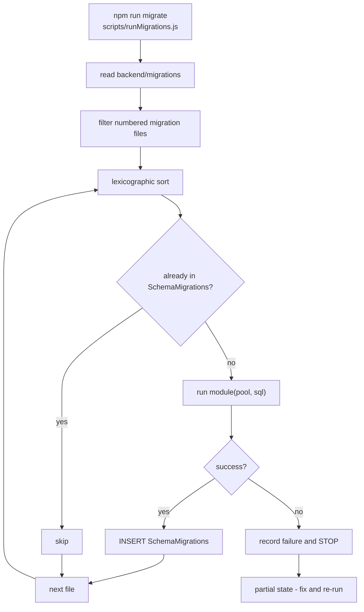

Facts:

- Runner: `backend/database/migrate.js`; CLI wrapper `backend/scripts/runMigrations.js`; helpers `backend/migrations/_helpers.js`.
- Tracking table: `SchemaMigrations (Id VARCHAR(50) PK, Name NVARCHAR(200) UNIQUE, AppliedAt DATETIME2)`.
- Modules may export a function `(pool, sql)`, `{ up }`, or `{ runMigration }`.
- Startup auto-run is enabled unless `RUN_MIGRATIONS_ON_STARTUP=false`, and is **non-fatal**.
- There is **no advisory lock**, so two instances booting simultaneously can race. Run migrations as a single deploy step, not from every worker.
- There is **no rollback runner**. `down()` exists only in one unused migration.
- Failures stop the run and leave earlier migrations applied.
- Numbering debt: duplicate `004`, `007`, `031`; `011` is missing. Because sorting is lexicographic, a new migration must use the next unused three-digit prefix and a descriptive suffix.

Adding a migration:

```js
// backend/migrations/035_add_example_column.js
module.exports = async function up(pool) {
  await pool.request().query(`
    IF COL_LENGTH('dbo.Asins', 'ExampleColumn') IS NULL
      ALTER TABLE dbo.Asins ADD ExampleColumn NVARCHAR(100) NULL;
  `);
};
```

Rules: idempotent, forward-only, no data loss, no dependency on application code that may change. Use `_helpers.js` (`tableExists`, `columnExists`, `createTableIfMissing`) instead of raw guards where possible.

---

## 8. Data acquisition and automation

There are five ingestion paths. They overlap and all write to the same catalogue, which is why "why is this ASIN wrong" questions need the source recorded on the row (`Asins.LastSyncSource`).

| Path | Trigger | Transport | Credentials | Primary code |
| --- | --- | --- | --- | --- |
| Live Sync | UI, nightly cron, completeness loop | Amazon Creators API | `LIVE_SYNC_*`, `CREATORS_API_*_2/3` | `services/liveDataSyncService.js` |
| Live Data Inspector | UI | Creators API plus AI LQS | same | `services/aiLqsService.js`, `controllers/pems/liveDataController.js` |
| Market sync (legacy) | UI, cron | Octoparse tasks / scrapers | `OCTOPARSE_API_KEY` | `services/marketDataSyncService.js` |
| Playwright scraper | UI, cron | Rendered pages | none | `services/playwrightScraperService.js`, `playwrightScraperRunner.js` |
| Uploads | UI | Excel/CSV | n/a | `services/*Import*`, `controllers/uploadController.js` |

### 8.1 Live Sync sequence

Live Sync is the production path for Amazon catalogue refresh.

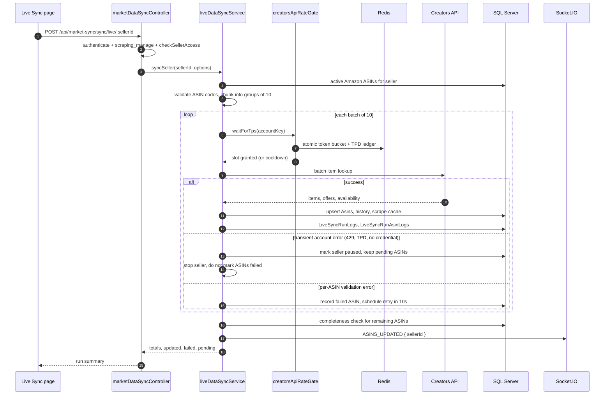

Operational properties:

- **Batch size 10.** The Creators API accepts at most ten item IDs per request. The service rejects malformed ASIN codes before calling, because one bad value fails the whole batch with a 400 validation error.
- **One seller at a time.** `concurrency: 1`, 2 second seller gap, 1.1 second request gap. Parallelism is deliberately avoided; the account-level budget is the constraint.
- **Transient vs real failures.** TPD exhaustion, throttling and "no healthy credential" pause the seller and keep the remaining ASINs pending. The completeness loop resumes them. Only genuine per-ASIN failures count as failures and get a retry.
- **Retries.** `maxRetries: 3`, 3 second retry delay, plus the rate gate cooldown after any upstream 429.
- **Credentials.** Multiple credential sets are supported (`LIVE_SYNC_CLIENT_ID/SECRET`, `CREATORS_API_CLIENT_ID_2`, `..._3`). Each has a partner tag and an Amazon account key. Credentials on separate accounts get separate TPS/TPD budgets unless `CREATORS_RATE_SHARE_ACCOUNT=true`.
- **Run history.** `LiveSyncRunLogs` and `LiveSyncRunAsinLogs` hold the durable record; Redis holds the live progress snapshot so any PM2 worker can answer a status poll.
- **Global runs.** `sync-all-live` iterates sellers, exposes progress and abort, and publishes snapshots to Redis. It is the heaviest operation in the system; run it outside business hours.

Live Sync endpoints (all under `/api/market-sync`):

| Method + path | Purpose |
| --- | --- |
| `POST /sync/live/:sellerId` | Sync one seller |
| `POST /sync-asins-live` | Sync a supplied ASIN list |
| `POST /sync-all-live` | Start global sync |
| `GET /sync-all-live/status` | Global progress |
| `POST /sync-all-live/abort` | Abort global sync |
| `GET /status`, `GET /sync/status/:sellerId` | Last run state |
| `GET /creators-rate/status` | Live TPS/TPD budget |
| `POST /fetch-results/:sellerId`, `/ingest-task`, `/ingest-all`, `/update` | Legacy Octoparse result ingestion |
| `POST /setup-task/:sellerId`, `/sync-pool`, `/pool-tasks`, `/start-task/:sellerId`, `/bulk-inject-*`, `/repair`, `/restart-all` | Legacy Octoparse pool management; still mounted |

### 8.2 Creators API rate gate

`services/creatorsApiRateGate.js` is the single choke point for every Creators API call: Live Sync, the Inspector, keyword lookups and AI LQS enrichment. It exists because per-worker limiters would multiply the real rate by the PM2 worker count.

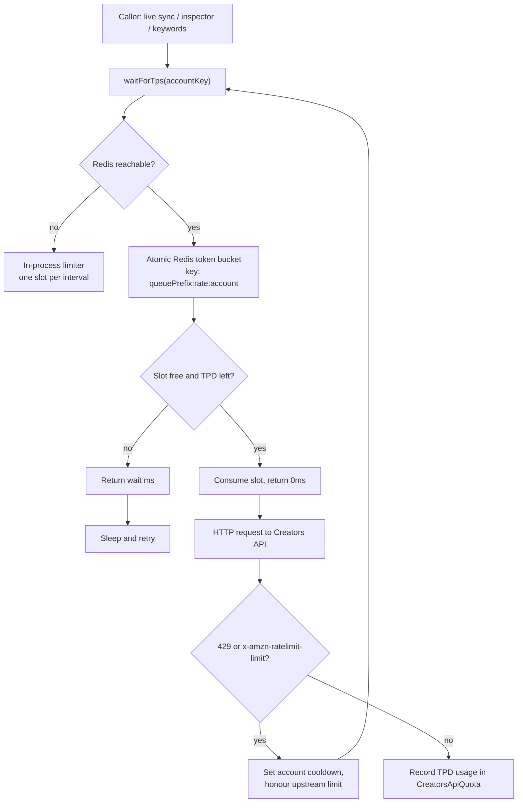

Configuration (all optional, safe defaults shown):

| Variable | Default | Meaning |
| --- | --- | --- |
| `CREATORS_RATE_TPS` | `1` | Requests per second per account |
| `CREATORS_RATE_INTERVAL_MS` | `1000` | Interval form of the same limit |
| `CREATORS_RATE_TPD` | `8640` | Daily request budget per account |
| `CREATORS_RATE_TPD_BUFFER` | `40` | Reserved headroom subtracted from TPD |
| `CREATORS_RATE_MAX_WAIT_MS` | see code | Maximum queue wait before failing fast |
| `CREATORS_RATE_ACCOUNT` | `primary` | Default account bucket key |
| `CREATORS_RATE_ACCOUNT_<N>` | credential id | Per-credential account override |
| `CREATORS_RATE_SHARE_ACCOUNT` | `false` | Force all credentials into one bucket |
| `CREATORS_RATE_REQUIRE_REDIS` | `false` | Fail instead of using the in-process fallback |

The same Redis instance also provides `acquireLock` (`SET NX EX`) for cron leadership and long-running jobs. If Redis is down, cron locks degrade to per-process and duplicate runs become possible; this is the first thing to check when "the sync ran four times" is reported.

### 8.3 Live Data Inspector

The Inspector is the ad-hoc inspection tool. It takes a seller or an uploaded ASIN list, fetches live data, optionally enriches it with scraper output, and can run AI listing-quality scoring.

| Endpoint group | Auth | Status |
| --- | --- | --- |
| `/api/live-data/v3/*` (metrics, fetch, upload, progress, results, download, cancel) | **none** | Active |
| `/api/live-data/v2/*` | `authenticate` | Active |
| `/api/live-data/*` (v1) | `authenticate` | Returns 410-style disabled response; gated by `LIVE_DATA_V1_ENABLED` |
| `/api/live-data/creds-stats` | `authenticate` | Credential health |

Job model: a job id is returned immediately, progress is polled from `/progress/:jobId`, results from `/results/:jobId`, and the export from `/download/:jobId`. Jobs can be cancelled. The v3 family is the only actively developed surface and currently has **no route-level authentication** - see [Known issues](#16-known-issues-and-technical-debt).

AI enrichment (`aiLqsService`) sends listing text to NVIDIA NIM for scoring and can send images for vision checks. Its limits are controlled by `LIVE_SYNC_AI_ENABLED` and `LIVE_SYNC_AI_MAX_ASINS`. It is best-effort: AI failure never fails the data fetch.

### 8.4 Scrapers

Three scraper paths coexist.

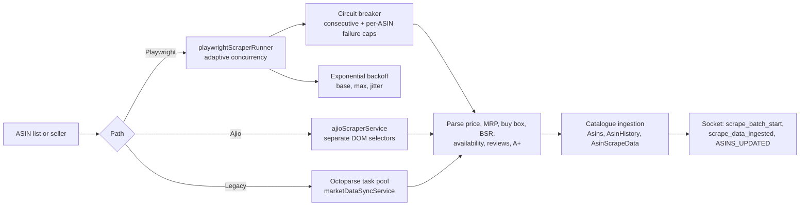

Playwright tuning (`backend/.env.example`):

| Variable | Purpose |
| --- | --- |
| `SCRAPER_BASE_CONCURRENT_PAGES` | Starting page concurrency |
| `SCRAPER_MIN_CONCURRENT_PAGES` / `SCRAPER_MAX_CONCURRENT_PAGES` | Adaptive bounds |
| `SCRAPER_MAX_CONSECUTIVE_FAILURES` | Open the circuit after N failures in a row |
| `SCRAPER_MAX_ASIN_FAILURES` | Per-ASIN failure threshold |
| `SCRAPER_ASIN_FAILURE_TIMEOUT` | Cooldown for a failing ASIN |
| `SCRAPER_BACKOFF_BASE`, `SCRAPER_BACKOFF_MAX`, `SCRAPER_BACKOFF_JITTER` | Retry backoff curve |

Scraper results and history live in `ScrapeJobHistory` / `ScrapeJobDetails`. Octoparse is legacy but still reachable; removing it requires checking every `/api/market-sync` pool endpoint and the seller configuration columns (`Sellers.OctoparseId`).

`scraper-package/` is a separate standalone Amazon.in page scraper that writes files and never touches the database. It is useful for one-off investigations and for reproducing a page outside the API, but it is not part of the production request path.

### 8.5 Scheduler

Only the PM2 worker with `NODE_APP_INSTANCE` unset or `0` starts cron. Every callback additionally takes a Redis lock so a reschedule or a stray worker cannot double-run.

| Job | Default time | Source of truth | What it does |
| --- | --- | --- | --- |
| Amazon enterprise pipeline | `00:00` daily | `SystemSettings.AUTOMATION_SCHEDULE_TIME`, `AUTOMATION_AMAZON_ENABLED` | Scrape/sync all Amazon sellers |
| Ajio pipeline | `00:00` daily | `AUTOMATION_AJIO_SCHEDULE_TIME`, `AUTOMATION_AJIO_ENABLED` | Scrape Ajio |
| Live Data Sync | `06:00` daily | `LIVE_SYNC_SCHEDULE_TIME`, `LIVE_SYNC_ENABLED`, `LIVE_SYNC_CONCURRENCY` | Creators API refresh for all sellers |
| Scraper sync | `00:05` or Live Sync time | `SCRAPER_CRON_TIME`, `SCRAPER_CRON_ENABLED` | Playwright enrichment |
| Recurring task sweep | hourly at minute 0 | code | Generate due PEMS instances |
| Keepa seller discovery | every 12 hours | code | Find new seller ASINs |
| OTP cleanup | 03:00 daily | code (`jobs/otpCleanup.js`) | Delete expired OTPs and audit rows |

Times are interpreted in `AUTOMATION_TIMEZONE` (default `Asia/Kolkata`). Changing a schedule through Settings updates `SystemSettings`; `scheduleJobs()` must re-run for it to take effect, which happens on the next worker restart. There is no UI-triggered reschedule, despite the scheduler exposing the method.

### 8.6 Bull queues

Queues are created by `jobs/queueDefinitions.js`, processed by `jobs/processors.js`, and stored in Redis under `QUEUE_PREFIX` (default `retailops:queue`). Every worker registers processors; concurrency is enforced by Bull's limiter and by the queue's own lock.

| Queue | Job purpose | Attempts | Backoff | Timeout | Limiter |
| --- | --- | --- | --- | --- | --- |
| `market-sync` | Legacy market sync run | 3 | 5s | 10 min | 10/s |
| `keepa-sync` | Keepa seller/ASIN discovery | 2 | 10s | 5 min | 5/s |
| `pipeline-run` | Full enterprise pipeline | 1 | none | 2 h | 1/s |
| `auto-tag` | Apply tag rules to ASINs | 2 | default | 10 min | none |
| `sla-escalation` | Task SLA breach escalation | 3 | 1s | 2 min | none |
| `pems-notification` | Task notification fan-out | 3 | 1s | 30s | 50/s |
| `webhook-delivery` | Outbound webhook POST | 5 | fixed 10s | 30s | 20/s |

`services/queueService.js` wraps Bull with `create`, `add`, and lifecycle helpers. Failed jobs remain in Redis; inspect them before restarting Redis, or you lose the failure history.

### 8.7 Socket.IO events

Server setup: Socket.IO attached to the same HTTP server, Redis adapter for cross-worker rooms, JWT handshake from `localStorage.authToken`, rooms `user_<id>`, `task:<instanceId>`, and one room per conversation.

| Event | Direction | Payload / purpose |
| --- | --- | --- |
| `new_system_log` | server to all | Activity feed entry |
| `ASINS_UPDATED` | server to all | `{ sellerId }` or `{ type: 'bulk' }`; refresh ASIN grids |
| `SELLERS_UPDATED` | server to all | Seller list changed |
| `task_status_changed` | server to `task:<id>` | Task workspace refresh |
| `export_progress` | server to `user_<id>` | `{ downloadId, progress, status }` |
| `export_completed` / `export_failed` | server to `user_<id>` | Terminal export state |
| `scrape_batch_start`, `scrape_batch_complete`, `scrape_data_ingested` | server to all | Scraper dashboard |
| `user_status_change` | server to all | Presence |
| `role_permissions_updated` | server to all | Force permission refresh |
| `receive_message`, `typing`, `message_reaction_updated` | bidirectional | Chat |
| `incoming_call`, `call_initiated`, `call_accepted`, `call_rejected`, `call_ended` | bidirectional | Legacy call signalling |
| `call:invite`, `call:incoming`, `call:answer`, `call:answered`, `call:ice`, `call:reject`, `call:busy`, `call:end`, `call:ended` | bidirectional | WebRTC signalling |

The client also subscribes to `dataUpdate`, `asinUpdated`, `targetReached`, `alerts` and `sellerSynced` for dashboard invalidation. Those names are client-side expectations and are not all emitted by the current server; verify before relying on them.

### 8.8 Exports

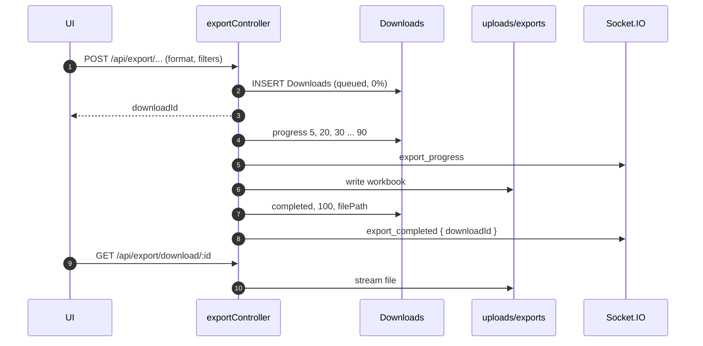

- Files are written to `backend/uploads/exports` and referenced as `/exports/<downloadId>_<name>`; express serves `/uploads` statically.
- Progress is pushed to `user_<id>` and mirrored to `export_progress`.
- **No retention job was found.** `Downloads` rows and files accumulate; a disk-full incident is a matter of time. Add a cleanup job as an early improvement.
- Ads exports have a separate controller (`exportAdsController.js`) with the same `Downloads` model and an `ADS_EXPORTS_DIR` override.

### 8.9 Advertising analytics

`/api/ads` covers spend, sales, ACOS/ROAS, ASIN-level efficiency, targets and an AI analyst. Data comes from `AdsPerformance` (daily rows per seller/ASIN) loaded by imports and seller reports. The AI layer (`adsAiService`, `adsInsights`) summarises performance and proposes actions; it is advisory only and writes nothing without an explicit user action.

Be careful with ads date filtering: the API uses `useUTC: false` and IST-first dates, while imported report files are usually in marketplace time. Off-by-one-day reports around midnight are the most common ads bug class.

### 8.10 Rules engine

`rulesetEngineService` evaluates rulesets against ASIN and performance data, and `decisionEngine` turns matches into actions or tasks. Tags are applied by `autoTagService` through the `auto-tag` queue, with history in `TagsHistory`. Every run is recorded in `RulesetExecutionLogs` and summarised by migration 026.

Rulesets can be bound to PEMS templates (migration 027 adds the source link), which means a single rule match can open a task with a pre-populated affected-ASIN list. When a ruleset "did nothing", check: is it active, does its schedule match the worker timezone, did the run log record zero matches, and is the target template published?

### 8.11 Alerts and webhooks

- Alerts are raised by rules and by system events into `Alerts` / `AlertRules`; the UI reads them through the `/api` alert router and the `alerts` Socket event family.
- Webhooks are stored in `Webhooks`, delivered through the `webhook-delivery` queue (5 attempts, fixed 10 second backoff), and logged in `WebhookLogs` with request/response bodies (secrets masked).
- Delivery is at-least-once. Consumers must be idempotent; there is no deduplication key in the payload beyond the event id.

---

## 9. Tasks, PEMS and OOS

### 9.1 Task lifecycle

PEMS is the operational task system. A **template** describes recurring work; an **instance** is one occurrence for one seller; **subtasks and activities** are the phases materialised from the template's JSON; **evidence** and **reviews** gate completion.

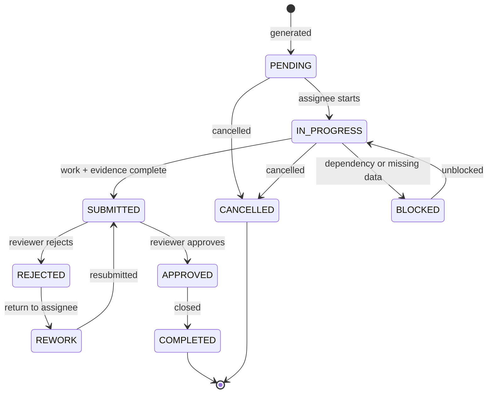

Status strings observed in the task services: `PENDING`, `IN_PROGRESS`, `BLOCKED`, `SUBMITTED`, `APPROVED`, `REJECTED`, `REWORK`, `COMPLETED`, `CANCELLED`. `BLOCKED` is used by the OOS workspace and by rules that cannot evaluate; the legacy task family does not use it consistently.

`ReviewStatus` is separate from `Status`: a task can be `APPROVED` while its review record is `REJECTED`, or `SUBMITTED` with no review yet. Always read both.

### 9.2 Template anatomy

| Field group | Fields | Notes |
| --- | --- | --- |
| Identity | `TaskCode` (unique), `Name`, `Description`, `Category`, `Department`, `Tags` | `TaskCode` is the stable key used by rulesets and imports |
| Scheduling | `Frequency`, `CustomCron`, `RunDays`, `DueTime`, `LastGeneratedAt`, `NextScheduledDate` | `RunDays` is a comma list of weekday numbers for weekly templates |
| SLA | `SLAHours`, `TATHours`, `EscalationHours`, `Priority`, `CriticalityScore` | Drives the SLA queue and escalation job |
| Assignment | `AssigneeRole`, `AssigneeUserIds`, `AutoAssign`, `AutoAssignEnabled`, `ReviewerId`, `TemplateOwnerId` | Auto-assign rules can override |
| Definition | `Activities` JSON, `SubTaskDefinitions` JSON, `ExpectedOutput`, `TargetType`, `DefaultTarget` | Activities are the checklist steps rendered in the workspace |
| Behaviour | `ReviewRequired`, `AutomationEligible`, `ExecutionComplexity`, `EstimatedExecutionMinutes`, `BrandMode`, `TemplateVersion` | `BrandMode=CHECKLIST` materialises `PemsTaskBrands` |
| Lifecycle | `IsActive`, `CreatedBy`, `CreatedAt`, `UpdatedAt` | Deactivating stops future generation, not live instances |

`SubTaskDefinitions` shape (simplified):

```json
[
  {
    "key": "intake",
    "label": "Intake and validation",
    "order": 1,
    "activities": [
      { "key": "download_report", "label": "Download Brand Central report", "type": "upload", "required": true },
      { "key": "confirm_scope", "label": "Confirm seller and channel", "type": "checkbox", "required": true }
    ]
  }
]
```

Published templates are versioned. Editing a template increments `TemplateVersion` and affects newly generated instances only.

### 9.3 Generation and recurrence

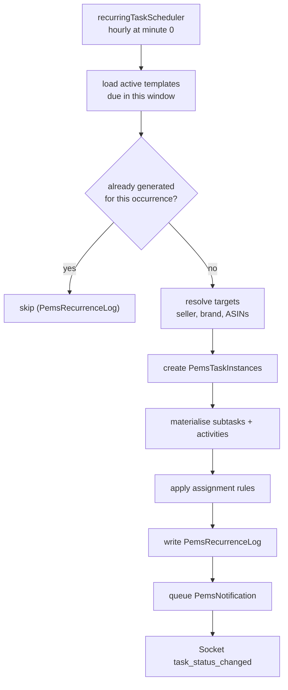

Generation triggers:

1. **Recurring scheduler** - hourly sweep; idempotency enforced by `PemsRecurrenceLog` with the occurrence key.
2. **Manual** - `POST /api/pems/generate` (permission `tasks_manage`).
3. **Ruleset** - a rule match creates an instance with `SourceType` and affected ASINs.
4. **OOS binding** - the OOS run binds or creates a task instance through `OosTaskBindings`.

Assignment resolution order: explicit `AssigneeUserIds`, then assignment rules (`PemsAssignmentRules`) by role/seller/load, then `AssigneeRole` default, then unassigned. Escalation follows `PemsEscalationRules` and the `sla-escalation` queue.

### 9.4 View registry

A template declares a **view definition** that tells the frontend which workspace to render.

| Concept | Table | Notes |
| --- | --- | --- |
| Definition | `PemsTemplateViewDefinitions` | `ViewKey`, `DefinitionVersion`, `DefinitionJson`, `Status` |
| Binding | Template -> definition | One active published definition at a time |
| Snapshot | `PemsTaskInstances.ViewDefinitionSnapshot` | Frozen JSON at generation; in-flight tasks never change view |

Known view keys: `STANDARD_V1` (generic subtask checklist) and `OOS_RECON_V1` (OOS reconciliation workspace). The task module resolves the key to a view component (generic or OOS) and falls back to standard when the key is unknown, so a typo degrades silently instead of erroring.

### 9.5 My Day, reviews and SLA

- **My Day** (`/tasks/my-day`) is the default landing page for task users. `utils/dayPlanner.js` orders work by due time, priority, SLA risk and estimated duration; the workday and deferrals are stored client-side (`myday.workday`, `myday.deferred.<date>`). Planner logic has node:test coverage (`npm run test:planner`).
- **Task Workspace** is the execution surface: subtasks, activities, evidence upload, comments, timer, submit. Evidence requirements are enforced server-side after migration 034 (`EvidenceRequired`), not only in the UI.
- **Review Queue** (`/tasks/reviews`) lists submitted tasks; reviewers approve, reject or request rework, with quality scores in `PemsTaskReviews`. `tasks_approve` controls actions.
- **SLA** is computed from `SLAHours`/`TATHours` and updated by a scheduled job; breaches escalate through `PemsEscalationRules` and notification queues. `PemsScorecards` aggregates completion and quality per user/seller/period for analytics.
- **Notifications** go to `PemsNotifications` and are fanned out by the `pems-notification` queue. Email uses templates in `backend/emails`.

### 9.6 OOS reconciliation

OOS is the most complex workflow and the most likely source of handover questions. It reconciles three views of stock: RetailOps' own scraped signal, the Brand Central report, and (for Amazon India only) the Vendor Central report.

> **Release status (27 October 2026):** `OOS-RECON-001` is **contained in
> production** but not ready for further rollout. A read-only check found 7
> OOS instances, 188 reconciled runs and 44,223 decisions; all 188
> `OosTaskBindings` point at nonexistent `OosRuns.Id` values. The specialized
> view is not wired into the active task drawer, and upload, resync, export and
> review contracts have release-blocking defects. Under exception `EX-001`, the
> OOS template was deactivated at `2026-10-27T01:02:06.840Z` to stop the daily
> recurrence before `2026-10-27T08:51:23Z`; existing data and `DLY-004` were not
> changed. A post-deadline instance-count check is still outstanding. Do not
> create or assign more OOS work, run OOS setup scripts, reactivate or overwrite
> OOS, or deactivate/overwrite DLY-004. See the
> [OOS-RECON-001 remediation plan](docs/engineering/OOS_RECON_001_REMEDIATION_PLAN.md),
> [production read-only snapshot](docs/engineering/OOS_RECON_001_PRODUCTION_READONLY_SNAPSHOT.md)
> and [execution backlog](docs/engineering/OOS_RECON_001_TASK_BACKLOG.md)
> for the verified findings, gates and repair sequence.

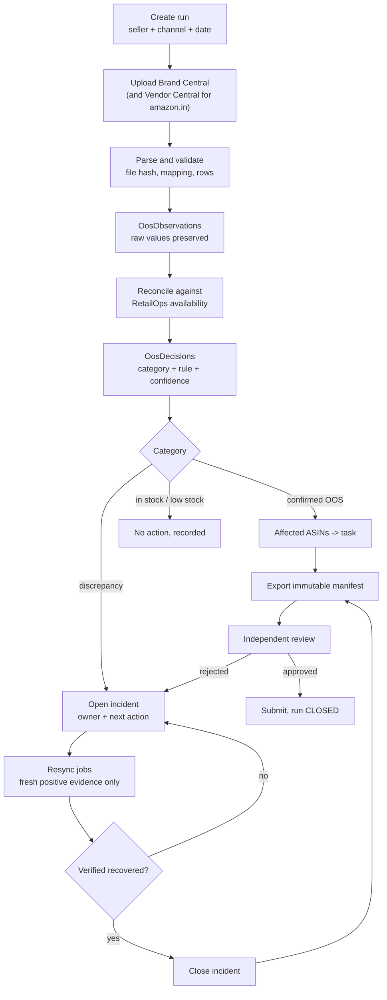

Phase detail:

1. **Create run.** One run per `(RunDate, SellerId)`; channel is `amazon.in` or `ajio`. The policy version is pinned on the run.
2. **Upload.** Files are hashed and stored; the original bytes are retained. Required columns are mapped per source. Duplicate uploads for the same `(RunId, Channel, SourceType)` are rejected by a unique index.
3. **Parse.** Every row becomes an `OosObservation` with nullable quantity, availability, status and source timestamp. Empty stays empty; unknown is never converted to zero.
4. **Reconcile.** The candidate set is the union of RetailOps-unavailable, Brand Central zero and applicable Vendor Central zero observations. Each ASIN gets one `OosDecisions` row with category, rule id, confidence and evidence JSON.
5. **Incidents.** Discrepancies open an incident per `(SellerId, Channel, AsinCode, EpisodeKey)`; a filtered unique index allows only one `OPEN` incident per episode. Incidents carry owner, next action and communication status.
6. **Resync.** A disputed case can request a verification job (`OosResyncJobs`). An accepted resync request is **not** a recovery; only a newer, fresh, positive, same-channel observation closes the incident.
7. **Export.** `OosExports` stores an immutable version with a manifest and file hash. The export is the audit artefact; do not edit it.
8. **Review and submit.** An independent reviewer (not the submitter) records `APPROVED` or `REJECTED` in `OosSubmissionReviews`. Submission may proceed with open incidents only if each is fully owned and has a next action. On success the run moves to `SUBMITTED` and later `CLOSED`.

OOS status vocabulary (from migration 032 and the services):

| Entity | Values |
| --- | --- |
| `OosRuns.Status` | `OPEN`, `SUBMITTED`, `CLOSED` (code also sets `MONITORING`, `RECONCILED` - vocabulary drift) |
| `OosImports.Status` | `RECEIVED`, `VALIDATED`, `REJECTED` |
| `OosIncidents.Status` | `OPEN`, `RESOLVED`, `WAIVED` |
| `OosIncidents.CommunicationStatus` | `NOT_REQUIRED`, `PENDING`, `APPROVED`, `SENT` |
| `OosResyncJobs.Status` | `QUEUED`, `RUNNING`, `VERIFIED_RECOVERED`, `OPEN_DISCREPANCY`, `BLOCKED` |
| `OosSubmissionReviews.Status` | `APPROVED`, `REJECTED` |
| Decision categories | `CONFIRMED_CHANNEL_OOS`, `DISCREPANCY`, `IN_STOCK`, `LOW_STOCK`, `OOS_ZERO`, `NO_CURRENT_OOS_SIGNAL`, `INSUFFICIENT_EVIDENCE`, `GMS_UNVERIFIED` |

Endpoints under `/api/oos`:

| Method + path | Purpose | Gate |
| --- | --- | --- |
| `GET /policy` | Active policy | view |
| `POST /runs`, `GET /runs`, `GET /runs/:id` | Create/list/read runs | manage / view |
| `POST /runs/:id/imports`, `GET /runs/:id/imports` | Upload and list source files | manage / view |
| `POST /runs/:id/reconcile` | Run reconciliation | manage |
| `GET /runs/:id/decisions`, `GET /runs/:id/incidents` | Results | view |
| `POST /incidents/:id/resolve` | Resolve or waive | manage |
| `GET /sellers/:sellerId/pareto` | GMS Pareto view | view |
| `POST /runs/:id/resync`, `GET /runs/:id/resync`, `POST /resync/:id/verify` | Verification loop | manage plus `canResync` |
| `POST /runs/:id/export`, `GET /runs/:id/export`, `GET /runs/:id/export/download` | Immutable export | manage / view |
| `POST /runs/:id/submit` | Submit for review | manage |

### 9.7 OOS policy rules

Policy is code plus a versioned database row (`OosWorkflowPolicies`). Defaults:

| Rule | Value | Meaning |
| --- | --- | --- |
| RetailOps freshness | 24 hours | Older scrape is not evidence |
| Upload freshness | 48 hours | Older report is not evidence |
| GMS window | 30 days | Pareto eligibility window |
| GMS Pareto threshold | 80% | Top ASINs covering 80% of GMS |
| OOS vocabulary | currently unavailable, out of stock, temporarily out of stock, available_date | Normalised, case-insensitive, trailing punctuation stripped |
| In-stock vocabulary | in stock, add to bag | |
| Low stock pattern | `^only\s+\d+\s+left in stock` | LOW_STOCK, not OOS |
| Vendor applicability | `amazon.in` only | Ajio has no Vendor Central |
| Unknown quantity | `null`, never 0 | Prevents false "zero stock" decisions |
| Blank availability | unknown, never "available" | |
| Both reports positive + RetailOps unavailable | `DISCREPANCY` | Not auto-resolved in either direction |
| Resync recovery | fresh, positive, same-channel observation | An accepted request alone never resolves |

GMS Pareto uses the whole eligible seller catalogue. If GMS data is missing, affected rows are marked `GMS_UNVERIFIED` rather than silently excluded from the review, so a data gap cannot hide an ASIN.

Policy changes must be made by inserting a new `OosWorkflowPolicies` version and activating it. Runs pin their policy version, so historical decisions remain reproducible.

---

## 10. API reference

### 10.1 Conventions

| Item | Convention |
| --- | --- |
| Base path | `/api` (no version prefix) |
| Format | JSON request and response, UTF-8 |
| Auth | httpOnly cookie (browser) or `Authorization: Bearer <accessToken>` (mobile, scripts) |
| CSRF | No token. Protection relies on `sameSite: Strict` cookies and a strict CORS allow-list |
| Request tracing | Send `x-request-id` or let the server generate one; it is echoed in the header and in error bodies |
| Body limit | 10 MB JSON and urlencoded in Express; 20 MB at Nginx; multer limits per upload route |
| Uploads | `multipart/form-data` with field `file` (single) or `files` (up to 20 where enabled) |
| Static files | `GET /uploads/*` (runtime files), `GET /tools/*` (public tools) |
| Time zones | Dates interpreted as IST; SQL Server runs `useUTC: false` |
| Idempotency | No general idempotency keys. OOS, recurrence and imports enforce uniqueness in the schema |
| Versioning | None. Breaking changes must be coordinated with the mobile client |
| OpenAPI | Not provided. `docs/api-endpoints.md` is a generated narrative reference |

### 10.2 Pagination, filtering and dates

Three patterns exist; check the controller before assuming:

1. `?page=1&limit=50` with a `total` in the response (most list endpoints).
2. `?limit=100&offset=0` (PEMS and some newer endpoints).
3. Cursor-free full export (`?format=xlsx`) handled by the export controllers.

Date filters are usually `startDate` / `endDate` (`YYYY-MM-DD`), occasionally `from` / `to`. Month-wise reports accept `?month=YYYY-MM`. Ranges are inclusive of both days. When a report looks shifted by a day, confirm whether the caller sent UTC dates.

### 10.3 Health endpoints

`GET /api/health` (also used by Docker and CI):

```json
{
  "status": "ok",
  "timestamp": "2026-10-26T10:00:00.000Z",
  "uptime": 86400,
  "memory": { "heapUsed": "120MB", "heapTotal": "180MB", "rss": "260MB" },
  "env": "production",
  "nodeVersion": "v20.x",
  "checks": {
    "database": { "status": "connected", "poolSize": 42, "poolAvailable": 158 },
    "redis": { "status": "connected" }
  }
}
```

Returns `503` with `status: "degraded"` if either dependency is down. `/api/health/liveness` returns `{ status: "alive", uptime }` without touching dependencies. `/api/health/readiness` pings SQL Server and returns `503` `{ status: "not-ready" }` on failure. None of the three require auth, and they are exempt from the global rate limiter.

### 10.4 Endpoint map

The authoritative inventory is `docs/api-endpoints.md` and the route files themselves. The table below lists the surfaces a new owner will touch first.

| Area | Base | Key operations |
| --- | --- | --- |
| Auth | `/api/auth` | login, request/verify/resend OTP, refresh, logout, me, profile, forgot/validate/reset password |
| Users and roles | `/api/users`, `/api/roles`, `/api/teams`, `/api/keys`, `/api/security` | CRUD, permission overrides, trusted devices, OTP audit |
| Catalogue | `/api/asins`, `/api/asins-table`, `/api/bulk` | detail, history, tags, paginated grid, bulk tag/status |
| Sellers | `/api/sellers`, `/api/seller-tracker` | CRUD, configuration, scoped tracking, Keepa discovery |
| Dashboard | `/api` (`dataRoutes`) | KPI aggregates, top ASINs, marketplace splits |
| Ads | `/api/ads` | performance, efficiency, ASIN grid, targets, AI analyst |
| Reports | `/api/revenue-engine`, `/api/revenue`, `/api/targets`, `/api/goals` | P&L, calculator, targets, goals |
| Live Sync | `/api/market-sync` | see [8.1](#81-live-sync-sequence) |
| Inspector | `/api/live-data` | see [8.3](#83-live-data-inspector) |
| Scraper | `/api/scraper`, `/api/scheduled-runs` | jobs, health, stats, run history |
| Exports | `/api/export` | create, progress, download, list |
| Imports | `/api` (`uploadRoutes`) | ASIN, GMS, ads, user and seller imports |
| Alerts and rules | `/api` (`alertsRoutes`, `rulesetRoutes`), `/api/webhooks` | rules, alerts, webhook delivery |
| Tasks | `/api/tasks`, `/api/pems` | templates, instances, subtasks, evidence, reviews, analytics |
| OOS | `/api/oos` | see [9.6](#96-oos-reconciliation) |
| AI | `/api/ai`, `/api/ai/chat`, `/api/strategy` | chat, goals, listing analysis |
| Admin | `/api/settings`, `/api/logs`, `/api/files` | runtime settings, activity, file manager |

### 10.5 Error codes

Codes are stable strings; HTTP status is the primary contract.

| Code | Status | When |
| --- | --- | --- |
| `VALIDATION_ERROR` | 400 | Joi or manual validation failed |
| `INVALID_TRANSITION` | 400 | Task or OOS state change not allowed |
| `AUTH_ERROR` | 401 | Missing, invalid, expired or blacklisted token |
| `FORBIDDEN` | 403 | Missing permission or out-of-scope seller |
| `ACCOUNT_DISABLED` | 403 | Inactive user |
| `NOT_FOUND` | 404 | Missing entity |
| `CONFLICT` | 409 | Duplicate key or concurrent edit |
| `PAYLOAD_TOO_LARGE` | 413 | Upload over limit |
| `CREDENTIAL_UPDATE_REQUIRED` | 428 | First login, forced reset or expired password |
| `RATE_LIMITED` | 429 | Tier or login limiter exceeded |
| `DEPENDENCY_ERROR` | 502 | Upstream Creators/SMTP/AI failure |
| `MAINTENANCE_MODE` | 503 | Maintenance flag on |
| `INTERNAL_ERROR` | 500 | Unhandled |

Note that unmatched routes return Express' HTML 404, not a JSON envelope. Clients must tolerate that.

---

## 11. Configuration reference

### 11.1 How configuration is loaded

1. `dotenv` reads `backend/.env` when the backend starts. Variables already in the environment win.
2. `config/env.js` centralises some values, but `database/db.js` reads `process.env` directly and is authoritative for the pool.
3. `SystemSettings` (SQL table) overrides a subset of automation settings at runtime: schedule times, enable flags, Live Sync concurrency.
4. Frontend values are **build-time**: Vite inlines `VITE_*` into the bundle. Changing them requires a rebuild, not a restart.
5. `.env` files are gitignored. Examples are committed: `backend/.env.example`, `backend/.env.production.example`, `backend/.env.staging.example`, and the root `.env.example`.

The root `.env.example` is backend-oriented and mostly duplicates `backend/.env.example`, but it is **not** what the backend loads. Keep both in sync or delete the root one.

### 11.2 Backend runtime

| Variable | Default | Purpose |
| --- | --- | --- |
| `NODE_ENV` | `development` | Enables production-only behaviour (secure cookies, HTTPS redirect) |
| `PORT` | `3001` | API port |
| `NODE_APP_INSTANCE` | unset | Set by PM2; `0` is the scheduler leader |
| `MAINTENANCE_MODE` | `false` | 503 all API traffic |
| `RUN_MIGRATIONS_ON_STARTUP` | `true` | Auto-run migrations at boot; non-fatal |
| `QUEUE_PREFIX` | `retailops:queue` | Redis key namespace for queues, locks, rate gate |
| `AUTOMATION_TIMEZONE` | `Asia/Kolkata` | Cron timezone and SQL `GetEnvDate` offset |
| `AUTOMATION_ENABLED` | `true` | Master switch for automation |
| `FRONTEND_URL`, `DASHBOARD_URL`, `APP_URL` | see env | Email link origins |
| `ADS_EXPORTS_DIR` | `backend/uploads/exports` | Ads export directory override |

### 11.3 Database

| Variable | Default | Purpose |
| --- | --- | --- |
| `DB_SERVER` | none | SQL Server host. **The backend reads `DB_SERVER`, not `DB_HOST`** |
| `DB_PORT` | `1433` | Port |
| `DB_NAME` | `RetailOps` | Database |
| `DB_USER`, `DB_PASSWORD` | none | SQL credentials |
| `DB_POOL_MAX`, `DB_POOL_MIN` | `200`, `10` | Primary pool bounds (PM2 config overrides to 80/5) |
| `DB_ENCRYPT` | per-host | TLS on/off; defaults off for IP hosts |
| `DB_TRUST_SERVER_CERT` | `false` | Accept self-signed certificates |
| `DB_READER_SERVER` | unset | Optional read replica; falls back to primary |
| `DB_READER_USER`, `DB_READER_PASSWORD`, `DB_READER_DATABASE`, `DB_READER_PORT` | fallbacks | Reader credentials |

### 11.4 Auth and security

| Variable | Purpose |
| --- | --- |
| `JWT_SECRET` | Access token signing key. Changing it invalidates every session |
| `JWT_REFRESH_SECRET` | Refresh token signing key |

### 11.5 Redis, queues and rate gate

| Variable | Default | Purpose |
| --- | --- | --- |
| `REDIS_URL` | `redis://localhost:6379` | Cache, queues, locks, rate gate, socket adapter |
| `REDIS_PASSWORD` | unset | If your provider needs it in a separate variable |
| `CREATORS_RATE_TPS` | `1` | Requests per second per Amazon account |
| `CREATORS_RATE_TPD` | `8640` | Daily budget per account |
| `CREATORS_RATE_TPD_BUFFER` | `40` | Headroom |
| `CREATORS_RATE_MAX_WAIT_MS` | code default | Max queue wait |
| `CREATORS_RATE_ACCOUNT` | `primary` | Default account bucket |
| `CREATORS_RATE_SHARE_ACCOUNT` | `false` | Merge all credentials into one bucket |
| `CREATORS_RATE_REQUIRE_REDIS` | `false` | Refuse the in-process fallback |

### 11.6 Creators API credentials

| Variable group | Purpose |
| --- | --- |
| `LIVE_SYNC_CLIENT_ID`, `LIVE_SYNC_CLIENT_SECRET`, `LIVE_SYNC_PARTNER_TAG`, `LIVE_SYNC_MARKETPLACE` | Primary credential |
| `CREATORS_API_CLIENT_ID_2`, `CREATORS_API_CLIENT_SECRET_2` | Second credential |
| `CREATORS_API_CLIENT_ID_3`, `CREATORS_API_CLIENT_SECRET_3`, `CREATORS_API_PARTNER_TAG_3` | Third credential, possibly a separate Amazon account |
| `CREATORS_RATE_ACCOUNT_<N>` | Per-credential account key override |

Credential health is visible at `GET /api/live-data/creds-stats` and `GET /api/market-sync/creators-rate/status`.

### 11.7 Live Sync and Inspector

| Variable | Default | Purpose |
| --- | --- | --- |
| `LIVE_SYNC_ENABLED` | `true` | Nightly Live Sync |
| `LIVE_SYNC_SCHEDULE_TIME` | `06:00` | Nightly time |
| `LIVE_SYNC_CONCURRENCY` | `1` | Sellers processed in parallel |
| `LIVE_SYNC_RATE_LIMIT_RPS` | `1` | Legacy per-process limiter |
| `LIVE_SYNC_BATCH_SIZE` | `10` | ASINs per request |
| `LIVE_SYNC_BATCH_DELAY_MS` | `1100` | Delay between requests |
| `LIVE_SYNC_MAX_CONCURRENT_JOBS` | see env | Inspector concurrency |
| `LIVE_SYNC_MAX_FETCH_ASINS`, `LIVE_SYNC_MAX_UPLOAD_ASINS` | see env | Inspector input caps |
| `LIVE_SYNC_AI_ENABLED`, `LIVE_SYNC_AI_MAX_ASINS` | see env | AI LQS enrichment |
| `LIVE_DATA_V1_ENABLED` | `false` | Re-enable the disabled v1 Inspector |
| `LIVE_SYNC_SCRAPER_ENRICHMENT`, `LIVE_SYNC_SCRAPER_TIMEOUT` | `false`, `25000` | Optional scraper enrichment |

### 11.8 Scraper

`SCRAPER_BASE_CONCURRENT_PAGES`, `SCRAPER_MIN_CONCURRENT_PAGES`, `SCRAPER_MAX_CONCURRENT_PAGES`, `SCRAPER_MAX_CONSECUTIVE_FAILURES`, `SCRAPER_MAX_ASIN_FAILURES`, `SCRAPER_ASIN_FAILURE_TIMEOUT`, `SCRAPER_BACKOFF_BASE`, `SCRAPER_BACKOFF_MAX`, `SCRAPER_BACKOFF_JITTER`, `SCRAPER_CRON_ENABLED`, `SCRAPER_CRON_TIME`.

### 11.9 Email, AI and third parties

| Variable | Purpose |
| --- | --- |
| `SMTP_HOST`, `SMTP_PORT`, `SMTP_SECURE`, `SMTP_USER`, `SMTP_PASS` (or legacy `SMTP_PASSWORD`), `SMTP_FROM` | Transactional email |
| `OPENAI_API_KEY` | AI chat and goals |
| `NIM_API_KEY` | NVIDIA NIM for LQS text and vision |
| `PERPLEXITY_API_KEY` | Keyword and market research |
| `OCTOPARSE_API_KEY`, `MARKET_SYNC_USERNAME`, `MARKET_SYNC_PASSWORD`, `MARKET_SYNC_API_KEY` | Legacy Octoparse |
| `KEEPA_API_KEY` | Seller ASIN discovery |

### 11.10 Frontend (build time)

| Variable | Purpose |
| --- | --- |
| `VITE_API_URL` | API origin; empty or `/api` means same-origin |
| `VITE_SOCKET_URL` | Socket origin; defaults to the API origin without `/api` |
| `VITE_MAINTENANCE_MODE` | `true` renders the maintenance screen with no API calls |
| `ALLOWED_HOSTS` | Vite allowed host list for hosted previews |

### 11.11 Known configuration traps

1. `docker-compose.yml` passes `DB_HOST`, but `database/db.js` expects `DB_SERVER`. Verify the fallback before using the compose stack.
2. `backend/.env.example` omits variables the code reads, including `DB_READER_*`, `AUTOMATION_*`, `DASHBOARD_URL`, `QUEUE_PREFIX`, `SCRAPER_CRON_*`, `RUN_MIGRATIONS_ON_STARTUP` and `KEEPA_API_KEY`.
3. The root `.env.example` is not loaded by either process; CORS origins are hardcoded in `server.js`, not environment-driven.
4. `config/env.js` and `database/db.js` define different pool defaults; only `db.js` matters.
5. `VITE_*` changes require a rebuild; restarting Nginx or the API does nothing.
6. `JWT_SECRET` rotation logs every user out and invalidates refresh tokens that were signed with the old key.

---

## 12. Local development

### 12.1 Prerequisites

- Node.js 20 LTS (CI uses 20; newer majors mostly work but the DB TLS default has a Node 24+ workaround for a reason).
- npm 10+.
- SQL Server 2019/2022, local or Docker, with the `RetailOps` database.
- Redis 7 (optional for pure UI work, required for sync, queues, rate gate and cron leadership).
- Git, and Playwright browsers only if you run the browser tests.

### 12.2 First run

```bash
# 1. Install
npm ci
cd backend && npm ci && cd ..

# 2. Database
#    Create an empty database named RetailOps, then:
sqlcmd -S localhost -U sa -P "<password>" -d RetailOps -i init-database.sql
#    init-database.sql creates tables, seeds, indexes and the GetEnvDate UDF.

# 3. Redis (Docker example)
docker run -d --name retailops-redis -p 6379:6379 redis:7-alpine

# 4. Environment
cp backend/.env.example backend/.env
#    Set DB_SERVER, DB_USER, DB_PASSWORD, DB_NAME, JWT_SECRET, JWT_REFRESH_SECRET, REDIS_URL.
#    Add LIVE_SYNC_* only if you need real Amazon data.

cp .env.example .env
#    Set VITE_API_URL if the API is not on the same origin (dev proxy makes this optional).

# 5. Migrations
cd backend && npm run migrate && cd ..

# 6. Seed RBAC and (optionally) the OOS template
cd backend
node scripts/seed-roles-permissions.js
node scripts/seed-oos-recon-template.js
cd ..

# 7. Run
cd backend && npm run dev        # API on :3001
npm run dev                      # in a second terminal, Vite on :5173
```

Open `http://localhost:5173`. Registration is disabled; create the first user with `backend/scripts/importUsers.js` or directly in `Users`, assign the `admin` role, then log in. There is no self-service bootstrap endpoint.

### 12.3 Day-to-day commands

| Task | Command |
| --- | --- |
| API with reload | `cd backend && npm run dev` |
| API without reload | `cd backend && npm start` |
| Frontend | `npm run dev` |
| Production build | `npm run build` |
| Preview build | `npm run preview` |
| Lint | `npm run lint` |
| Typecheck | `npm run typecheck` |
| Backend tests | `cd backend && npm test` |
| Planner tests | `npm run test:planner` |
| Playwright | `npm run test:auth` |
| Migrations | `cd backend && npm run migrate` |
| Force a full sync | `cd backend && npm run force-sync` |

### 12.4 Local pitfalls

- Vite proxies `/api` and `/socket.io` to `:3001`; if the API is on another port, set `VITE_API_URL` and `VITE_SOCKET_URL`.
- Cookies are `secure` in production. Over plain HTTP, set `NODE_ENV=development` or the browser silently drops them.
- The frontend and backend must agree on the host. Logging in on `127.0.0.1` and calling the API on `localhost` is a different cookie origin.
- `init-database.sql` is the baseline, not the full schema. Always run migrations afterwards.
- Some runtime tables (`PemsTaskEvents`) are created lazily by services, not by migrations. A fresh database can look "missing tables" until the relevant feature runs once.
- Playwright tests mock auth and do not need the backend or a database.

---

## 13. Testing and quality gates

### 13.1 What exists

| Suite | Command | Scope |
| --- | --- | --- |
| Backend unit | `cd backend && npm test` | Jest 30, 40+ suites under `backend/__tests__/unit` |
| Backend route | same | Supertest suites under `backend/__tests__/routes` for PEMS, ads, keywords, auth, security, sync |
| Coverage | `cd backend && npm run test:coverage` | Jest coverage report |
| Planner | `npm run test:planner` | node:test for `dayPlanner.js` |
| Browser | `npm run test:auth` | Playwright, mocked API, 12 specs covering auth, tasks, ASIN table, rule sets, mobile nav |
| Lint | `npm run lint` | ESLint 10, JS/JSX only, `--max-warnings=0` |
| Typecheck | `npm run typecheck` | `tsc --noEmit`, **non-strict**, JS not fully covered |
| Syntax | CI | `node --check` and import verification for backend files |

The backend tests are meaningful for auth contracts, PEMS scope and pagination, OOS policy, recurrence, review flow, daily ops and market parsing. Start there before changing those areas.

### 13.2 CI jobs

| Workflow | Trigger | Jobs |
| --- | --- | --- |
| `ci.yml` | Push and PR | Frontend lint, typecheck, test, build; backend install, lint, Jest, syntax, import check; security audit; Docker build |
| `cd.yml` | Push to `main`, manual | Deploy to `/var/www/retail-ops`, health check, automatic rollback job on failure |
| `staging.yml` | Push to `develop`, manual | Deploy to `/var/www/retail-ops-staging` with staging secrets |
| `security.yml` | Weekly Sunday 02:00 UTC, manual | Dependency audit, secret and code scanning |
| `design-system.yml` | Changes under `docs/design/mobile` or `apps/mobile` | Mobile design registry and prompt validation. `apps/mobile` does not exist in this repository, so only doc changes trigger it |

### 13.3 Gaps and traps

1. **The frontend CI test step calls `npm run test`, but the root `package.json` has no `test` script.** Only `test:auth` and `test:planner` exist. Expect that step to fail or to be skipped by the `grep "No tests found"` guard, depending on npm's error text.
2. **Playwright is not run in CI.** `npm run test:auth` is local-only and requires a browser install.
3. **Typecheck is not part of `npm run build`** and `strict` is off, so type errors ship.
4. **ESLint ignores backend** and treats unused uppercase identifiers as used, hiding dead imports.
5. **No migration tests.** A broken migration is only discovered on deploy.
6. **No load or soak tests.** Live Sync, global sync and export concurrency are untested at production scale.
7. **Security job fails the build on high/critical advisories.** At handover there were 33 open Dependabot advisories (1 critical, 25 high, 7 moderate) on `main`. Until they are cleared, CI can fail for reasons unrelated to your change.
8. **Docker build test passes even though the image is not runnable** (see [14.4](#144-docker)). Passing CI is not proof the image works.

### 13.4 Adding tests

- Backend: put unit tests in `backend/__tests__/unit/<area>.test.js`, mock the DB with the existing helpers, and never hit a real database.
- Route tests: use Supertest against the router with mocked middleware and services; follow `pemsSellerScope.test.js` for permission cases.
- Frontend: there is no component test runner. Prefer a Playwright spec in `tests/` with `page.route()` mocks, as the existing specs do.
- Every bug fix should add a regression test in the layer where it broke.

---

## 14. Deployment and operations

### 14.1 Production topology

Single Linux VPS, code at `/var/www/retail-ops`, PM2 cluster on port 3001, Nginx in front, SQL Server and Redis reachable from the host. Uploads and logs are local directories. There is no container runtime in the production path; Docker is for local use and CI.

### 14.2 PM2

| App | Script and cwd | Instances | Memory | Logs |
| --- | --- | --- | --- | --- |
| `retailops-api` | `./server.js`, `/var/www/retail-ops/backend` | 4, cluster | restart at 2 GB, heap 1536 MB | `/var/www/retail-ops/logs/api-error.log`, `api-out.log` |
| `grownext` | `npx next start`, `/var/www/grownext.in` | 1, fork | restart at 1 GB | Same log directory, `grownext-*.log` |

Common settings: `min_uptime 30s`, `max_restarts 10`, `restart_delay 3000`, exponential backoff, merged logs, timestamps, no watch, `kill_timeout 5000`, `listen_timeout 10000`. No `cron_restart`. PM2 does not provide sticky sessions; the client uses websocket-only transport and the Redis adapter.

> **Name mismatch.** `ecosystem.config.js` defines `retailops-api`, while `cd.yml` restarts `brand-central-api` with a fallback `pm2 start server.js --name brand-central-api`. On a host where the cluster was started from `ecosystem.config.js`, a deploy can start a *second* process and leave the real cluster on the old code. Verify `pm2 ls` on the host and align the names before the next deploy.

### 14.3 Nginx

- Listens on port 80 only. There is **no TLS server block, no certificate directive and no HSTS** in the repository config, even though Docker Compose maps 443 and CD health checks use `https://`. TLS is terminated elsewhere or is missing - confirm on the host.
- Serves the SPA from `/app/frontend` with `try_files ... /index.html` and immutable caching for hashed assets.
- Proxies `/api/` and `/socket.io/`, with websocket upgrade headers and a 86400s read timeout for sockets.
- Rate limit: 100 requests/second per IP, burst 20, `nodelay`, on `/api/`.
- `client_max_body_size 20m`, gzip on, 300s API read/send timeout.
- Adds `X-Frame-Options`, `X-Content-Type-Options`, `X-XSS-Protection` and `Referrer-Policy`.
- The upstream is `backend:3001`, which only resolves inside the Compose network. A bare-metal Nginx must use `127.0.0.1:3001`.

### 14.4 Docker

`Dockerfile.backend` is a two-stage `node:20-alpine` build with a non-root user and a health check, but it is **not runnable as committed**:

1. It does not copy `backend/database/`, `backend/sockets/`, `backend/lib/`, `backend/scripts/`, `backend/prompts/` or `backend/database` dependencies, yet `server.js` requires `database/db.js` and `sockets/chatSocket.js`.
2. `CMD ["node", "server.js"]` runs from `/app`, but the server is copied to `/app/backend/server.js`.
3. It copies `dist/` to `/app/frontend`, but the Compose stack does not mount or serve that path in Nginx the way production does.
4. It does not copy `.env`; runtime secrets must be supplied as environment variables.

`docker-compose.yml` runs `backend` and `nginx` only, with `DB_HOST=host.docker.internal`. `docker-compose.db.yml` provides SQL Server 2022 for local development. Treat the Compose stack as a starting point, not a supported deployment.

### 14.5 CI/CD flow

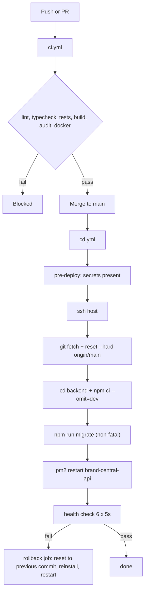

Required GitHub secrets: `SSH_PRIVATE_KEY`, `DEPLOY_HOST`, `DEPLOY_USER` (production); `STAGING_SSH_PRIVATE_KEY`, `STAGING_DEPLOY_HOST`, `STAGING_DEPLOY_USER` (staging). The deploy script does **not** build the frontend: `dist/` is gitignored and no `npm run build` step exists in `cd.yml`. Confirm how `/var/www/retail-ops/dist` is produced; the likely answer is a manual `npm run build` on the host, which is a release risk.

### 14.6 Deploy runbook

**Before**

1. `git pull --ff-only` on `main`; never rebase or force-push shared `main`.
2. Confirm CI is green (or know exactly which job is red and why).
3. Back up the database (see [14.10](#1410-backups-and-disaster-recovery)). Migrations are forward-only.
4. Announce the window if the change touches Live Sync, the scheduler or OOS.

**Deploy**

1. Merge to `main`; `cd.yml` runs automatically.
2. Watch the `Deploy to VPS` job. If it fails, check the rollback job before intervening.
3. On the host, confirm `pm2 ls` shows the expected app name, four workers and a recent restart time.
4. `curl -s https://<host>/api/health | jq` - database and Redis must both be `connected`.
5. Check scheduler logs on worker 0 for `[Scheduler]` lines and no lock contention errors.
6. Log in, open Ops Center, open a task, and trigger a small Live Sync for a test seller.

**Manual equivalent**

```bash
cd /var/www/retail-ops
git fetch origin && git reset --hard origin/main
cd backend && npm ci --omit=dev && npm run migrate
mkdir -p logs uploads/exports uploads/temp
pm2 restart retailops-api --update-env   # use the name that actually exists
pm2 save
curl -sf http://127.0.0.1:3001/api/health
```

**Rollback**

```bash
cd /var/www/retail-ops
PREV=$(git log --oneline -n 2 | tail -1 | cut -d' ' -f1)
git reset --hard "$PREV"
cd backend && npm ci --omit=dev
pm2 restart retailops-api --update-env
pm2 save
```

Migrations are **not** rolled back. If the previous release cannot run against the new schema, restore the database backup; that is the only safe path. Prefer forward-fixes for schema issues.

### 14.7 Migration runbook

1. Take a backup or a restore point.
2. Deploy with the app stopped, or run `npm run migrate` once before restarting workers.
3. With a PM2 cluster, migrations may run from several workers at boot. Set `RUN_MIGRATIONS_ON_STARTUP=false` and run them explicitly if a migration is not trivially idempotent.
4. Verify:

```sql
SELECT * FROM dbo.SchemaMigrations ORDER BY AppliedAt DESC;
```

5. If a migration fails, the runner stops. Fix forward with a new migration; do not edit an applied file, because the registry will skip it.

### 14.8 Operational runbooks

| Symptom | First checks | Action |
| --- | --- | --- |
| API 503 with `database: disconnected` | SQL Server up, credentials, firewall, pool exhaustion | Restore DB, restart workers, check `DB_POOL_MAX` vs SQL limits |
| API 503 with `redis: disconnected` | Redis process, memory, eviction | Restart Redis; expect lost queues and locks; restart workers; check for duplicate syncs |
| Live Sync running 4x | Redis down or `NODE_APP_INSTANCE` not set on all workers | Restore Redis, confirm only worker 0 schedules, inspect `LiveSyncRunLogs` |
| Sync stuck at 0 progress | TPD exhausted, no healthy credential, account cooldown | `GET /api/market-sync/creators-rate/status`, `GET /api/live-data/creds-stats`, wait for reset or add a credential |
| Queue jobs piling up | Redis memory, processor crash, poison job | Inspect Bull failed jobs, fix the payload, retry or remove; restart workers |
| Socket updates missing | Nginx upgrade headers, client transport, Redis adapter | Check browser console, `/socket.io` proxy, Redis pub/sub; test with one worker |
| Login loops back to `/login` | Cookies dropped (secure/HTTP), clock skew, 428 gate | Check Set-Cookie flags, server time, `/api/auth/me`, setup-wizard state |
| Tasks not generating | Scheduler not leader, template inactive, recurrence ledger | Check worker 0 logs, `PemsTaskTemplates.IsActive`, `PemsRecurrenceLog`, `NextScheduledDate` |
| OOS upload rejected | File hash duplicate, wrong columns, wrong channel | Inspect `OosImports.Status` and `MappingJson`; re-upload with correct source type |
| Export stuck at 90% | Disk full, workbook too large, process restart | Check disk, `Downloads.Status`, worker memory; rerun with a narrower filter |
| Nginx 502 | Backend down or port mismatch | `pm2 ls`, `curl 127.0.0.1:3001/api/health`, upstream name resolution |

### 14.9 Logs and monitoring

| Source | Location | Contents |
| --- | --- | --- |
| PM2 stdout/error | `/var/www/retail-ops/logs/api-*.log` | Console output, crashes, scheduler messages |
| Winston app log | `backend/logs/` | Structured application logs, rotating |
| API call log | `SystemLogs` table | Non-read 2xx `/api` calls, masked secrets |
| Activity log | `SystemLogs` + UI | User-visible audit feed |
| Nginx | `/var/log/nginx/access.log`, `error.log` | Requests, upstream errors |
| Docker | `docker logs brand-central-api` | Local only |
| Health | `/api/health`, `/api/health/readiness` | DB and Redis state, memory, uptime |

There is no APM, no metrics endpoint, no alerting integration and no log aggregation. Monitoring is PM2 plus health checks plus the in-app activity log. If you inherit this system, adding external uptime checks and a log drain is a high-value first task.

### 14.10 Backups and disaster recovery

There is **no backup script in the repository** and no scheduled database backup job in the code. Confirm the SQL Server host's native backup schedule before assuming one exists.

Minimum viable policy:

1. Full database backup nightly, retained 14 days; transaction log backups every 15 minutes if the recovery point objective is tight.
2. Off-host copy (object storage) with encryption.
3. Back up `backend/uploads` (evidence and exported OOS manifests are legal artefacts) and `backend/.env`.
4. Test a restore into a scratch database quarterly.
5. Document the RPO/RTO you actually achieve, not the one you want.

### 14.11 Scaling and limits

- **Vertical first.** PM2 cluster workers share one SQL pool budget; raising `DB_POOL_MAX` without raising SQL Server capacity makes things worse.
- **Uploads are local.** Multi-host requires shared storage or object storage. Do not scale horizontally until that is solved.
- **Schedule leader.** Only worker 0 runs cron. With multiple hosts, replace the `NODE_APP_INSTANCE` check with a Redis leader election.
- **Socket.IO** needs the Redis adapter plus websocket transport; adding sticky sessions would allow polling but is not required today.
- **Live Sync** is account-bound at 1 TPS and 8640 TPD. More workers do not make it faster; more credentials on separate accounts do.
- **Exports** run in-process and hold memory proportional to row count. Cap filters and paginate large exports.

### 14.12 Production security checklist

- [ ] Replace the default `Welcome@123`, all seed users, and any shared admin account.
- [ ] Rotate `JWT_SECRET`, `JWT_REFRESH_SECRET`, database credentials, Creators credentials, SMTP and AI keys from any value that has ever been in a chat, ticket or commit.
- [ ] Terminate TLS and add HSTS at the actual edge; the repo config is HTTP-only.
- [ ] Restrict the hardcoded CORS allow-list in `server.js` to real hosts.
- [ ] Add authentication to `/api/live-data/v3/*` (currently open).
- [ ] Add an admin permission to `/api/security/otp-logs`.
- [ ] Hash or encrypt `PasswordResets.Token` and `Users.RefreshToken` at rest.
- [ ] Set `CREATORS_RATE_REQUIRE_REDIS=true` in production so the rate gate cannot silently multiply.
- [ ] Disable or remove legacy Octoparse pool endpoints if Octoparse is retired.
- [ ] Set `DB_TRUST_SERVER_CERT=false` with a valid certificate, and `DB_ENCRYPT=true` for remote SQL.
- [ ] Add file-type and size validation on evidence uploads; serve downloads with `Content-Disposition: attachment`.
- [ ] Add backup, upload retention and export cleanup jobs.
- [ ] Clear or consciously accept the 33 Dependabot advisories; at minimum patch the critical one.
- [ ] Add rate limits to `/api/live-data` and export creation; they are expensive and currently inherit only the global READ tier.

---

## 15. Handover checklist

### 15.1 Access and accounts

| Item | What to obtain | Notes |
| --- | --- | --- |
| GitHub | Org membership, write access to `Brandcentral-Pvt/RetailOps` | `main` is protected; use PRs |
| GitHub Actions | Permission to read and rotate secrets | `SSH_PRIVATE_KEY`, `DEPLOY_HOST`, `DEPLOY_USER`, staging equivalents |
| Production host | SSH key and sudo (or a deploy-only account) | `/var/www/retail-ops` |
| PM2 | Ability to run `pm2 ls/logs/restart/save` as the deploy user | Confirm the real app name first |
| SQL Server | Read/write account, backup/restore rights, a read-only account for analytics | `RetailOps` database |
| Redis | Connection URL and `AUTH` if enabled | Shared by cache, queues, locks and rate gate |
| Amazon Creators API | Partner account, client ids/secrets, partner tags, quota contact | Multiple credentials possible |
| SMTP | Sender domain, relay credentials, SPF/DKIM ownership | OTP and reset email depend on it |
| AI providers | OpenAI, NVIDIA NIM, Perplexity keys and billing owners | Costs scale with usage |
| Keepa / Octoparse | Keys and account owners, or confirmation they are retired | Legacy paths still mounted |
| DNS and TLS | Domain control for `data.brandcentral.in`, certificate renewal | Repo config is HTTP-only |
| Mobile client | Repo, release process, API contract owner | Separate Expo app, same API |
| Monitoring | Existing uptime checks, log destination, on-call rota | Verify what actually exists |

### 15.2 Knowledge transfer

- [ ] Walk through [1](#1-system-overview) to [9](#9-tasks-pems-and-oos) with the outgoing owner.
- [ ] Run the app locally end to end, including one Live Sync against a test seller.
- [ ] Perform a staging deploy and a production deploy with supervision.
- [ ] Create an OOS run, upload both source files, reconcile, export, review and submit in staging.
- [ ] Generate a task from a template, execute it, submit it and review it.
- [ ] Restore a database backup into a scratch database.
- [ ] Trigger and clear a failed queue job.
- [ ] Review the [known issues](#16-known-issues-and-technical-debt) and agree which are accepted.

### 15.3 First two weeks (suggested)

1. Fix the deployment path: align the PM2 app name, add a frontend build step, confirm TLS.
2. Add authentication to `/api/live-data/v3/*` and restrict `/api/security/otp-logs`.
3. Put database and upload backups on a schedule, and test a restore.
4. Add uptime monitoring and a log drain; alert on `/api/health` and scheduler silence.
5. Clear the critical Dependabot advisory and reduce the high-severity backlog.
6. Add export and upload retention jobs; check disk headroom.
7. Fix the session lifetime and make logout revoke server-side.
8. Add a JSON 404 handler and normalise the success/error envelope.
9. Write down the real deploy and rollback procedure after fixing it, and replace section 14 if it differs.

### 15.4 Questions to ask the outgoing owner

- Which PM2 app name is actually running in production, and why does it differ from `ecosystem.config.js`?
- How is `dist/` built and published today?
- Where do database backups run, and when was the last restore test?
- Which Amazon accounts own each Creators credential, and what are their TPD limits?
- Is Octoparse still in use? Which sellers depend on it?
- Who are the OOS reviewers, and is reviewer independence enforced by policy or only by habit?
- Which Seller/Brand Manager role rows are authoritative when the duplicate rows disagree?
- Are the `Task*` legacy tables still written anywhere, or are they safe to archive?
- What is the expected behaviour when Redis is down: fail closed or degrade?
- Which customers are on the mobile app, and which API version do they call?

---

## 16. Known issues and technical debt

Severity: **S1** production risk or security, **S2** correctness or operational pain, **S3** maintainability.

| # | Sev | Area | Issue | Where | Suggested action |
| --- | --- | --- | --- | --- | --- |
| 1 | S1 | Security | `/api/live-data/v3/*` has no authentication middleware and can trigger paid API calls | `routes/pems/liveDataRoutes.js` | Add `authenticate` plus a permission gate |
| 2 | S1 | Auth | Passwordless OTP login yields a full session with only email control | `authController.requestOtp` | Require a second factor or restrict to mobile device registration |
| 3 | S1 | Auth | Access cookie lives 2h while JWT lives 12h; clients never refresh, so sessions die mid-work | `authController`, clients | Align TTLs and add a refresh interceptor |
| 4 | S1 | Auth | Frontend logout is local only; server tokens remain valid | `AuthContext.logout` | Call `/api/auth/logout` and clear server state |
| 5 | S1 | Auth | Default password `Welcome@123` on user creation | `userController` | Generate a random one-time password and force reset |
| 6 | S1 | Auth | Password reset tokens stored in plaintext | `PasswordResets` | Store a hash; compare on use |
| 7 | S1 | Security | OTP audit endpoint requires only authentication, not admin | `routes/securityRoutes.js` | Add `users_manage` or a dedicated permission |
| 8 | S1 | Deploy | CD restarts `brand-central-api`, PM2 defines `retailops-api`; may start a second process and leave the cluster stale | `cd.yml`, `ecosystem.config.js` | Align names and add a post-deploy assertion |
| 9 | S1 | Deploy | No frontend build or publish step; `dist/` is gitignored | `cd.yml`, `.gitignore` | Build and atomically publish `dist` in CD |
| 10 | S1 | Infra | No backup script or documented schedule in the repo | repository-wide | Add SQL backup, off-host copy, restore runbook |
| 11 | S1 | Infra | Nginx config is HTTP-only; Compose maps 443 without a TLS listener | `nginx.conf` | Add TLS or document the external terminator |
| 12 | S1 | Docker | Image copies an incomplete tree and runs the wrong entry path; container cannot start | `Dockerfile.backend` | Copy `database/`, `sockets/`, `lib/`, `scripts/`, set `CMD ["node","backend/server.js"]` from `/app` |
| 13 | S1 | Supply chain | 33 open Dependabot advisories (1 critical, 25 high); security CI fails | GitHub | Patch critical/high, then set a ratchet |
| 14 | S2 | CI | Frontend CI calls `npm run test`, which does not exist | `ci.yml`, `package.json` | Add a `test` script or change the step |
| 15 | S2 | Data | Duplicate `Task*` and `Pems*` families; live data lives in PEMS but legacy tables remain | database | Document ownership, then archive legacy |
| 16 | S2 | Data | OOS tables have no foreign keys; integrity is application-only | migrations 032-034 | Add FKs where history allows |
| 17 | S2 | Data | OOS run status vocabulary drifts (`OPEN/SUBMITTED/CLOSED` vs code writing `MONITORING/RECONCILED`) | `oosReconciliationService` | Pick one vocabulary and migrate |
| 18 | S2 | Migrations | Duplicate `004`, `007`, `031`, missing `011`; no advisory lock; no rollback | `backend/migrations` | Add a lock, keep numbering monotonic, document forward-fix |
| 19 | S2 | Config | Root `.env.example` documents `DB_HOST`; backend reads `DB_SERVER`. Two config modules with different pool defaults | `.env.example`, `config/env.js`, `database/db.js` | Single source of truth, delete duplicates |
| 20 | S2 | Scheduler | Changing schedule settings requires a restart to take effect | `schedulerService.scheduleJobs` | Add a reschedule endpoint or watch the settings table |
| 21 | S2 | Async | Redis down silently removes shared rate limiting and cron leadership | `creatorsApiRateGate`, `schedulerService` | Fail closed in production; alert on Redis loss |
| 22 | S2 | Files | No retention for `Downloads`, exports or uploads; disk fills | export controllers | Add TTL cleanup and disk alerts |
| 23 | S2 | Auth | Permission keys used but not seeded (`roles_create/edit/delete`, `monthlyreport_edit`) | role seeds, `App.jsx` | Seed or remove them |
| 24 | S2 | Auth | Frontend `hasPermission` special-cases role names, diverging from backend RBAC | `AuthContext` | Make the client ask the server for effective permissions only |
| 25 | S2 | Tasks | PEMS seller scoping implemented twice | `utils/sellerScope.js`, `services/pems/sellerScope.js` | Consolidate |
| 26 | S2 | Tasks | `PemsTaskEvents` created lazily at runtime, so fresh environments miss it until first use | event store service | Add to migrations |
| 27 | S2 | Frontend | `/dashboard-v2` renders demo data; no catch-all route | `src/pages`, `App.jsx` | Remove or wire to the API; add a 404 route |
| 28 | S2 | Frontend | Three live-sync paths render the same page; multiple API clients and auth schemes coexist | `App.jsx`, `services/` | Redirect legacy paths; standardise on one client |
| 29 | S2 | Quality | Typecheck is non-strict and not run by `build`; ESLint ignores backend | `tsconfig`, `eslint.config` | Enable strict incrementally; lint backend |
| 30 | S2 | Ops | No APM, metrics, alerting or log aggregation | repository-wide | Add uptime checks, metrics, log drain |
| 31 | S3 | Code | Dead code: `targets.js`, unmounted `pems/dashboardRoutes.js`, disabled Actions module, unused `TokenBlacklist` | backend | Delete after confirming no external callers |
| 32 | S3 | API | Success uses `message`, errors use `error`; unmatched routes return HTML | `responseHandler`, `server.js` | Normalise envelope and add a JSON 404 |
| 33 | S3 | UI | Two design systems and roughly 5.7k lines of bespoke CSS with hardcoded values | `src/styles` | Migrate to `--bc-*` tokens, delete duplicates |
| 34 | S3 | UI | Duplicate role rows (`Brand Manager` and `brand_manager`) kept in sync by hand | role seeds | Collapse to one canonical row |
| 35 | S3 | Docs | `docs/api-endpoints.md` describes a `.NET` API that does not exist in this repository | `docs/` | Mark as historical or delete |
| 36 | S3 | Repo | A backup branch and several stashes remain from a history rewrite | Git | Confirm and delete after a stable release |
| 37 | S3 | Scripts | 20+ one-off operational scripts with no tests or documentation | `backend/scripts` | Add a README with purpose and safety notes |
| 38 | S3 | Mobile | `staging.yml` and design workflow reference mobile paths absent here | workflows | Confirm the mobile repo and update paths |

---

## 17. Troubleshooting

| Symptom | Likely cause | What to do |
| --- | --- | --- |
| Login returns 401 for a known-good password | Account locked, disabled, or wrong email case | Check `Users.IsActive`, `LockUntil`, Redis `rl:fail:<email>`; unlock or clear |
| Login succeeds but immediately returns to `/login` | Cookie dropped (secure over HTTP), CORS, or 428 wizard gate | Inspect Set-Cookie, use HTTPS or development mode, check `/api/auth/me` and setup state |
| Every API call returns 428 | First login, forced reset, or expired password | Complete the setup wizard or reset the password |
| 403 on a page the user should access | Permission missing, role override excluded, seller out of scope | Check effective profile, `ExtraPermissions`, `ExcludedPermissions`, `UserSellers` |
| Nav item visible but route says unauthorized | Sidebar and route guards disagree | Compare `useNavigationItems` with `ProtectedRoute`; fix both |
| Dashboard empty after login | No seller scope, no data for range, stale cache | Check `resolveSellerScope`, date range, query key; hard refresh |
| ASIN price or availability stale | Sync not run, seller paused, TPD exhausted | Check `LastScrapedAt`, `LiveSyncRunLogs`, rate status; rerun for one seller |
| Live Sync immediately pauses | TPD exhausted or no healthy credential | Check `CreatorsApiQuota`, credential stats, account cooldown; wait or add credentials |
| Sync runs at 4x expected rate | Redis down, rate gate fallback per worker | Restore Redis; set `CREATORS_RATE_REQUIRE_REDIS=true` |
| Tasks not appearing in My Day | Not assigned, not in scope, template inactive, status not open | Check instance status, assignee, seller scope, template flag |
| Task cannot be submitted | Required activity or evidence missing | Check `EvidenceRequired`, activity completion, server validation message |
| Recurring tasks generate twice | Scheduler on multiple workers or recurrence ledger gap | Confirm Redis lock, `NODE_APP_INSTANCE`, `PemsRecurrenceLog` |
| OOS upload rejected as duplicate | Same file hash or same run/channel/source | Check `OosImports`; create a new run or use the existing import |
| OOS decision looks wrong | Policy version, stale evidence, channel mismatch | Read the decision `RuleId`, `EvidenceJson`, run `PolicyVersion`; resync if allowed |
| OOS incident will not close | Resync accepted but not verified recovered | Only a fresh, positive, same-channel observation closes it |
| OOS submit blocked | Open incident without owner or next action, or reviewer is submitter | Assign an owner and next action; use an independent reviewer |
| Export stuck or 0 bytes | Disk full, worker restart, oversized query | Check disk, `Downloads.Status`, worker memory; retry with narrower filters |
| Socket updates not arriving | Proxy upgrade, transport mismatch, Redis adapter | Check browser network, Nginx `/socket.io`, Redis pub/sub, test one worker |
| Email not delivered | SMTP credentials, sender domain, rate limit | Check Winston error log, SMTP provider, SPF/DKIM; OTP failures are user-visible |
| 502 from Nginx | Backend down, wrong upstream, wrong port | `pm2 ls`, `curl 127.0.0.1:3001/api/health`, fix upstream |
| Health 503 but app mostly works | Database or Redis partially unavailable | Read the `checks` object; fix the failing dependency |
| Migration fails on deploy | Non-idempotent SQL, permission, lock timeout | Fix forward with a new migration; restore backup only if incompatible |
| Reports shifted by one day | UTC vs IST date handling | Send IST dates, check `useUTC:false` and report file timezone |
| CI fails without code changes | Security audit advisories or flaky workflow | Check `security` job and Dependabot; rerun after patching |

---

## 18. Glossary

| Term | Meaning |
| --- | --- |
| ASIN | Amazon Standard Identification Number; the catalogue item key |
| BSR / Sub-BSR | Best Sellers Rank overall and within a sub-category |
| Buy Box | The default add-to-cart offer; tracked per ASIN |
| GMS | Gross Merchandise Sales; the commercial revenue measure used for targets and Pareto |
| ACOS / ROAS | Advertising cost of sale and return on ad spend |
| LQS | Listing Quality Score; AI-assisted content and image assessment |
| PEMS | The task system: templates, instances, subtasks, activities, evidence, reviews |
| SOP | Standard operating procedure encoded in a template's JSON |
| TAT / SLA | Turnaround time and service-level deadline used for escalation |
| OOS | Out of stock; the reconciliation workflow compares RetailOps, Brand Central and Vendor Central |
| Pareto | The top ASINs covering a share of GMS; used to prioritise OOS review |
| EpisodeKey | Identifier grouping consecutive observations of the same stock-out episode |
| Resync | A verification job that re-checks a disputed ASIN; an accepted request is not a recovery |
| Manifest | Immutable export metadata and file hash used as the OOS audit artefact |
| TPS / TPD | Transactions per second and per day; the Creators API budget |
| Creators API | Amazon's affiliate/product data API used for live catalogue data |
| Keepa | Third-party price and seller history API |
| Octoparse | Legacy scraping platform still reachable through market-sync endpoints |
| PM2 cluster | Node process manager running four workers behind one port |
| Redis adapter | Socket.IO adapter that broadcasts rooms across workers |
| Seller scope | The set of sellers a user may see; global, assigned or self |
| Rate gate | The shared Redis token bucket and daily ledger for Creators API calls |
| Read replica | Optional SQL Server reader endpoint with automatic fallback |
| Maintenance mode | Global 503 switch for the API |
| Rework | A rejected task returned to the assignee for correction |
| View definition | Versioned JSON that selects the task workspace UI |
| Snapshot | Frozen view or template JSON stored on an instance at generation |

---

## 19. Contributing

### Branching

- `main` is production. Treat it as append-only; merge through PRs.
- `develop` is the integration branch and deploys to staging.
- Feature branches: `feat/<short-name>`, fixes: `fix/<short-name>`, docs: `docs/<short-name>`.
- Never rebase or force-push `main` or `develop`. A history rewrite on `main` already caused a 900-commit divergence; recovery required a hard reset to `origin/main`.
- Set `git config pull.ff only` on shared branches. If a pull cannot fast-forward, stop and investigate; do not merge a rewritten history.

### Commits and pull requests

- Conventional commit subjects: `feat(scope): ...`, `fix(scope): ...`, `docs(scope): ...`, `refactor(scope): ...`, `chore(scope): ...`.
- Keep migrations, schema changes and the code that needs them in the same PR.
- A PR should state: what changed, why, how it was tested, and any migration or env change.
- Do not commit `.env`, real customer data, exports, logs or `node_modules`.

### Code conventions

- Backend: Express 5, async handlers, parameterised SQL, no string interpolation of user input, services for domain logic, controllers thin.
- Frontend: function components and hooks, TanStack Query for server state, existing primitives and `--bc-*` tokens, no new CSS framework.
- Permissions: add to the seed, the backend guard and the frontend route together. A frontend-only permission is not a permission.
- Errors: throw typed errors, let the global handler format them, include a request id in the log line.
- Dates: IST-first, explicit about timezone at boundaries.

### Database changes

1. New file in `backend/migrations` with the next unused number and a descriptive suffix.
2. Idempotent guards (`IF OBJECT_ID ... IS NULL`, `IF COL_LENGTH ... IS NULL`).
3. Indexes for new query paths, named consistently.
4. No destructive change in the same release as the code that stops using the column.
5. Update this document's table inventory if you add a table.

### Before requesting review

```bash
npm run lint
npm run typecheck
npm run test:planner
npm run test:auth          # if UI auth or routing changed
cd backend && npm test
cd backend && node --check server.js
```

---

## 20. License and ownership

This is proprietary Brand Central Pvt Ltd software. There is no open-source license file in the repository; do not redistribute it, publish it, or reuse it outside the organisation without written approval.

Third-party dependencies retain their own licenses. Before distribution or a security review, generate a dependency license inventory (`npm ls --all` plus a license scanner) and check the vendored packages (for example `backend/superagent-10.3.0.tgz`) and the Playwright browser binaries.

Ownership at handover:

| Area | Owner |
| --- | --- |
| Repository, CI/CD, infrastructure | Platform / DevOps |
| Auth, users, roles | Backend plus security reviewer |
| Catalogue and ingestion | Data pipeline |
| Ads and reporting | Analytics |
| PEMS and OOS | Operations product owner |
| Frontend design system | Frontend lead |

Update this table when ownership changes. An unowned system is an unmaintained system.

---

### Document maintenance

- Update this file in the same PR as any change to architecture, routes, env vars, schema, queues or deploy steps.
- Keep the Mermaid diagrams executable; a broken diagram is worse than no diagram.
- Date the verification line at the top whenever you re-verify the document against `main`.
- If a section becomes wrong and you cannot fix it immediately, mark it `STALE` with the date and the reason rather than leaving a confident lie.

_Last verified: 26 October 2026, `main` at `74b6346` plus the documentation commit that follows it._
