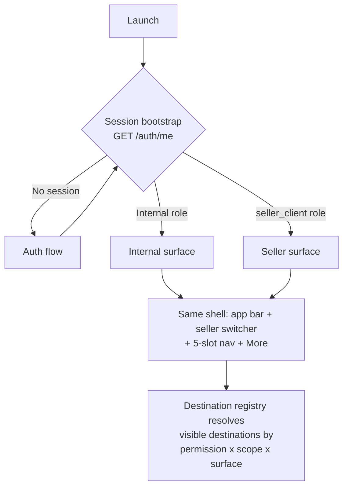

# RetailOps Android — Design Schema

**Document ID:** `RO-MOB-DS-001`
**Version:** 1.0.0
**Status:** Draft for review
**Owner:** Design System / Mobile
**Applies to:** RetailOps Android app (single APK, two role surfaces)

---

## 1. Purpose

This is the **schema**, not a mockup. It defines the structure that all UI/UX work —
wireframes, Figma components, and Compose/React Native implementation — must
conform to. Nothing in this document is a pixel-final visual; everything in it is a
contract that must stay stable while the visuals evolve.

The schema answers, in order:

| # | Question | Section |
|---|---|---|
| 1 | Who uses the app, and what changes for each of them? | §3, §4, §6.7 |
| 2 | What is the information architecture? | §6 |
| 3 | How is navigation composed and how does it adapt across devices? | §7, §8 |
| 4 | How do we translate dense web tables into a phone UI? | §9 |
| 5 | How is freshness, offline, and failure communicated? | §10, §11 |
| 6 | What are the design tokens, motion, and accessibility floors? | §12, §13, §14 |
| 7 | What does the backend need before this can be built? | §16 |
| 8 | In what order do we ship? | §17 |

**Companion documents** (read alongside this one):

| Document | Contents |
|---|---|
| `02-design-tokens.json` | Every token: colour, type, shape, elevation, spacing, motion, domain status |
| `03-screen-inventory.md` | All 140 screens with IDs, roles, states, endpoints |
| `04-component-library.md` | Component anatomy, variants, states, sizing, a11y contracts |
| `05-role-ui-matrix.md` | Module × role visibility and action matrix (the RBAC→UI bridge) |
| `06-api-screen-mapping.md` | Screen → endpoint mapping and backend gaps |

---

## 2. Product definition

> **RetailOps for Android** is a single application that serves two audiences from one
> codebase and one design system: the **internal RetailOps team** who operate seller
> accounts, and the **seller clients** whose accounts are operated.

Both audiences already exist as data in the platform — `Sellers`, `Users`,
`Roles`, `Permissions`, `UserSellers` (`init-database.sql`, `backend/controllers/roleController.js`).
What does not exist yet is a *seller-facing* role or login; §16 tracks that as a
hard prerequisite.

### 2.1 What "one app, two surfaces" means

One APK. One navigation shell. One component library. Two **destination registries**
that decide what fills the shell:



This is deliberate. Two separate apps would double the maintenance of every token,
component, and bug fix, and would make cross-surface features (chat between a seller
and their account manager) impossible to build once.

### 2.2 Product positioning

| Attribute | Internal surface | Seller surface |
|---|---|---|
| Metaphor | Operations console | Account companion |
| Primary job | Act on many accounts at once | Understand my account, respond to what's asked of me |
| Time budget | 5–40 min sessions, high frequency | 1–5 min sessions, daily habit |
| Data volume on screen | Thousands of ASINs, aggregated | My products only, tens to hundreds |
| Default landing | Alert-driven exception queue | Headline KPIs + what changed |
| Tone | Neutral, dense, tool-like | Reassuring, plain-language, guided |

---

## 3. Audiences

### 3.1 Internal staff personas

Derived from the actual role definitions in `backend/controllers/roleController.js`
(`defaultPermissions` / `defaultRoles`) and `init-database.sql`.

| Persona | Role key | Level | What they do in the app | Session shape |
|---|---|---|---|---|
| **Ops lead** | `admin`, `super_admin` | 100 | Everything; security & settings administration | Long, on desktop too |
| **Ops manager** | `operational_manager` | 90 | Runs day-to-day ops across all sellers; everything except security | Long, high frequency |
| **Brand manager** | `Brand Manager` | 50 | Owns a set of brands/sellers; catalog + tasks + keywords | Medium, mobile-heavy |
| **Catalog manager** | `catalog_manager` | 30 | Catalog hygiene across sellers; export-heavy | Medium, burst-y |
| **Listing team** | `listing_team` | 25 | Executes listing work for assigned brands; field work | Short, many per day |
| **Viewer / reviewer*** | `viewer`, `reviewer`, `brand_manager`* | 10–40 | Read-only or approval-only access | Episodic |

\* `init-database.sql` seeds `super_admin`, `admin`, `brand_manager`, `reviewer`, `viewer`;
`roleController` seeds `admin`, `operational_manager`, `Brand Manager`, `catalog_manager`,
`listing_team`. **Two divergent role taxonomies currently exist.** Unifying them is a
prerequisite (§16, P-1) because the UI cannot render a stable permission→navigation
mapping over two overlapping sets.

### 3.2 Seller client persona (new)

| Attribute | Value |
|---|---|
| Role key (proposed) | `seller_client` |
| Level | 20 |
| Data scope | **Only** sellers listed in `UserSellers` for that user |
| Relationship | One primary account manager (internal user), plus an optional internal support group |
| Device | Mid-range Android, 4G, intermittent connectivity |
| Expectation | "Tell me how my account is doing, and tell me when you need something from me" |
| Anti-expectation | Raw internals — scraper jobs, ruleset builders, API keys, other sellers |

Seller-facing labels must be written in **plain merchant language**, not internal
jargon. The mapping is a design deliverable, not an afterthought:

| Internal term | Seller-facing label |
|---|---|
| PEMS task instance | Request / Action item |
| SLA breach | Overdue |
| ASIN Manager | My Products |
| Ruleset | Automation |
| Scraper sync | Data refresh |
| Ads Intelligence | Advertising |
| GMS | Sales (GMS) |
| Parent ASIN | Product family |

---

## 4. The three-axis access model

Every destination, widget, and action in the app is resolved through three orthogonal
axes. Getting this model right is what keeps the UI honest as roles change.

```
VISIBILITY = Surface  ×  Capability (RBAC)  ×  Scope (data)
```

### Axis A — Surface
`internal` | `seller`
Static per session. Decides the label set (internal jargon vs merchant language),
the registry, and the theme accent (§14).

### Axis B — Capability (RBAC)
Driven by the permission strings the user holds — `dashboard_view`,
`asinmanager_view`, `asinmanager_manage`, `asinmanager_export`, `tasks_manage`,
`adsreport_view`, `seller_manage`, `users_manage`, …

Rules:
1. A destination is visible only if the user holds **at least one** of its declared
   `requiredPermissions` (any-of semantics, matching `requireAnyPermission` in
   `backend/middleware/auth.js`).
2. A screen is reachable at its deepest route only if the guard passes; deep links to
   denied routes land on **`Unauthorized`**, never a blank screen or a crash.
3. Capability also controls **affordances inside** a screen: `_view` renders a screen,
   `_manage`/`_create`/`_edit` render create-edit-commit controls, `_export` renders
   export, `_import` renders import.
4. The UI **never** infers capability from role name. Role → permissions is the
   backend's business; the app reads permissions only.

### Axis C — Scope (data)
Driven by `UserSellers` (and `req.user.assignedSellers` from `authenticate`).

| Scope | Who | UI consequence |
|---|---|---|
| `global` | admin, operational_manager, catalog_manager | Seller switcher offers **All sellers** + each seller |
| `assigned` | Brand Manager, listing_team, brand_manager | Seller switcher offers only assigned sellers; no "All" option |
| `self` | `seller_client` | Switcher hidden; the app is pinned to that seller |

**Every screen that shows seller data must render a `ScopeIndicator`** — either the
seller's name, or a `3 sellers` chip when aggregated. A user must never be able to
tell themselves "I'm not sure whose data this is."

---

## 5. Design principles

1. **Exception-first, not archive-first.** The web dashboard is a reporting surface; the
   phone is a decision surface. Home leads with what changed and what needs a human.
2. **One shell, two voices.** Identical structure and components; different words,
   different defaults, different depth.
3. **Permission-shaped, never permission-broken.** Hiding a module is a design outcome;
   showing a module that then 403s is a defect.
4. **Scope is always visible.** See Axis C.
5. **Freshness is part of the data.** Synced data carries its own timestamp on screen.
   Never imply real-time when the pipeline is batch.
6. **Progressive depth.** Card → detail → deep tool. Nothing requires a spreadsheet
   mindset to reach.
7. **Thumb-first.** Primary actions in the bottom third on phones; destructive and
   rare actions behind overflow.
8. **Offline is a state, not an error.** Cached reads stay useful; writes queue or
   explain.
9. **Every list has an empty state that teaches.** Empty means "here's what to do",
   not "no data".
10. **Numbers need a reference.** A bare metric is noise — always pair with delta,
    target, or trend.

---

## 6. Information architecture

### 6.1 Module map (canonical, from the web app + API surface)

| Group | Module | Permission(s) | Internal | Seller (v1) |
|---|---|---|---|---|
| **Home** | Dashboard | `dashboard_view` | ✅ | ✅ (simplified) |
| | Alerts & alert rules | `dashboard` alerts, `rules_view`/`rules_manage` | ✅ | ✅ (own alerts only) |
| | Notifications | — | ✅ | ✅ |
| **Catalog** | ASIN Manager | `asinmanager_view` `_manage` `_import` `_export` | ✅ | ✅ view + export (own) |
| | ASIN Tracker (BSR/price) | `asintracker_view` | ✅ | ✅ |
| | Listing Quality | `asinmanager_view` | ✅ | ✅ |
| | Keyword Research | `keywords_view` `_export` `_manage` | ✅ | ✅ view + export |
| **Growth** | Ads Intelligence | `adsreport_view` `_export` `_import` | ✅ | ✅ view + export |
| | Targets / Target vs Achievement | `targets_view` `_create` `_edit` `_delete` `_export` | ✅ | ✅ view |
| | GMS Tracker | `gms_tracker_view` `_import` `_export` | ✅ | ✅ view + export |
| | Reports (SKU, Parent ASIN, Monthly, P&L, Inventory, Goals) | `*report_view` / `_export` | ✅ | ✅ subset (own) |
| | Revenue Calculator | `calculator_view` `_manage` | ✅ | ➖ v2 |
| **Ops** | Optimization Tasks / PEMS instances | `tasks_view` `tasks_manage` | ✅ | ✅ (raise & track) |
| | Action Center | `actions_view` `actions_manage` | ✅ | ✅ (view own) |
| | Rulesets & automation | `rules_view` `rules_manage` | ✅ | ➖ |
| | Scheduled runs & scrapers | `scraping_view` `scraping_manage` | ✅ | ➖ |
| | Templates | `templates_manage` | ✅ | ➖ |
| **People** | Sellers | `seller_view` `seller_manage` | ✅ | ➖ |
| | Teams | `teams_manage` | ✅ | ➖ |
| | Chat (conversations, groups, polls, media) | `chat_view` | ✅ | ✅ (own thread(s)) |
| | Calls (VoIP + history) | `chat_view` | ✅ | ✅ (with account manager) |
| **Admin** | Users | `users_view` `users_manage` | ✅ | ➖ |
| | Roles & permissions | `roles_view` `roles_manage` | ✅ | ➖ |
| | API keys | `apikeys_manage` | ✅ | ➖ |
| | System settings | `settings_manage` | ✅ | ➖ |
| | Activity logs | `activitylogs_view` | ✅ | ➖ |
| | File Manager | `files_manage` | ✅ | ➖ |
| **Account** | Profile, security, device trust | — | ✅ | ✅ |
| | Notification preferences | — | ✅ | ✅ |
| | Appearance, language, data saver | — | ✅ | ✅ |

✅ = in scope · ➖ = deliberately out of scope for that surface

### 6.2 Internal sitemap

```mermaid
flowchart TD
    IN[Internal surface] --> H[Home]
    IN --> C[Catalog]
    IN --> G[Growth]
    IN --> O[Ops]
    IN --> M[More]

    H --> H1[Dashboard]
    H --> H2[Alerts]
    H --> H3[Notifications]

    C --> C1[ASIN Manager]
    C --> C2[ASIN Tracker]
    C --> C3[Listing Quality]
    C --> C4[Keyword Research]

    G --> G1[Ads]
    G --> G2[Targets]
    G --> G3[GMS Tracker]
    G --> G4[Reports]
    G --> G5[Revenue Calculator]

    O --> O1[Tasks / PEMS]
    O --> O2[Action Center]
    O --> O3[Rulesets]
    O --> O4[Scheduled Runs / Scrapers]

    M --> M1[Sellers]
    M --> M2[Teams]
    M --> M3[Chat]
    M --> M4[Calls]
    M --> M5[Reports library]
    M --> M6[Admin]
    M --> M7[Account]
```



### 6.3 Seller sitemap

```mermaid
flowchart TD
    SE[Seller surface] --> H[Home]
    SE --> P[Performance]
    SE --> C[My Products]
    SE --> W[Requests]
    SE --> M[More]

    H --> H1[Snapshot]
    H --> H2[What changed]
    H --> H3[Needs your input]

    P --> P1[Sales / GMS]
    P --> P2[Advertising]
    P --> P3[Target vs achievement]
    P --> P4[Reports]

    C --> C1[Product list]
    C --> C2[Product detail]
    C --> C3[Listing quality]
    C --> C4[Price and rank history]
    C --> C5[Keywords]

    W --> W1[Open requests]
    W --> W2[Awaiting your approval]
    W --> W3[Completed]

    M --> M1[Chat with account team]
    M --> M2[Account manager]
    M --> M3[Notifications]
    M --> M4[Account and preferences]
    M --> M5[Help and support]
```



---

## 7. Navigation architecture

### 7.1 The shell

```
┌──────────────────────────────────────────────────────────┐
│ Top app bar (M3 small/medium)                            │
│  [seller switcher ▾]        [search] [bell •3] [avatar]   │
├──────────────────────────────────────────────────────────┤
│ Scope indicator strip (only when scope ≠ self, compact)   │
├──────────────────────────────────────────────────────────┤
│                                                          │
│  Screen content (scroll, pull-to-refresh)                │
│                                                          │
├──────────────────────────────────────────────────────────┤
│ Navigation bar — 5 slots max (M3), badges on slots 1/4    │
└──────────────────────────────────────────────────────────┘
```

### 7.2 Navigation slots

| Surface | Slot 1 | Slot 2 | Slot 3 | Slot 4 | Slot 5 |
|---|---|---|---|---|---|
| Internal | **Home** | **Catalog** | **Growth** | **Ops** | **More** |
| Seller | **Home** | **Performance** | **My Products** | **Requests** | **More** |

Five slots is the M3 maximum and the working-memory ceiling for field users. Anything
that does not earn a slot lives under **More**, which is itself permission-filtered and
searchable.

### 7.3 Destination registry (implementation contract)

The nav bar, the rail, the drawer, the "More" list, and the global search index all
read from **one registry**. This is the single most important engineering-facing
decision in the schema: it is what makes "role-based UI" a data problem rather than a
forest of `if (role === …)`.

```ts
export type Surface = 'internal' | 'seller';
export type Scope = 'global' | 'assigned' | 'self';
export type NavSlot = 'home' | 'catalog' | 'growth' | 'ops' | 'performance' | 'more';

export interface Destination {
  id: string;                       // 'catalog.asin-manager'
  label: string;                    // resolved from i18n, surface-aware
  labelKey: string;
  icon: FluentIconName;
  slot: NavSlot;
  order: number;                    // integer, gaps of 10
  surfaces: Surface[];
  requiredPermissions?: string[];   // ANY-OF; omitted = always visible
  requiredScope?: Scope;
  scopeMode?: 'own' | 'assigned' | 'all';
  badgeKey?: 'alerts' | 'chat' | 'tasks' | 'notifications';
  featureFlag?: string;             // remote kill-switch
  deepLink: string;                 // 'retailops://catalog/asin-manager'
  screens: ScreenRef[];             // see 03-screen-inventory.md
}
```

Resolution algorithm at boot and on permission refresh:

```
visible = registry
  .filter(d => d.surfaces.includes(session.surface))
  .filter(d => !d.requiredPermissions?.length ||
               d.requiredPermissions.some(p => session.permissions.includes(p)))
  .filter(d => satisfy(scopeGuard(session.scope), d.requiredScope))
  .filter(d => !d.featureFlag || flags[d.featureFlag] !== false)
  .sort(by slot.order)
```

A slot with **zero visible destinations is not rendered** — the nav bar collapses from
5 to 4 to 3 slots rather than showing dead tabs. A slot with **one** visible
destination is rendered as a direct target (no nested list).

### 7.4 Depth rules

| Surface | Max depth | Back behaviour |
|---|---|---|
| Internal | 4 levels (slot → list → detail → sub-tool) | System back pops one level; header back matches |
| Seller | 3 levels | Same |

A screen that would exceed depth must be redesigned as a sheet, a tab within the
parent, or a "More" leaf — not as a fifth push.

### 7.5 Deep links

| Scheme | Pattern | Example |
|---|---|---|
| Custom | `retailops://<slot>/<screen>?<params>` | `retailops://ops/task/TI-10482` |
| Universal | `https://data.brandcentral.in/app/<slot>/<screen>?<params>` | `.../app/catalog/asin/B0XXXXXXX` |

Push notification payloads must carry a deep link plus the permission and scope they
assume, so the client can route safely:

```json
{
  "title": "Task overdue",
  "body": "Price correction for B0XXXXXXX is past SLA",
  "deepLink": "retailops://ops/task/TI-10482",
  "requiresPermission": "tasks_view",
  "sellerId": "SLR-0042",
  "collapseKey": "task:TI-10482"
}
```

---

## 8. Adaptive layout

### 8.1 Window size classes (Material 3)

| Class | Width | Typical device | Navigation | Layout |
|---|---|---|---|---|
| **Compact** | < 600 dp | Phone portrait | Navigation bar (bottom) | Single pane, 16 dp margins |
| **Medium** | 600–839 dp | Foldable outer, small tablet, phone landscape | Navigation **rail** (collapsed icons + labels) | Single pane, two-column KPI grid, 24 dp margins |
| **Expanded** | ≥ 840 dp | Tablet, foldable inner, desktop | Navigation **drawer** (permanent) | **List–detail** two pane; 3–4 column KPI grid; max content width 1200 dp |

Transitions are animated (M3 `shared-axis` for rail↔bar is not required; a 200 ms
`emphasized` fade-through is sufficient and cheaper).

### 8.2 List–detail

On expanded widths, master–detail applies to: ASIN list→detail, Task list→detail,
Seller list→detail, Chat list→conversation, Report list→report viewer.

On compact, the same pairs become **push navigation**, and the detail screen carries
the parent context in its app bar subtitle (e.g. `ASIN Manager · B0XXXXXXX`).

### 8.3 Orientation & foldables

- Phone landscape keeps the bottom bar (do **not** switch to a rail below 600 dp) —
  consistent muscle memory beats density.
- Foldable table-top posture: content top, controls bottom, for scan-heavy screens
  (ASIN Tracker, Listing Quality).
- Never lock orientation; never letterbox.

### 8.4 Touch targets

| Element | Minimum |
|---|---|
| Any tappable surface | 48 × 48 dp |
| Icon button | 48 dp container, 24 dp glyph |
| List row | 56 dp min (two-line 72 dp, three-line 88 dp) |
| Bottom nav slot | full slot width × 64 dp bar height |
| Inline table action | 40 dp visual, 48 dp hit area (expanded via `hitSlop`) |

---

## 9. Content strategy: from web tables to phone UI

RetailOps web screens are dense data tables (the `rulesets` page alone defines three
density levels and five breakpoints). **Tables are not ported; they are transformed.**

### 9.1 Degradation ladder

| Web | Mobile | When |
|---|---|---|
| Table with ≥ 6 columns | **Card list**: 3 primary fields + 2 metrics + status chip | Default, all list screens |
| Table | **Compact rows**: single line, 3 columns, monospaced numerics | Toggle in filter bar, power users |
| Wide table | **Horizontal scroll with sticky first column** | Only in Report Viewer (explicit "view as sheet") |
| Pagination | Infinite scroll, page size 25, explicit "Load more" after 200 rows | All lists |
| Column sort | Sort sheet (single active sort) | All lists |
| Faceted filters | **Filter bottom sheet**, chips reflect active filters above the list | All lists |
| Bulk select | **Selection mode**: long-press to enter, contextual app bar with count | Where `_manage`/`_export` present |
| Export XLSX | Share-sheet export action producing XLSX/CSV, with progress + notification on completion | Where `*_export` present |

### 9.2 Number formatting (locked rules)

| Kind | Format | Example |
|---|---|---|
| Currency (INR) | `₹` + Indian grouping, no decimals ≥ ₹1,000 | `₹12,48,300` |
| Currency (small) | 2 decimals under ₹1,000 | `₹842.50` |
| Compact | 1 decimal + suffix | `₹12.5L`, `₹1.2Cr`, `1.4K` |
| Percent | 1 decimal, always signed for deltas | `+12.4%` |
| Ratio (ROAS, ACoS) | 2 decimals, unit suffix | `3.42x`, `18.30%` |
| Count | Indian grouping | `1,24,802` |
| Delta | Arrow + sign + colour + **icon** (never colour alone) | `▲ +12.4%` |
| Null / no data | `—` (em dash) + tooltip "No data for this period" | `—` |
| Stale | value at 60 % opacity + `Stale` chip | |

Timestamps: relative under 24 h (`4 min ago`), absolute beyond (`12 Sep, 16:40`),
always in **Asia/Kolkata** for both surfaces.

---

## 10. Data freshness, sync and offline model

RetailOps data arrives through Octoparse sync jobs and scheduled runs — it is **not**
a live feed. The app must never suggest otherwise.

| State | Visual | Copy |
|---|---|---|
| Fresh | Nothing shown | — |
| Aged | `⟳ 3 h ago` subtle chip in app bar | "Updated 3 h ago" |
| Stale (past module threshold) | Amber `Stale` chip next to the value block | "Synced 2 days ago — figures may have changed" |
| Syncing | Linear progress under app bar + `⟳` spin on the chip | "Refreshing…" |
| Sync failed | Red `Sync failed` chip, tap → sync detail sheet | "Last refresh failed. Retry" |

Per-module staleness thresholds (defaults, remotely configurable):
ASIN price/BSR `6 h` · Ads `24 h` · GMS/sales `24 h` · Inventory `24 h` · Tasks/alerts `live`
(Socket.IO) · Chat `live`.

### 10.1 Offline behaviour

| Capability | Offline |
|---|---|
| Read cached lists/detail | ✅ with a persistent `Offline — showing cached data from <time>` banner |
| Dashboards & reports | ✅ cached, timestamp enforced |
| Search | Local index over cached entities only |
| Chat | Read cached threads; send queues with `Pending` state and auto-retries |
| Task comments / status change | Queued, optimistic, `Pending` chip, conflict → manual resolution sheet |
| Approvals, exports, admin writes | ❌ blocked with a clear message ("Needs connection") |

Cache policy: stale-while-revalidate, 7-day entity TTL, aggressive eviction above
150 MB, no caching of `users_manage` / `roles_manage` payloads (security).

---

## 11. Interaction and state model

Every screen must define **all nine states**. A screen is not "designed" until each has
a rendering.

| # | State | Treatment |
|---|---|---|
| 1 | **Loading (first)** | Skeleton mirroring final layout. Never a bare spinner for content. |
| 2 | **Loading (refresh)** | Inline `LinearProgress` at the top; content stays interactive. |
| 3 | **Empty (true)** | Illustration + one-line explanation + primary CTA. Teaches the feature. |
| 4 | **Empty (filtered)** | "No results for these filters" + `Clear filters` action. *Never* the true-empty art. |
| 5 | **Error (recoverable)** | Inline error card with `Retry`; keeps last good data visible if any. |
| 6 | **Error (fatal / 500)** | Full-screen with request ID for support, `Retry`, `Go home`. |
| 7 | **No permission (403)** | `Unauthorized` screen: "You don't have access to <Module>. Ask an admin." + back. Never a dead tab. |
| 8 | **Offline / degraded** | Persistent banner + cached content (§10.1). |
| 9 | **Partial / stale data** | Section-level `Stale` or `Partial data` chip; the rest of the screen stays fully usable. |

Additional per-screen states where relevant: **selection mode**, **bulk action
in progress**, **upload in progress**, **conflict**, **rate-limited (429)** with retry
countdown.

### 11.1 Feedback rules

- **Optimistic** — acknowledging an alert, marking notifications read, chat send,
  toggling a preference. Revert + snackbar on failure.
- **Confirmed** — anything that changes money, assignments, or permissions: task
  status, approvals, user/role edits. Requires a `ConfirmDialog` naming the object.
- **Irreversible** — delete, deactivate, revoke: typed confirmation or hold-to-confirm
  for the top 3 destructive actions per surface.
- One snackbar at a time; max 4 s; always dismissible; actions inline in the snackbar.

---

## 12. Design tokens

Full token set: **`02-design-tokens.json`**. Summary of the foundation:

| Family | System | Notes |
|---|---|---|
| Colour | Material 3 colour roles on a brand seed | Seed = RetailOps brand blue `#1976D2` (`--bc-ro-500`), *not* the legacy `#2563EB` |
| Typography | M3 type scale (Roboto / system) | 15 roles, `sp`; supports 200 % font scale |
| Shape | M3 shape scale | 0/4/8/12/16/28 + full |
| Elevation | M3 levels 0–5 | Surfaces + shadow; dark mode uses tonal elevation |
| Spacing | 4 dp grid | `4 8 12 16 20 24 32 40 48` |
| Motion | M3 durations + easing | see §13 |
| Domain | Status, SLA, metric-delta, marketplace, role colours | see `02-design-tokens.json` → `domain` |

**Invariants**
1. Screens consume **semantic** tokens only (`surface.container`, `status.danger.fg`),
   never primitives (`blue.600`).
2. Any new value needed by a screen is added to the token file first, then used. No
   hard-coded hex, px, or duration in screen code.
3. Web (`src/styles/tokens.css`) and mobile stay in sync on **brand** and **status**
   values; they may diverge on density and elevation, which are platform-specific.
4. Dark theme is authored, not inverted. Every token in `02-design-tokens.json` carries
   a `dark` value — the web has 36 tokens with no dark equivalent and dark mode is
   dormant there; the app must not inherit that debt.

---

## 13. Motion

| Purpose | Token | Duration | Easing |
|---|---|---|---|
| Tap feedback, state change | `motion.short` | 100–150 ms | `standard` |
| Enter/exit of sheets, shared-axis | `motion.medium` | 250–300 ms | `emphasized` |
| Large surfaces, drawer, screen push | `motion.long` | 400–500 ms | `emphasized` |
| Skeleton shimmer | `motion.shimmer` | 1400 ms loop | linear |
| Value change (count up/down) | `motion.value` | 300 ms | `standard` — **only when the value is already on screen**, never on first paint (web decision preserved: screen readers must read stable values) |

Rules:
- Motion must be **causally connected** — animate what changed, not the whole screen.
- Respect `Reduce motion` / `Remove animations` system setting: substitute opacity
  cross-fades ≤ 100 ms; disable shimmer and shared-axis.
- Haptics: light on selection change and pull-to-refresh trigger; medium on hold-to-confirm
  completion; **never** on scroll or list load. Haptics respect system settings.
- No motion may exceed 600 ms, and none may block input.

---

## 14. Theming and brand

| Theme | Rule |
|---|---|
| **Light** | Default. Brand blue primary; slate neutrals. |
| **Dark** | Authored palette; M3 tonal elevation; no pure black surfaces (base `#07111F` family from the existing app). |
| **System** | Default follows OS; user override in Account → Appearance. |
| **Dynamic colour** | **Off by default.** Android dynamic colour would repaint the brand and break status-colour semantics (a red that is no longer "danger"). Offer it only as an opt-in experimental toggle, and only after status colours are locked to fixed hues. |
| **Surface accent per surface** | Internal = brand blue. Seller = a distinct container tint so a seller user can never mistake the app for an internal tool, and so support can tell at a glance which surface is on screen. |

Brand assets: the app draws from `mobile/assets/brandcentral-logo.png`; icon, adaptive
icon foreground/background/monochrome, and splash already exist and must be regenerated
from the final token set.

---

## 15. Accessibility

Baseline: **WCAG 2.2 AA**, plus Android platform requirements.

| Requirement | Target |
|---|---|
| Contrast | Body text ≥ 4.5:1, large text ≥ 3:1, UI components ≥ 3:1 (both themes) |
| Touch target | ≥ 48 × 48 dp, ≥ 8 dp spacing |
| Text | ≥ 12 sp for any label, ≥ 14 sp body; no text in images |
| Font scale | Fully usable at 200 %; no clipped or truncated critical text; layouts reflow |
| Screen reader | TalkBack: every icon-only control labelled; lists announce item count and position; charts have a **table/list alternative** |
| Colour independence | Status always pairs colour with icon **and** text (SLA, deltas, marketplace) |
| Focus | Visible focus on all interactive elements; logical focus order in list–detail |
| Forms | Labels always visible (never placeholder-only), errors described in text, errors announced |
| Motion | Reduce-motion honoured; no autoplay animation |
| Charts | Every chart has: value labels or a data table view, and a text summary |
| Language | English (India) for v1; strings externalised for a future Hindi/Gujarati pass |
| Timeouts | No session timeout that destroys unsaved input without warning |

Two specific risks in this domain, called out because they are easy to miss:
1. **Dense numerics** — `₹12,48,300` at 200 % scale in a 3-column grid will overflow.
   KPI cards must reflow to a single column, not truncate.
2. **SLA colour coding** — red/amber/green is the primary overload channel. Always ship
   the icon + word (`Breached`, `At risk`, `On track`).

---

## 16. Prerequisites and dependencies

Design is blocked or shaped by these. Each needs an owner before build.

| # | Dependency | Why it blocks design | Owner |
|---|---|---|---|
| **P-1** | **Unify the two role taxonomies** (`init-database.sql` roles vs `roleController.defaultRoles`) | The UI cannot render a stable permission→nav map over overlapping role sets; screenshot-level review becomes impossible | Backend |
| **P-2** | **Create the `seller_client` role** with a scoped permission set (view-only catalog/ads/reports/tasks + chat, no scraper/rules/users/sellers) | Defines the entire seller surface | Backend + Design |
| **P-3** | **Enforce seller scope server-side** on every seller-facing endpoint via `UserSellers` | Scope is a security property; the UI only reflects it | Backend |
| **P-4** | **Seller client accounts & onboarding** (invite, first-login, trusted device) | Seller auth screens and empty states | Backend + Design |
| **P-5** | **Push notification taxonomy** (which events, which roles, which channels) — alerts, tasks, PEMS notifications all exist separately | Badge logic, notification centre grouping, deep-link coverage | Backend + Design |
| **P-6** | **Module-level "last synced" timestamps** exposed per module in API responses | Freshness/staleness UI (§10) cannot be built without them | Backend |
| **P-7** | **Mobile-friendly aggregate endpoints** (dashboard summary sized for phone; per-seller rollups) | Avoids 8-call fan-out screens; battery and latency | Backend |
| **P-8** | **Wire mobile to the existing async export job** — `POST /api/export/start`, `GET /api/export/status/:id`, `GET /api/export/download/:id`, `GET /api/export/downloads` already exist | Lower risk than expected: the backend is already async. Mobile must surface progress, a notification on completion, and a downloads list rather than blocking the UI | Backend + Design |
| **P-9** | **Tablet/foldable support decision** (Google Play tablet quality guidelines) | Determines whether §8 is v1 or v2 | Product |
| **P-10** | **Icon set decision** — the repo has a Fluent icon layer + vector-icons; M3 apps prefer Material Symbols | Component library cannot be finalised with two icon languages | Design + Eng |

---

## 17. Delivery phases

| Phase | Scope | Exit criteria |
|---|---|---|
| **0 — Foundations** | Tokens, typography, icon set, shell, destination registry, auth, `PermissionGate`/`ScopeIndicator`, component library v1, all nine states templated | A test account of each role lands on the correct, correctly-filtered navigation with no 403s |
| **1 — Internal parity (mobile)** | Home/Dashboard, Alerts, Catalog (ASIN Manager, Tracker, Listing Quality, Keywords), Ops (Tasks, Action Center), Notifications, Chat, Calls, Account | Internal staff can run a full day on mobile without opening the web dashboard |
| **2 — Seller surface** | `seller_client` role, seller Home, Performance, My Products, Requests, Chat with account team, reports, onboarding | A seller client can self-serve their account status and respond to requests |
| **3 — Growth modules** | Ads deep tools, Targets, GMS, Reports builder, Revenue Calculator, admin/security modules (tablet-first) | Full module parity where it makes sense on a large screen |
| **4 — Polish** | Tablet/foldable layouts, offline hardening, widgets/quick actions, Hindi/Gujarati, advanced a11y audit | Store-quality bar: Play Console pre-launch report clean, a11y audit passed |

**Success metrics per surface**

*Internal:* daily active staff %, task actions completed on mobile vs web, median
time-to-acknowledge an alert, crash-free sessions ≥ 99.5 %, cold start < 2.5 s on mid-tier.
*Seller:* weekly active sellers %, self-serve report views per seller per month,
requests responded to within 24 h, support tickets per seller (should fall).

---

## 18. Open questions for review

1. **App name and store identity** — is the seller build a separate Play listing
   ("RetailOps for Sellers") under one package, or a single listing with role-gated
   content? Packaging is one app (§2.1) but **listing** strategy is a store decision.
2. **Seller sub-accounts** — can a seller client invite their own teammates, and if so
   who owns that permission model?
3. **Internal role taxonomy owner** (P-1) — who signs off on the merged list?
4. **Dynamic colour** — permanently off, or opt-in? (§14)
5. **Language scope for launch** — English only, or English + Hindi/Gujarati?
6. **Calls on seller surface** — in v1, or chat-only first?
7. **Data residency / audit copy** for seller-visible audit trails — what may a seller
   see of their own operational history?

---

## 19. Definition of done for the design phase

A screen is design-complete only when it has:

- [ ] A screen ID from `03-screen-inventory.md`, with surface, roles, and required permissions
- [ ] All nine states from §11 specified
- [ ] Token-only styling (no raw values)
- [ ] Component instances from `04-component-library.md`, or a new component spec
- [ ] Compact / medium / expanded layouts
- [ ] TalkBack labels, focus order, and a 200 % font-scale proof
- [ ] Every API call mapped in `06-api-screen-mapping.md`, with failure behaviour
- [ ] Permission and scope enforcement points identified (`PermissionGate`, `ScopeIndicator`)
- [ ] Empty-state copy that teaches, and error copy that is actionable
- [ ] Analytics events named (screen view, primary action, error)
