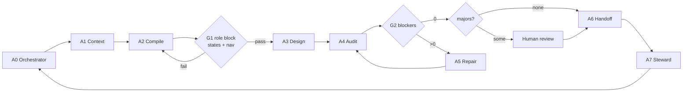

# RetailOps Android — Agent System

**Document ID:** `RO-MOB-AG-000` · **Version:** 1.0.0
**Scope:** how AI agents generate, verify and hand off the 140 screens of the RetailOps Android app.

---

## 1. What this system is

A set of defined agent roles, a shared contract, machine-readable inputs, and an automated
verifier — so that 140 screens produced by an AI come out as **one consistent product**
instead of 140 unrelated mockups.

Four things make it a system rather than a pile of prompts:

| # | Component | File |
|---|---|---|
| 1 | **Roles** — who each agent is, what it may decide, what it must refuse | `00-agent-system.md` (this file), `04-role-definitions.md` |
| 2 | **Contract** — the invariants every screen must satisfy | `02-consistency-contract.md` |
| 3 | **Machine-readable inputs** — the registry every agent reads instead of guessing | `registry/screens.json`, `registry/roles.json` |
| 4 | **Enforcement** — an automated verifier that blocks non-compliant output | `tools/validate-screen.mjs`, `tools/build-registry.mjs` |

**Non-negotiable rule:** no agent may state a fact about a screen that is not in
`registry/screens.json`, and no screen is accepted until `validate-screen.mjs` reports
**zero blockers**.

---

## 2. Agent roles

Every agent has one job and a defined hand-off. Roles are deliberately narrow: a generator
that also grades its own work is not a system.

| ID | Agent | Owns | May decide | Must refuse |
|---|---|---|---|---|
| **A0** | `Orchestrator` | Sequencing, `state/progress.json`, wave budget | Which screen is next; when to stop a wave | Skipping the audit gate |
| **A1** | `ContextAgent` | The per-screen context bundle | How to summarise inputs | Inventing a permission, role or endpoint |
| **A2** | `PromptCompiler` | Final prompt assembly | Wording of non-contract text | Changing the role block, states or nav shape |
| **A3** | `ScreenDesigner` | The generated screen | Layout, hierarchy, density within the contract | Using a colour, term or nav item outside the contract |
| **A4** | `ConsistencyAuditor` | Verification | Blocking acceptance; severity assignment | Passing output with a blocker |
| **A5** | `RepairAgent` | Minimal fixes to a failed screen | Small visual/copy corrections | Redesigning an accepted screen |
| **A6** | `HandoffAgent` | Export, naming, Figma reconciliation | Layer naming, ordering | Renaming a screen ID |
| **A7** | `SchemaSteward` | Tokens, schema, contract | Adding a token or rule | Silently diverging docs from tokens |

### A0 · Orchestrator

Drives the wave plan in `07-stitch-setup-and-workflow.md` §5. Maintains
`agents/state/progress.json` (one record per screen). Never edits design artifacts.
Stops a wave when the generation budget threshold is hit and reports the shortfall.

### A1 · ContextAgent

Assembles, for exactly one screen ID:

```
{
  "screen":      registry.screens[<id>],
  "roleHeader":  registry.screens[<id>].roleHeader,
  "surface":     roles.surfaces[<surface>],
  "navItems":    roles.surfaces[<surface>].navItems,
  "glossary":    roles.glossary,            // forbidden terms for the seller surface
  "tokens":      selected token groups,     // colour, type, shape, spacing
  "components":  the components this screen must use
}
```

Refuses if the screen ID is absent from the registry, or if the surface is `seller` and the
`seller_client` role is still marked `proposed` (see `registry/roles.json`).

### A2 · PromptCompiler

Produces the final prompt by concatenating:

1. the **role block** (`registry.screens[<id>].roleHeader`) — locked, never rewritten;
2. the **screen body** from `08`–`11`;
3. the **surface addendum** from `03-prompt-template.md` (nav shape, language register,
   negative constraints).

Output is deterministic: same registry + same body ⇒ byte-identical prompt.

### A3 · ScreenDesigner

The generation role. Its full definition is the paste-ready
`01-master-system-prompt.md`. Works on one screen at a time. Does not know about the
other 139 screens except through the role block and `DESIGN.md`.

### A4 · ConsistencyAuditor

Runs `tools/validate-screen.mjs` in both modes (prompt, artifact). Assigns severity.
A single blocker stops the pipeline. Majors go to human review. Minors are recorded and
batched into a polish pass.

The auditor is the **only** agent permitted to accept a screen.

### A5 · RepairAgent

Fixes only what the auditor reported, using the shortest change that clears the finding.
Never regenerates a screen from scratch, because regeneration loses accepted decisions and
costs budget. If three repair attempts fail, it escalates to a human with the violation log.

### A6 · HandoffAgent

Names each artifact `<ID> <Screen name>`, exports to Figma, participates in the
component-name reconciliation described in `04-component-library.md` §7, and writes the
analytics event names into the screen record.

### A7 · SchemaSteward

The only agent allowed to change `02-design-tokens.json`, `02-consistency-contract.md`, or
`registry/roles.json`. When a screen genuinely needs a new value, it adds the token first,
then re-runs `build-registry.mjs --write-prompts`, then allows the screen to proceed.
This is what prevents 140 one-off values from accumulating.

---

## 3. Pipeline



### Gates

| Gate | Condition | Enforced by |
|---|---|---|
| **G1** | Prompt carries a role block, required states, and the correct surface nav shape | `validate-screen.mjs --file <prompt>.md` |
| **G2** | Zero blockers on the generated artifact | `validate-screen.mjs --file <artifact> --surface <s>` |
| **G3** | No unreviewed majors | Human |
| **G4** | Registry and docs updated together if anything changed | `build-registry.mjs --check` |

### Per-screen state machine

```
planned → prompted → generated → audited → repaired* → accepted → exported → reconciled
```

`progress.json` records the state plus the last audit result. A screen may not skip
`audited`. `repaired` may repeat; three repeats escalate.

---

## 4. Machine-readable inputs

### `registry/screens.json`

```jsonc
{
  "id": "INT-CT-01",
  "name": "ASIN Manager list",
  "surface": "internal",
  "group": "INT-CT",
  "critical": true,
  "roleKeys": ["admin", "operational_manager", "Brand Manager", "..."],
  "permission": "asinmanager_view",
  "scope": "all/assigned",
  "states": ["empty-true", "empty-filtered", "selection-bulk", "offline-cached", "stale-partial"],
  "kind": null,
  "promptFile": "08-stitch-prompts-auth-home-catalog.md",
  "hasPrompt": true,
  "roleHeader": "Role: internal RetailOps staff — ...\nRequired states: ..."
}
```

### `registry/roles.json`

Authoritative role context: surfaces, accents, nav items, language registers, the role
list with scope and level, the pseudo-role expansions (`Σ-int` etc.), and the
seller-language glossary. Agents read this; they never hard-code a role.

### `state/progress.json`

One record per screen, mutated by A0:

```jsonc
{ "id": "INT-CT-01", "state": "accepted", "attempts": 2,
  "audit": { "blockers": 0, "majors": 0, "minors": 1 }, "exportedAt": null }
```

---

## 5. Failure modes this system is designed to prevent

| Failure | Cause without a system | Countermeasure |
|---|---|---|
| Nav bars drift across screens | Each prompt describes its own bar | Nav shape is in the role block + G1 check |
| Seller surface leaks internal jargon | Model mirrors the internal prompts | Forbidden-term list in `roles.json`, enforced by C-20 |
| 140 slightly different blues | Colour restated per prompt | Palette check C-12 against the token file |
| A screen arrives with no states | States forgotten under time pressure | C-02 + the canonical state vocabulary |
| Wrong currency formatting | Model defaults to US grouping | C-13, blocking |
| Silent scope leak on the seller side | Permission model lives only in the backend | C-21 + A1 refusal when the role is `proposed` |
| Prompt and spec drift apart | Two sources of truth | Registry compiled from both, `--check` in CI |
| Budget burned on regeneration | Fixing by starting over | RepairAgent is restricted to minimal edits |

---

## 6. Running the system

```bash
cd docs/design/mobile

# 1. Compile the registry from the inventory + prompts and stamp role headers
node agents/tools/build-registry.mjs --write-prompts

# 2. Verify the registry is in sync (CI gate)
node agents/tools/build-registry.mjs --check

# 3. Audit a prompt before using it
node agents/tools/validate-screen.mjs --file 09-stitch-prompts-growth-ops.md

# 4. Audit a generated screen (Stitch HTML export)
node agents/tools/validate-screen.mjs --file ./artifacts/INT-CT-01.html --surface internal

# 5. Machine-readable audit output for an orchestrator
node agents/tools/validate-screen.mjs --file ./artifacts/INT-CT-01.html --json
```

Current status: **141 prompts, 0 blockers, 0 majors, 0 minors, 0 registry findings.**

---

## 7. Definition of done (per screen)

A screen is accepted only when **all** of these hold:

- [ ] `validate-screen.mjs` reports zero blockers on the prompt **and** the artifact
- [ ] Role block matches `registry/screens.json`, unmodified
- [ ] Every required state in the registry is either drawn or explicitly delegated to the
      state-variant templates in `07-stitch-setup-and-workflow.md` §6
- [ ] Seller-surface screens pass the glossary check with no exceptions
- [ ] Screen is named `<ID> <Name>` in Stitch and in Figma
- [ ] `progress.json` state is `accepted`
- [ ] If anything changed in the token file or the contract, the change is in the same PR

---

## 8. Escalation to a human

Agents must stop and ask when:

1. A screen needs a value, component or term that is not in the token file or the contract
   (→ A7 proposes the addition, a human approves).
2. Three repair attempts fail on the same screen.
3. A screen's permission implies access the role does not hold — for example an
   `admin`-only action appearing on a Brand Manager screen. That is a **product** decision,
   not a design fix; the blocker report in `05-role-ui-matrix.md` §4 is the reference.
4. The seller surface is requested before `seller_client` exists in the backend.
