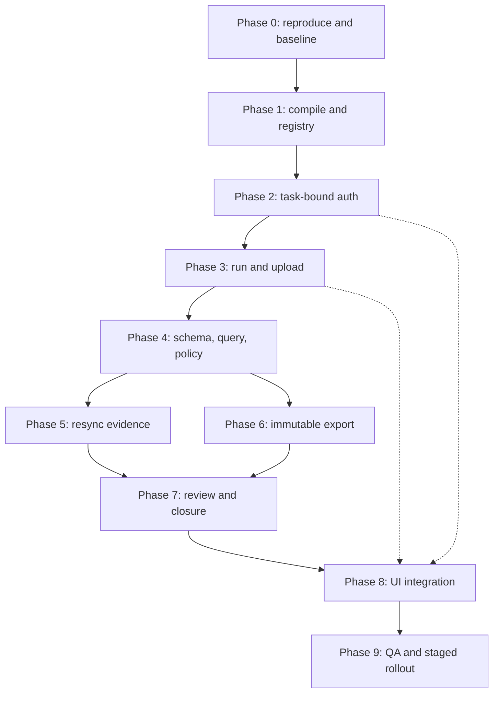

# OOS-RECON-001 Remediation Plan

**Document type:** Engineering remediation plan and release-gate record 
**Audit date:** 2026-10-27 (Asia/Kolkata) 
**Repository:** `Brandcentral-Pvt/RetailOps` (private) 
**Verified `main` HEAD:** `316729a4dad3b8758135a44a62553c46620a0134` 
**Prior audit baseline:** `883d39869bd69d259ed78354d01a78fd02075fa2` 
**Document status:** Proposed - not approved for execution 
**Template state at audit:** `OOS-RECON-001` inactive, `AutoAssign` disabled 
**Existing production task:** `DLY-004` remains active and must not be modified or overwritten 
**Release decision:** **NOT READY** for activation or deployment

**Execution backlog:** [`OOS_RECON_001_TASK_BACKLOG.md`](./OOS_RECON_001_TASK_BACKLOG.md) 
**Import file:** [`oos-recon-001-tasks.csv`](./oos-recon-001-tasks.csv)

---

## 1. Purpose and scope

This document converts the 27 October 2026 OOS-RECON-001 audit into an executable,
reviewable remediation plan. It is deliberately a plan only. It does not change
application code, database schema, workflows, or deployment state.

In scope:

- OOS-RECON-001 task view, shell, registry, and task-bound APIs.
- OOS run creation, source upload, reconciliation, affected-ASIN grid, resync,
  export, incident handling, submission, and review.
- The schema and read models required by those flows.
- Authorization, tenant/seller scoping, and private-file handling.
- Automated tests, staging validation, rollout, and rollback.
- Preservation of the existing generic task drawer and DLY-004.

Out of scope:

- Activation of OOS-RECON-001 in production.
- Changes to DLY-004, its assignments, its template, or its live data.
- Unrelated modules (Live Sync, Keepa, marketplace scrapers, PEMS in general)
  except where an OOS contract depends on them.
- Production data correction. Any backfill must be separately approved and
  rehearsed on a restored copy.

---

## 2. Audit method, evidence, and limitations

The source audit was read-only. It reviewed GitHub source and GitHub Actions
check metadata. It did not execute production queries, migrations, a running
server, Jest, Playwright, or a staging deployment.

Additional verification performed while writing this plan:

| Check | Result |
|---|---|
| `main` HEAD | `316729a`, working tree clean at time of plan creation |
| `npm run build` | Passes, but `SharedTaskShell.jsx` and `OosTaskView.jsx` are not imported by any reachable module, so their defects are not compiled |
| Shell imports | No file imports `SharedTaskShell`; `views/oos/index.js` is only imported by itself |
| `SharedTaskShell` exports | Two `export default` statements (lines 102 and 289) |
| `SharedTaskShell` API import | `../../services/tasksApi`, which resolves outside `src/modules/tasks`; canonical file is `src/modules/tasks/services/tasksApi.js` |
| Upload middleware | `taskViewRoutes.js` uses `multer.diskStorage` |
| Upload controller | `taskViewController.js` hashes and parses `file.buffer` |
| Upload service | `oosUploadService.js` requires `fileBuffer`; controller passes `rows` and `fileHash` and omits `fileBuffer` |
| Monitoring export | `oosMonitoringService.js` exports `createOrGetRun`, `getRun`, `listRuns`, `updateRunStatus`, `buildManifest`, `loadSeller`; it does not export `getRunBySellerAndDate` |
| Resync | `verifyResync()` queries `Marketplace = @channel` without binding `@channel`, then calls `classifyPostSync(postSyncObs.recordset[0])` although `postSyncObs` is already the row |
| Export | `buildExport()` passes a `taskInstanceId` parameter but does not insert it; `ContentJson` stores sheet names and row counts, not the sheet rows |
| Download | `downloadExport()` passes `exportId` to `buildWorkbook()`, which expects a `runId` |
| UI compile hazards | `OosAffectedAsinsGrid.jsx` contains `{80%}`; `OosTaskView.jsx` imports `Text` from `antd` (available as `Typography.Text`) |
| GitHub CLI | `gh` is not installed on the planning workstation, so failed run logs could not be retrieved locally |

Limitations that must be closed in Phase 0:

- The exact cause of failed GitHub Actions run `40304737266` is not recorded in
  this document.
- Live database state, template activation, assignments, and DLY-004 status were
  not independently verified.
- Several findings are source-level only and require runtime reproduction.
- Production credentials, seller data, and provider APIs were not used.

Evidence labels used below:

- **Verified:** confirmed in the local checkout on 2026-10-27.
- **Audit-reported:** asserted by the source audit; reproduce before fixing.
- **Decision required:** product, security, or operations must choose.

---

## 3. Decision and non-negotiable guardrails

1. Do not activate OOS-RECON-001.
2. Do not switch `TaskInstancesPage.jsx` or `MyDayPage.jsx` from `TaskWorkspace`
   to `SharedTaskShell` until the shell compiles when imported and all generic
   task regressions pass.
3. Do not deactivate, overwrite, migrate, or reseed DLY-004.
4. Do not run destructive schema changes on production. Every migration requires
   a restore-verified backup, a rollback script, and staging evidence.
5. Do not expose original seller reports through static `/uploads`. Uploads must
   be private and downloaded only through an authorized endpoint.
6. Do not trust client-supplied reviewer identity, observation time, stock state,
   export identity, sort keys, pagination, seller, channel, or task binding.
7. Do not make live marketplace/provider calls without explicit authorization and
   rate-budget approval.
8. Keep all work on a feature branch. `main` remains the integration baseline and
   is not the place for partial OOS cutover.
9. Every phase exit requires written evidence: test output, screenshots, SQL
   results, or a signed check in this document.
10. If a gate cannot be met, stop and re-plan. Do not "temporarily" bypass a gate.

---

## 4. Finding register

Severity is taken from the audit. Phase references point to Section 5. Gate
references point to Section 7.

### 4.1 P0 findings

| ID | Phase | Gate | Finding | Required repair | Exit evidence |
|---|---|---|---|---|---|
| TV-01 | 8 | G7 | `TaskInstancesPage.jsx` and `MyDayPage.jsx` still import `TaskWorkspace`; the specialized shell is not user-visible. | Mount the view resolver only after the shell is stable. Preserve generic tasks and add a rollback switch. | Task list opens OOS from a real instance; DLY-004 still opens the generic drawer. |
| TV-02 | 1 | G1 | `SharedTaskShell.jsx` imports a nonexistent API module, has duplicate default exports, undeclared symbols (`setTransModal`, `VALID_TRANSITIONS`, `calculateHealth`), and conditional hook-order risk. | Repair imports, remove duplicate exports, define or remove undefined symbols, move all hooks above conditional returns, add lint/typecheck and an import smoke test. | File parses when imported; lint has zero hook/import/export errors; shell renders in isolation. |
| TV-03 | 1 | G1 | `OosTaskView.jsx` and child components import nonexistent contexts/API paths and use `Text` from `antd`. | Correct module paths, use `Typography.Text`, verify every child import, add a rendering test. | OOS view renders in a test harness with mocked API. |
| TV-04 | 1 | G1 | `OosAffectedAsinsGrid.jsx` contains invalid `{80%}` JSX, ignores the passed group, and has repeated default exports. | Render the server group (`80%`, `20%`, `GMS_UNVERIFIED`) exactly; show `New ASIN` only when `isNewAsin`; remove duplicate exports. | Snapshot/unit tests for all three groups and the new-ASIN badge. |
| TV-05 | 1 | G1 | The OOS registration side effect is never imported by the active path, and the API view-definition shape differs from `resolveViewForTask` expectations. | Explicitly import/register the view at boot, validate and normalize the definition JSON, pin it to the instance snapshot, reject unknown view keys. | Registry contains `OOS_RECON_V1` after boot; malformed definition falls back safely. |
| UP-01 | 3 | G3 | Multer uses disk storage, but the controller requires `file.buffer`. | Use bounded memory storage or a private staging read that returns the original bytes; validate extension, MIME, magic bytes, and size. | Upload test receives exact bytes; invalid type/size rejected with a safe error. |
| UP-02 | 3 | G3 | Controller and service disagree on `rows`, `fileHash`, `filePath`, `rows`, and `createdBy`; service references undefined symbols. | Define one canonical upload contract; persist accurate revision, row counts, hash, size, content type, and storage path; parse once on the server. | Service unit test plus DB assertion for hash, size, revision, counts, path. |
| RUN-01 | 3 | G3 | Controller calls a nonexistent `getRunBySellerAndDate`. | Use an exported, transaction-safe idempotent lookup/create; add a scoped uniqueness constraint and retry on duplicate key. | Two concurrent creates produce one run; seven sellers produce seven scoped runs. |
| RUN-02 | 2 | G2 | Most OOS endpoints check seller membership only, not the requested run/case/export binding to the task instance; brandless multi-brand tasks do not enforce assignment/reviewer rights. | Add canonical task-access middleware and verify `OosTaskBindings` on every read/write. Enforce task assignment, seller scope, brand scope, and reviewer role. | Cross-task, cross-seller, cross-tenant, and unassigned-user tests return 403/404 without data leakage. |
| AS-01 | 4 | G4 | `getAffectedAsins` selects `PriorityGroup`, `IsNewAsin`, `Sku`, `FirstSeenAt`, `GmsVerified`, `Gms`, `GmsSharePct`, `CumulativePct`, `RetailOpsState`, and similar columns that do not exist in migrations 032-034. | Add a reconciled schema/read model and persist every displayed field. Backfill only from trustworthy evidence; leave unknowns null. | Query runs on a fresh database; API returns all columns from persisted data. |
| AS-02 | 4 | G4 | Client `sortBy` is interpolated into `ORDER BY`; `@offset`/`@limit` are not bound; page/pageSize are unvalidated. | Allowlist sort keys and direction; parse and clamp positive integers; bind `@offset` and `@limit`; add injection tests. | Malformed sort/page inputs rejected or safely defaulted; SQL tests pass. |
| SY-01 | 5 | G5 | Resync dispatch verifies freshness against `new Date()` taken after the sync, and the manual verifier has an unbound `@channel` plus a wrong row access. | Persist the pre-dispatch request timestamp; bind channel; verify a scoped provider observation newer than that timestamp; fail closed on unknown/timeout. | Older observation never resolves an incident; fresh in-stock observation resolves exactly once. |
| EX-01 | 6 | G5 | Export computes a real XLSX buffer but stores only names/counts; rebuild yields placeholder rows. Version query does not await the pool; download passes an export ID to a run-ID function. | Persist immutable bytes or complete serialized rows plus a hash; query by authorized export ID and task binding; verify hash on download. | Downloaded SHA-256 equals stored hash; four sheets contain the exact authorized rows. |
| RV-01 | 7 | G6 | Submission passes `reviewerId: null` to `checkSubmission`, which requires a reviewer, so the path cannot pass. | Separate "named reviewer assigned" from "reviewer authenticated decision"; integrate the PEMS review queue; gate daily closure on approval. | Submission succeeds with an assigned reviewer; closure blocks until an independent approval. |
| QA-01 | 9 | G8 | The former Playwright OOS test is absent; the remaining drawer spec tests only the generic drawer; backend unit tests do not prove the task-bound routes or download paths. | Add unit, integration, and E2E coverage for the full scenario matrix, including seven sellers, RBAC, failures, export hash, and review. | CI runs the new suites and they fail on a deliberately broken branch. |

### 4.2 P1 findings

| ID | Phase | Gate | Finding | Required repair | Exit evidence |
|---|---|---|---|---|---|
| AS-03 | 4 | G4 | `getInstanceAsins` returns synthetic RetailOps-only rows for OOS-RECON-001; synthetic IDs are not persisted and generic Resolve/Waive cannot operate on them. | Read from OOS decisions/incidents for the specialized view; keep DLY-004 on generic PEMS ASINs; reject synthetic IDs in generic endpoints. | OOS rows survive reload and are actionable; DLY-004 behavior unchanged. |
| PR-01 | 4 | G4 | Pareto computation is basic; the New ASIN always-20% rule is not persisted; results are not attached to decisions; SOP still says "Tier 1". | Implement the documented policy as a pure, versioned function; persist group, new override, denominator, GMS window/source/version; remove "Tier" terminology. | Boundary and policy tests pass; persisted classification matches the approved rule. |
| RB-01 | 2 | G2 | Routine OOS uploads and reconciliation require `tasks_manage`, an administrator-level capability. | Authorize the assigned executor plus scoped seller/task binding; reserve template/policy management and scraping for specialist roles. | Executor can reconcile own task; unrelated manager/executor cannot. |
| UX-01 | 8 | G7 | Nested Data Sources/Affected ASINs tabs exist, but Queue Resync, CSV, and XLSX still report "not implemented"; `canManage` logic and imports are broken. | Wire all actions to the authorized APIs, use server pagination and exact groups, and add loading/error/empty states. | Buttons perform the real action; no placeholder text remains. |
| UX-02 | 3, 8 | G3, G7 | Source uploader exposes upload/reupload/download actions, but several are placeholders and imports are broken. | Build revision history, original download via an authorized endpoint, validation feedback, and retry. | Upload, re-upload, and download complete end to end with audit rows. |

---

## 5. Work breakdown

Granular, dependency-ordered tickets are in
[`OOS_RECON_001_TASK_BACKLOG.md`](./OOS_RECON_001_TASK_BACKLOG.md). This section
defines phase outcomes and gates; the backlog defines individual tasks.

Each phase has a single exit gate. Phase estimates in Section 13 are the sum of
the task estimates in the backlog; they include implementation, tests and
evidence. Re-estimate after Phase 0.

### Phase 0 - Reproduce, baseline, and protect

**Goal:** Establish a trustworthy baseline before changing code.

Tasks:

| # | Task | Output |
|---|---|---|
| 0.1 | Capture failed Actions run `40304737266` logs (pre-deploy, deploy, rollback jobs) into a private evidence file. | Exact failing command and error |
| 0.2 | Create a feature branch from the verified `main` commit. Recommended: `feat/oos-recon-001-remediation`. | Branch SHA |
| 0.3 | Add a temporary import smoke test that imports the shell, OOS view, and registry so hidden compile defects surface. | Failing test output |
| 0.4 | Run frontend lint, typecheck (if configured), unit tests, and build. Record every failure. | Baseline report |
| 0.5 | Run backend lint/tests and a migration dry run against a disposable database. | Baseline report |
| 0.6 | Restore a production backup into an isolated database; verify row counts for OOS tables and DLY-004. | Restore evidence |
| 0.7 | Confirm template activation state, assignments, and that DLY-004 is intact in the restored copy. | Read-only SQL evidence |
| 0.8 | Freeze OOS template/seed edits and live provider calls until the plan is approved. | Written freeze notice |

Exit criteria:

- The CI failure is explained by a specific command and error.
- The hidden frontend defects are reproduced by an import test.
- A restorable backup exists and has been restored once.
- DLY-004 is confirmed present and unchanged in the restored copy.
- No application behavior has changed.

Estimate: S.

### Phase 1 - Make the specialized UI compile and register

**Goal:** The shell, OOS view, registry, and child components are structurally
valid before any cutover.

Tasks:

| # | Task | Files / notes |
|---|---|---|
| 1.1 | Remove the duplicate default export and repair imports in `SharedTaskShell.jsx`. | `src/modules/tasks/components/SharedTaskShell.jsx` |
| 1.2 | Define or remove `setTransModal`, `VALID_TRANSITIONS`, and `calculateHealth`; replace with explicit state/constants/helpers. | Same |
| 1.3 | Move every hook above conditional returns; enforce `react-hooks/rules-of-hooks`. | Same, plus lint config if needed |
| 1.4 | Correct the API import to the canonical `src/modules/tasks/services/tasksApi.js`. | Same and `OosTaskView.jsx` |
| 1.5 | Replace `Text` from `antd` with `Typography.Text`; verify all antd imports against the installed version (including `Tabs.TabPane`, which may not exist in the installed major). | `OosTaskView.jsx`, child components |
| 1.6 | Fix all context/API imports in OOS child components and add a module-resolution test. | `src/modules/tasks/views/oos/**` |
| 1.7 | Fix `{80%}` and group rendering; use the server-provided `priorityGroup`; show `New ASIN` only when true; remove duplicate exports. | `OosAffectedAsinsGrid.jsx` |
| 1.8 | Import the OOS registration module from the application boot path, not via an unreachable side effect. | `src/modules/tasks/views/oos/index.js`, app bootstrap |
| 1.9 | Normalize and validate the view definition: `viewKey`, `version`, `tabs`, `widgets`; reject unknown keys; fall back to `STANDARD_V1` with a visible warning. | `taskViewRegistry.js`, adapter |
| 1.10 | Pin the resolved definition to the instance snapshot; do not accept arbitrary remote code or unvalidated JSON. | Registry, backend view service |
| 1.11 | Add an error boundary and a safe empty/loading state around the shell. | Shell |
| 1.12 | Add unit tests: renders generic fallback, renders OOS, invalid definition falls back, duplicate registration fails safely. | Frontend tests |

Exit criteria:

- Importing the shell/OOS view is part of the test suite and passes.
- Lint reports zero `rules-of-hooks`, import, or duplicate-export errors in the
  touched files.
- The OOS view renders with mocked data.
- Registry resolves `OOS_RECON_V1` only after explicit registration.
- Generic fallback still renders.

Estimate: M.

### Phase 2 - Enforce task-bound authorization

**Goal:** Every OOS read/write is scoped to the task instance, seller, brand, and
authorized actor.

Tasks:

| # | Task | Notes |
|---|---|---|
| 2.1 | Inventory every route in `taskViewRoutes.js` and classify read/write/review. | 18 routes currently |
| 2.2 | Add/reuse canonical middleware: `requireTaskView` for reads, `requireTaskAccess` (or equivalent) for writes, plus reviewer capability. | Do not duplicate ad hoc checks |
| 2.3 | For every run/case/import/export/incident route, verify `OosTaskBindings` matches `:id`, `:runId`, `:sellerId`, and `:caseId`/`:exportId`. | Join by `TaskInstanceId`, `OosRunId`, `SellerId`, `Channel` |
| 2.4 | Enforce seller scope and brand scope for brandless multi-brand tasks. | Reuse existing brand/seller scope helpers where correct |
| 2.5 | Separate executor permission from administrator permission. Routine upload/reconcile must not require `tasks_manage`. | Introduce a capability map; migrate seeds if new permissions are added |
| 2.6 | Ensure missing/foreign resources return a non-enumerating 404 or 403 consistently. | Document the contract |
| 2.7 | Add audit events for binding creation, rebinding, export, submit, approve, waive, and resync. | Actor, task, seller, run, case, timestamp |
| 2.8 | Negative tests: cross-task, cross-seller, cross-tenant, unassigned executor, reviewer without assignment, brandless multi-brand. | Integration tests |

Exit criteria:

- A user assigned to task A cannot read or mutate task B's run, case, export, or
  incident even with a valid seller ID.
- A user assigned to seller 1 cannot use a run ID for seller 2.
- Routine executor actions no longer require `tasks_manage`.
- Every OOS route has an explicit authorization test.

Estimate: M.

### Phase 3 - Repair run creation and source uploads

**Goal:** One canonical, idempotent run and upload contract with immutable
originals and accurate metadata.

Tasks:

| # | Task | Notes |
|---|---|---|
| 3.1 | Replace `getRunBySellerAndDate` with an exported idempotent `createOrGetRun` call inside a transaction. | Or add a correctly scoped exported lookup |
| 3.2 | Scope run uniqueness by task, seller, and date. Replace `UX_OosRuns_Date_Seller` with task-aware filtered unique indexes; backfill `TaskInstanceId` first. | Migration required; do not drop the old index before backfill |
| 3.3 | Choose one upload transport: bounded `memoryStorage` (recommended for 20-50 MB) or private staged file plus explicit `fs.readFile`. | Never rely on `file.buffer` with disk storage |
| 3.4 | Lower the limit if business agrees; validate extension, MIME, magic bytes, worksheet count, row count, and cell sizes. | Reject CSV/XLS/XLSX spoofing |
| 3.5 | Define the canonical service contract: `runId`, `sellerId`, `channel`, `sourceType`, `fileName`, `contentType`, `fileBuffer`, `uploadedBy`, `parentImportId`, `mapping`. | Remove `rows`/`fileHash`/`filePath` ambiguity |
| 3.6 | Persist hash, size, content type, storage path, parser version, revision, parent import, accepted/rejected counts, and validation JSON in one transaction. | `OosImports` already has most columns |
| 3.7 | Store originals in private storage outside any static directory; serve only through an authorized download endpoint. | Remove reliance on `/uploads` static serving |
| 3.8 | Add re-upload revision semantics and idempotency: same hash/source does not duplicate; a changed file creates a new revision and rebuilds derived observations. | Do not overwrite history |
| 3.9 | Map validation failures to user-safe errors with row/column references. | No stack traces or internal paths |
| 3.10 | Wire the uploader UI: upload, re-upload, list revisions, download original, retry. | UX-02 |
| 3.11 | Tests: valid CSV/XLSX, wrong type, oversized, empty, duplicate, re-upload, malformed rows, path traversal filename, seven sellers. | Unit + integration |

Exit criteria:

- Concurrent creates for one task/seller/date produce exactly one run.
- Stored hash equals the SHA-256 of the exact received bytes.
- Original download requires authorization and returns the same bytes.
- Re-upload creates a revision and preserves the original.
- No static URL exposes a seller report.

Estimate: M.

### Phase 4 - Reconcile ASIN schema, query, and 80/20 policy

**Goal:** The affected-ASIN grid reads only persisted, authorized, correctly
classified data.

Tasks:

| # | Task | Notes |
|---|---|---|
| 4.1 | Approve the data model: extend `OosDecisions` or add `OosDecisionMetrics` plus a read view. | Recommendation: metrics table plus `vw_OosAffectedAsins` to keep decision history stable |
| 4.2 | Add fields required by the API: SKU, priority group, new-ASIN flag, first seen, GMS verified, GMS value, GMS share, cumulative share, channel states, classification version. | Exact names and types in Section 9 |
| 4.3 | Enforce allowed priority values (`80%`, `20%`, `GMS_UNVERIFIED`) and a single source of truth for labels. | Avoid free-text drift |
| 4.4 | Implement the policy as a pure, versioned function with explicit inputs: eligible seller catalog, GMS window/source, first-seen rule, exclusions. | Unit-testable without a database |
| 4.5 | Enforce: New ASINs always 20% and flagged; eligible existing high-GMS ASINs form the 80% cohort; remaining verified existing ASINs are 20%; missing-GMS existing ASINs are `GMS_UNVERIFIED`. | Per approved business policy |
| 4.6 | Persist denominator, GMS window, source, classification version, and computed-at timestamp. | Enables reproducibility |
| 4.7 | Backfill only from trustworthy evidence; leave unknown GMS/stock as null, never zero. | No fabricated metrics |
| 4.8 | Replace synthetic rows in `getInstanceAsins` for OOS-RECON-001 with decisions/incidents; keep DLY-004 generic. | AS-03 |
| 4.9 | Allowlist sort keys and directions; parse/clamp `page` and `pageSize`; bind `@offset`/`@limit`. | AS-02 |
| 4.10 | Add `Sku`, `FirstSeenAt`, and GMS filters with indexes that match the query predicates. | Review execution plans |
| 4.11 | Remove "Tier 1" from the OOS SOP; align terminology with `80%`, `20%`, `GMS_UNVERIFIED`. | Product documentation |
| 4.12 | Tests: zero/positive/null/stale GMS, new-only catalog, ties, boundary at 80%, seven sellers, pagination, injection strings, unknown stock. | Unit + integration |

Exit criteria:

- A fresh database migrates and the affected-ASIN query succeeds.
- Every returned field is persisted or deterministically derived and stamped
  with a classification version.
- Sorting and paging cannot alter SQL structure.
- New ASIN is always 20% with an explicit flag.
- Missing GMS is never silently treated as zero.

Estimate: L.

### Phase 5 - Make resync evidence-based

**Goal:** A candidate resolves only after a real, fresh, scoped provider
observation, never because time passed or a client said so.

Tasks:

| # | Task | Notes |
|---|---|---|
| 5.1 | Persist `RequestedAt` in UTC before dispatch; keep dispatch time and completion time separate. | Existing `CreatedAt` may serve if semantics are fixed |
| 5.2 | Dispatch through the existing rate-gated live-sync service; record provider request/job identifiers and attempts. | No direct unscoped provider calls |
| 5.3 | Fix `verifyResync`: bind `@channel`; use the row object directly; scope seller, channel, ASIN, and marketplace. | Verified defects |
| 5.4 | Require observation timestamp strictly newer than the persisted request timestamp. | Reject stale/equal timestamps |
| 5.5 | Classify status from the persisted provider observation; treat unknown, failed, timed out, or missing as unresolved. | Fail closed |
| 5.6 | Resolve incidents exactly once, with an idempotency key and an incident event. | No duplicate resolution |
| 5.7 | Add retry/backoff and a terminal timeout state; expose status to the UI. | `QUEUED`, `RUNNING`, `VERIFIED_RECOVERED`, `OPEN_DISCREPANCY`, `FAILED`, `BLOCKED`, `TIMEOUT` |
| 5.8 | Tests: pre-existing fresh observation, stale observation, equal timestamp, unbound channel regression, provider failure, timeout, duplicate verify. | Integration with mocked provider |

Exit criteria:

- A genuinely older observation cannot resolve an incident.
- A fresh in-stock observation resolves it once and only once.
- Provider failure leaves the incident open and records the reason.
- The manual verify path and the background path use the same verifier.

Estimate: M.

### Phase 6 - Make exports immutable and download-correct

**Goal:** The exported workbook is the exact authorized result set, reproducible
by hash.

Tasks:

| # | Task | Notes |
|---|---|---|
| 6.1 | Define the four sheet names as constants: `01 Active OOS`, `02 Discrepancies`, `03 Resync Resolved`, `04 Summary & Sources`. | Already present in code; move to one module |
| 6.2 | Persist either immutable XLSX bytes or complete serialized rows. Recommendation: bytes in private storage plus `FileName`, `FileSize`, `StoragePath`; reuse the existing `FileHash` as the content hash and keep row-count metadata. | `OosExports.ContentJson` alone is insufficient |
| 6.3 | Add `TaskInstanceId` to the insert and validate the export's task/run/seller binding. | Currently supplied but not inserted |
| 6.4 | `await getPool()` before querying the next version. | Version race |
| 6.5 | Fix download to look up by authorized `exportId`, not `runId`; stream the stored bytes; verify the stored hash before sending. | EX-01 |
| 6.6 | Sanitize CSV/XLSX cells against formula injection; cap cell length; escape sheet names. | Security |
| 6.7 | Add export audit: actor, task, run, filters, row counts, hash, version, created at. | Traceability |
| 6.8 | Tests: byte-for-byte download, SHA-256 equality, four sheet names, row counts, filters, unauthorized export ID, cross-task download, empty result set. | Unit + integration + E2E |

Exit criteria:

- Re-downloading an export returns the identical bytes and hash.
- The workbook contains the exact authorized rows, not placeholders.
- Cross-task/export-ID substitution is rejected.
- CSV cells beginning with `=`, `+`, `-`, or `@` are neutralized.

Estimate: M.

### Phase 7 - Repair submission, review, and closure gates

**Goal:** An employee cannot self-approve; a task cannot close with an
unowned/unresolved incident or missing evidence.

Tasks:

| # | Task | Notes |
|---|---|---|
| 7.1 | Split the model: `reviewerAssigned` (submission prerequisite) vs `reviewerDecision` (authenticated approval). | RV-01 |
| 7.2 | Allow submission when a named, independent reviewer is assigned; do not require the reviewer's decision at that moment. | Check policy semantics |
| 7.3 | Record the reviewer decision with actor ID, timestamp, decision, reasons, and checklist snapshot. | `OosSubmissionReviews` extension |
| 7.4 | Enforce independence: submitter cannot approve; reviewer must have the review capability and task/brand scope. | Server-side |
| 7.5 | Integrate the PEMS Review Queue; no parallel approval universe. | Existing reviewer flow |
| 7.6 | Gate daily task closure on approved review plus every incident resolved or explicitly waived by an authorized actor. | Evidence + incident rules |
| 7.7 | Enforce `EvidenceRequired` and completion policy server-side, not only in UI. | Migration 034 fields |
| 7.8 | Persist waiver reason, actor, and expiry; waivers must be visible and auditable. | No silent waivers |
| 7.9 | Tests: no reviewer, self-review, unauthorized reviewer, missing evidence, open incident, unresolved disposition, approval, rejection, waiver, closure. | Integration + E2E |

Exit criteria:

- Submission passes with an assigned independent reviewer.
- Approval requires an authenticated, authorized reviewer who is not the
  submitter.
- Closure is impossible while a required incident or evidence item is open.
- Every state transition is auditable.

Estimate: M.

### Phase 8 - Integrate the specialized view without breaking generic tasks

**Goal:** OOS opens from the real Task Execution Center and My Day, with the
generic drawer preserved as fallback.

Tasks:

| # | Task | Notes |
|---|---|---|
| 8.1 | Wire `TaskInstancesPage.jsx` and `MyDayPage.jsx` through the resolver, behind a feature flag. | Keep `TaskWorkspace` as fallback |
| 8.2 | Mount `SharedTaskShell` with resolved `viewDefinition` and task context. | Do not pass whole unfiltered API payloads |
| 8.3 | Implement OOS tabs: Overview, Data Sources, Affected ASINs, Incidents, Export, Review. | Match approved scope |
| 8.4 | Build the Excel-like affected-ASIN table: server pagination, filters, sticky header, exact 80/20/GMS groups, New ASIN badge, resync status, incident owner. | UX-01 |
| 8.5 | Wire Queue Resync, CSV, XLSX, upload, re-upload, original download, and review actions to real APIs. | Remove all "not implemented" text |
| 8.6 | Add loading, empty, error, permission-denied, and partial-failure states. | No blank screens |
| 8.7 | Verify mobile widths, keyboard navigation, focus, contrast, and table overflow. | Accessibility |
| 8.8 | Preserve DLY-004 and generic tasks; run drawer regression tests for both entry points. | TV-01 |
| 8.9 | Add E2E: Task List -> OOS -> tabs -> upload -> reconcile -> grid -> resync -> export -> submit -> review. | QA-01 |
| 8.10 | Add rollback: feature flag off restores the generic drawer immediately. | Operations |

Exit criteria:

- OOS opens from both entry points with the correct task/seller binding.
- Generic DLY-004 still opens the old drawer and works.
- All visible actions call real endpoints; no placeholders remain.
- Feature flag off is a tested rollback.

Estimate: L.

### Phase 9 - QA, staging, and controlled rollout

**Goal:** Prove the workflow with realistic, adversarial data before activation.

Tasks:

| # | Task | Notes |
|---|---|---|
| 9.1 | Build a seven-seller fixture set: 0, positive, null, stale, and conflicting stock. | Include brandless/multi-brand |
| 9.2 | Run the full test pyramid in CI: lint, unit, integration, E2E, build. | QA-01 |
| 9.3 | Test RBAC/tenant matrix for every role and entry point. | Admin, manager, executor, reviewer, analyst |
| 9.4 | Test upload/reconcile with real-shaped BC/VC reports and malformed inputs. | No production data in lower environments |
| 9.5 | Test resync success, failure, timeout, duplicate, and stale observation. | Mocked provider; then one authorized staging call if approved |
| 9.6 | Verify export hash and four sheets against the DB result set. | Independent recomputation |
| 9.7 | Verify reviewer approval and closure gates end to end. | Independent reviewer |
| 9.8 | Reconcile SOP identity: seed logs must report four phases/13 activities, not six; template remains inactive. | Stale operator output |
| 9.9 | Run a staging soak: seven sellers, repeated uploads, concurrent users, pagination. | Performance and stability |
| 9.10 | Produce rollout plan, rollback plan, owner list, and go/no-go checklist. | Signed |
| 9.11 | Activate only after written go/no-go. Keep the generic fallback available. | Separate change window |

Exit criteria:

- All gates in Section 7 are green with evidence.
- No P0/P1 finding remains open.
- Staging matches production schema and configuration.
- Rollback has been rehearsed.
- Product, engineering, security, and operations sign off.

Estimate: L.

---

## 6. Dependency and critical path

Critical path: `0 -> 1 -> 2 -> 3 -> 4 -> 5/6 -> 7 -> 8 -> 9`.

Parallelizable work:

- Phase 1 frontend repairs and Phase 2 backend authorization inventory can start
  together once Phase 0 is complete.
- Phase 5 resync and Phase 6 export can proceed in parallel after Phase 4.
- Test authoring for Phase 9 starts in Phase 2 and grows with each phase; it is
  not a final-phase activity.

Blocking dependencies:

- Phase 4 cannot complete without the product decisions in Section 12
  (New ASIN definition, GMS source/window, catalog denominator).
- Phase 7 cannot complete without the PEMS review-queue contract.
- Phase 8 cannot start the cutover until Phase 1 compiles and Phase 2 authorizes.
- Phase 9 cannot run without a restored, staging-equivalent database.

---

## 7. Release gates

| Gate | Requirement | Evidence artifact | Status |
|---|---|---|---|
| G0 | Failed CI reproduced; backup restored; DLY-004 confirmed | CI log, restore report, SQL output | Open |
| G1 | Shell/OOS/registry compile when imported; lint clean | CI job, import test, lint report | Open |
| G2 | Cross-task/seller/tenant tests pass; executor rights correct | Integration test report | Open |
| G3 | Idempotent run; exact-byte upload; private original download | Test report, hash assertion | Open |
| G4 | Fresh DB migration; query/paging/sort safe; 80/20 policy tests | Migration log, SQL tests, policy tests | Open |
| G5 | Stale observation rejected; fresh resolves; export hash matches | Integration + E2E evidence | Open |
| G6 | Submission, independent approval, closure gate proven | E2E trace + audit rows | Open |
| G7 | OOS opens from Task List and My Day; DLY-004 unchanged | Screenshots, regression run | Open |
| G8 | Full suite green; seven-seller and failure matrix green | CI run, staging report | Open |
| G9 | Written go/no-go; rollback rehearsed; owners named | Signed checklist | Open |

Rules:

- A gate is either Open or Passed. There is no "mostly passed".
- A skipped test is a failed gate unless the checker records an approved,
  written exception with an expiry date.
- G9 is not automatic after G8. Activation is a separate business decision.

---

## 8. Test and evidence plan

### 8.1 Test layers

| Layer | Scope | Examples |
|---|---|---|
| Unit | Pure policy, parsers, sanitizers, formatting | 80/20 boundary, New ASIN override, unknown stock, formula escaping |
| Integration | Routes + middleware + SQL against a disposable DB | Cross-task access, upload transaction, run idempotency, export lookup |
| Contract | API request/response and DB schema | View definition shape, upload fields, export metadata |
| E2E | Real browser through the active UI | Task List -> OOS -> upload -> reconcile -> grid -> resync -> export -> submit -> review |
| Regression | Generic task drawer and DLY-004 | Open, edit, complete, attachments, review |
| Security | Authz, injection, file handling | ID substitution, SQL injection strings, path traversal, MIME spoofing |
| Performance | Pagination, large uploads, concurrent users | 10k+ decisions, 50 MB upload, seven sellers in parallel |
| Accessibility | Keyboard, focus, contrast, mobile | Table navigation, modal focus trap, 375 px width |

### 8.2 Mandatory scenarios

| # | Scenario | Expected |
|---|---|---|
| T01 | Seven assigned sellers, none outside the task | Each seller sees only its run; no cross-seller rows |
| T02 | Brandless multi-brand task | Access follows assignment/brand scope; no global leak |
| T03 | BRAND_CENTRAL and VENDOR_CENTRAL reports upload | Immutable original, revision, hash, accepted/rejected counts |
| T04 | Malformed/oversized/wrong-type upload | Safe 4xx, no partial import, no file left public |
| T05 | RetailOps + BC + VC merge | Channel-aware decisions with evidence |
| T06 | Stock 0, positive, null, stale, conflicting | Null/stale remains unknown; never treated as 0 |
| T07 | GMS verified, missing, zero, negative | 80/20/GMS_UNVERIFIED exactly per policy |
| T08 | New ASIN | Always 20%, flagged, with first-seen provenance |
| T09 | Grid filter, sort, page | Server-side, allowlisted, bounded, stable ordering |
| T10 | Resync with fresh in-stock observation | Resolves once; incident event recorded |
| T11 | Resync with older/equal observation | Stays open; no false recovery |
| T12 | Resync provider failure/timeout | Stays open; retry/timeout state visible |
| T13 | CSV and four-sheet XLSX export | Exact rows, exact sheet names, stored hash |
| T14 | Download after reload | Byte-identical, hash-verified |
| T15 | Cross-task export ID | 403/404, no data |
| T16 | Submission without reviewer | Blocked with clear reason |
| T17 | Self-review | Blocked |
| T18 | Independent reviewer approval | Allowed; closure gate opens |
| T19 | Open incident at closure | Blocked unless authorized waiver |
| T20 | Evidence required but missing | Blocked server-side |
| T21 | Feature flag off | Generic drawer restores; OOS API unaffected |
| T22 | DLY-004 regression | Unchanged behavior and data |

### 8.3 Evidence retention

- CI logs and test reports: retain with the release record.
- Screenshots/video for E2E: attach to the release ticket, not the repository if
  they contain seller data.
- SQL evidence: redact seller names, ASINs, and tokens; store hashes and counts.
- Export hash evidence: record hash, row counts, and version, not the workbook
  itself unless the environment is non-production.

---

## 9. Data model and migration plan

### 9.1 Proposed migrations 035-039

Allocate migrations sequentially after confirming the runner order. The
repository already contains duplicate `031` migrations; do not reuse numbers.
Each migration must be idempotent, transactional where supported, independently
reviewable, and paired with a rollback script. Do not put unrelated schema
changes in one migration.

| Migration | Scope | Owning task |
|---|---|---|
| `035_oos_task_scoped_runs` | Task-scoped run uniqueness and supporting indexes | OOS-017 |
| `036_oos_decision_metrics` | Decision metrics/read model, GMS and 80/20 fields | OOS-024 |
| `037_oos_resync_metadata` | Request, dispatch, provider and completion metadata | OOS-031 |
| `038_oos_export_storage` | Immutable export storage and task binding | OOS-036 |
| `039_oos_review_waiver` | Reviewer assignment/decision and waiver fields | OOS-040 |

Proposed `OosDecisions`/metrics fields for migration 036 (names subject to schema
review):

| Field | Type | Purpose |
|---|---|---|
| `Sku` | `NVARCHAR(100) NULL` | Seller SKU displayed and searched |
| `PriorityGroup` | `VARCHAR(20) NULL` | `80%`, `20%`, `GMS_UNVERIFIED` |
| `IsNewAsin` | `BIT NOT NULL DEFAULT 0` | New-ASIN override |
| `FirstSeenAt` | `DATETIME2 NULL` | Provenance for new-ASIN decision |
| `GmsVerified` | `BIT NOT NULL DEFAULT 0` | Whether GMS is trustworthy |
| `Gms` | `DECIMAL(18,2) NULL` | GMS value; null is unknown |
| `GmsSharePct` | `DECIMAL(9,4) NULL` | Share of eligible catalog |
| `CumulativePct` | `DECIMAL(9,4) NULL` | Pareto cumulative share |
| `RetailOpsState` | `VARCHAR(40) NULL` | Channel state snapshot |
| `BrandCentralState` | `VARCHAR(40) NULL` | Channel state snapshot |
| `VendorCentralState` | `VARCHAR(40) NULL` | Channel state snapshot |
| `ClassificationVersion` | `VARCHAR(20) NOT NULL` | Reproducibility |
| `ComputedAt` | `DATETIME2 NOT NULL` | When classification ran |

Recommendation: keep immutable decision facts in `OosDecisions` and put
recomputable metrics in `OosDecisionMetrics` (1:1 by `DecisionId`), exposed by
`vw_OosAffectedAsins`. This avoids rewriting decision history when policy
changes. If the team chooses denormalized columns, the same acceptance criteria
apply.

Cross-cutting requirements:

- Migration 035: replace `UX_OosRuns_Date_Seller` with
  `(TaskInstanceId, SellerId, RunDate)` for non-null task bindings and a separate
  filtered index for legacy null bindings. Backfill before dropping the old
  index.
- Migration 037: resync timing/attempt columns if not already present:
  `RequestedAt`, `DispatchAttempt`, `ProviderRequestId`, `CompletedAt`,
  `FailureCode`.
- Migration 038: `OosExports` storage columns `FileName`, `FileSize`,
  `StoragePath` (or `FileBytes` if the team accepts the size), and a non-null
  `TaskInstanceId` after backfill. Reuse the existing `FileHash` for content
  verification.
- Migration 039: reviewer assignment/decision separation and waiver fields.
- Foreign keys or enforced checks for `RunId`, `TaskInstanceId`, `SellerId`, and
  `DecisionId` where the data model allows. OOS tables currently lack FKs; add
  them only after cleaning orphan rows in the restored copy.

### 9.2 Backfill

1. Inventory existing rows and orphan keys in the restored database.
2. Backfill only deterministic fields. Leave unknown GMS, stock, and first-seen
   null; never infer zero.
3. Stamp every backfilled row with `ClassificationVersion = 'backfill-035'` and
   `ComputedAt`.
4. Recompute 80/20 classifications with the approved policy and compare counts
   to the legacy report; investigate every difference.
5. Store before/after counts and a checksum per seller in the migration evidence.

### 9.3 Rollback

- Keep the old columns/indexes until the new path has passed G8.
- Provide a rollback script that removes the new objects and restores the old
  unique index.
- Never delete uploaded originals or export bytes during rollback.
- Rehearse rollback on the restored copy and record duration.

---

## 10. Security and privacy controls

| Control | Requirement |
|---|---|
| Object authorization | Every OOS object access verifies task, seller, brand, and binding; never rely on an ID being unguessable |
| File storage | Private directory/object store outside web root; no static `/uploads`; randomized names; path traversal rejected |
| File validation | Extension + MIME + magic bytes; size limit; worksheet/row/cell caps; parser version recorded |
| Download | Authorized endpoint; `Content-Disposition: attachment`; no inline HTML/SVG; hash header |
| PII | Uploaded reports may contain seller/customer data; restrict access, avoid logs, define retention |
| SQL | Parameterized values; allowlisted identifiers; bounded paging; no raw sort/filter interpolation |
| Export | Formula-injection sanitization; exact authorized scope; audit actor and filters |
| Reviewer identity | Server-derived from the authenticated session; never from the request body |
| Secrets | No provider tokens or connection strings in logs, errors, exports, or documents |
| Rate limits | Upload, resync, export, and review endpoints are rate-limited per user and task |
| Audit | Append-only events for upload, rebind, reconcile, resync, export, submit, approve, waive, close |
| Error handling | No stack traces, file paths, SQL, or cross-tenant existence leaks |

Security acceptance requires a negative-test report, not only a code review.

---

## 11. Operations and observability

Metrics:

- Uploads: count, bytes, duration, accepted/rejected rows, validation failures.
- Runs: created, idempotent hits, duplicate-key retries.
- Reconcile: duration, decisions by category/group, unknown-stock rate.
- Resync: queued/running/succeeded/failed/timeout, age of newest observation,
  provider rate-limit hits.
- Export: count, bytes, hash mismatches, build/download duration.
- Review: submissions, approvals, rejections, blocked closures, waivers.
- Access: 401/403/404 rates by route and role.

Alerts:

- Export hash mismatch or download of a missing object.
- Resync success with an observation timestamp not newer than the request.
- Any OOS route returning data across task/seller binding.
- Upload parser failure rate above threshold.
- Review closure with an open incident (should be impossible; alert if observed).
- Migration failure or non-fatal migration error hidden at startup.

Runbooks required before G9:

- Recover a failed upload/revision.
- Rebuild an export from persisted rows/bytes.
- Re-drive a stuck resync.
- Roll back migration 035.
- Disable the OOS view via feature flag.
- Restore OOS tables from backup.

---

## 12. Open decisions

These decisions block Phase 4 or Phase 7 and must be resolved in writing.

| ID | Decision | Options / notes | Owner | Needed by |
|---|---|---|---|---|
| D1 | New ASIN definition and first-seen source | Launch date, first catalog observation, or provider flag; window and timezone | Product + Data | Before 4.4 |
| D2 | GMS source, window, currency, and denominator | Seller-level GMS, trailing window, eligible catalog scope | Product + Finance | Before 4.4 |
| D3 | Vendor report applicability and channel mapping | Which sellers/channels; how VC rows map to ASINs | Product + Ops | Before 4.5 |
| D4 | Reviewer independence model | Can a task owner review? Which role? Delegation rules | Ops + HR/Compliance | Before 7.4 |
| D5 | Export sheet columns, retention, and PII | Exact columns per sheet; retention period; storage location | Product + Security | Before 6.2 |
| D6 | Upload limits and storage backend | 20 MB vs 50 MB; local private disk vs object storage | Platform + Security | Before 3.3 |
| D7 | Brandless multi-brand access semantics | Assignment-only vs brand-scoped; reviewer scope | Product + Security | Before 2.4 |
| D8 | Resync SLA and rate budget | Timeout, retries, per-seller TPS, provider budget | Ops + Data | Before 5.7 |
| D9 | Incident waiver authority | Who can waive, for how long, with what evidence | Ops + Compliance | Before 7.8 |
| D10 | Cutover mode | Feature flag per task/template; pilot sellers; fallback duration | Product + Engineering | Before 8.1 |

Default if no decision is recorded: keep the template inactive and do not
activate the affected phase.

---

## 13. Effort and sequencing summary

| Phase | Scope | Estimate | Primary owner |
|---|---|---|---|
| 0 | Reproduce, backup, freeze | 3.5d | Backend lead + DevOps |
| 1 | Compile, imports, registry | 9.5d | Frontend lead |
| 2 | Task-bound auth | 9d | Backend + Security |
| 3 | Runs and uploads | 12d | Backend |
| 4 | Schema, query, 80/20 policy | 15.5d | Backend + Data + Product |
| 5 | Resync evidence | 6d | Backend + Data |
| 6 | Immutable export | 8d | Backend |
| 7 | Review and closure | 8d | Backend + Product/Ops |
| 8 | UI integration | 13.5d | Frontend |
| 9 | QA, staging, rollout | 11d | QA + all |
| **Total** |  | **96d** |  |

Planning range: the v1.0 backlog totals **96 engineer-days**, including
implementation, tests, migrations, security review, staging and rollout. With two
engineers plus shared QA/security support, plan for roughly **10-12 calendar
weeks**; one engineer is substantially longer. This excludes provider latency,
business decision time, review queues and production change-window waits.
Re-estimate after Phase 0 using actual failures.

Suggested staffing:

- One frontend engineer for Phases 1 and 8, with QA support.
- One backend engineer for Phases 2, 3, 5, 6, and 7.
- Data/backend support for Phase 4 and migration review.
- Security review at G2, G5, and G9.
- Product/ops availability for D1-D10.

---

## 14. Definition of done

The remediation is done only when all of the following are true:

- [ ] G0-G9 are passed with linked evidence.
- [ ] All P0 and P1 findings are closed or explicitly deferred with an approved,
      owned, dated exception.
- [ ] OOS-RECON-001 opens from Task List and My Day with correct task/seller
      binding.
- [ ] DLY-004 remains active, readable, and behaviorally unchanged.
- [ ] Seven-seller scope is proven, including brandless/multi-brand.
- [ ] Uploads preserve immutable originals, revisions, hashes, and validation
      results; originals are private.
- [ ] Reconciliation merges RetailOps, BrandCentral, and Vendor data with
      channel-aware evidence.
- [ ] The grid shows status, quantities, GMS, 80%, 20%, New ASIN, owners, with
      safe server-side filter/sort/page.
- [ ] New ASIN is always 20% and flagged.
- [ ] Missing/stale GMS and stock remain unknown, never zero.
- [ ] Resync resolves only on a fresh, scoped observation and fails closed.
- [ ] CSV and four-sheet XLSX contain the exact authorized rows; download hash
      matches; cross-task/export-ID access is denied.
- [ ] Submission, independent review, evidence, incident ownership, and closure
      gates are enforced server-side.
- [ ] Lint, unit, integration, E2E, build, and migration checks are green in CI.
- [ ] Rollback is rehearsed and the feature flag restores the generic drawer.
- [ ] SOP text and seed logs agree with four phases and 13 activities.
- [ ] Product, engineering, security, and operations sign the go/no-go record.

---

## Appendix A - Audit record (27 October 2026)

### A.1 Executive decision

**NOT READY** for activation or deployment of OOS-RECON-001. The repository
contains many pieces of the intended template-specific execution architecture and
several useful commits, but the active user-facing task drawer remains generic;
the new shell/components contain compile-time defects; OOS report ingestion, ASIN
grid, exports, resync verification, and review gates contain release-blocking
contract mismatches. Do not deactivate or overwrite DLY-004.

### A.2 GitHub Actions evidence

For HEAD `316729a`, GitHub Actions run `40304737266` completed failure:

- Pre-deploy Validation failed.
- Deploy to VPS was skipped.
- Rollback on Failure failed.
- Deployment Summary returned success as a summary job, not a successful
  deployment.
- Four Dependabot check jobs succeeded.

The available check metadata does not reveal the exact pre-deploy failure cause.
Phase 0.1 closes this gap.

### A.3 Change summary since prior audit

- `d5ddc95` introduced a RetailOps-unavailable ASIN fallback for OOS-RECON-001
  tasks; this is not the three-source reconciliation result.
- `a36be5f3` repaired a `TemplateCode` database column mistake in generic ASIN
  lookup.
- `bcc64200` added nested Data Sources/upload tabs within the specialized OOS
  Affected ASINs view; it did not wire that view into the active task drawer.
- `be620989` added an incident resolve/waive endpoint and an intended
  task-binding check; binding correctness still needs validation.
- `main` includes a shared shell, template-view registry, `OosTaskView`,
  task-bound endpoints, original-upload metadata fields, and 80%/20% UI
  elements. Presence is not proof of working integration.

### A.4 Scope notes

- **SOP identity:** `oosReconTemplate.js` defines four phases, 13 activities,
  inactive and `AutoAssign` disabled. The seed script still logs six phases, so
  operator output is stale. DLY-004 remains separate in source; live DB status
  was not independently verified.
- **Template view registration:** `index.js` registers OOS with a side effect,
  but the active drawer never imports it. The registry must not accept arbitrary
  remote code.
- **Original files:** Multer disk destination is `uploads`, and `server.js`
  serves static `/uploads` under `backend/uploads` without endpoint-specific
  user permissions. Audit exposure and switch to private storage before
  activating uploads.
- **Business policy:** New ASINs are always 20% with a clear New ASIN flag once
  launch/first-seen status is verified; eligible existing high-GMS ASINs are
  80%; remaining existing verified ASINs are 20%; missing-GMS existing ASINs
  remain `GMS_UNVERIFIED`. The 80% cohort uses the full eligible seller catalog,
  not merely OOS cases.

### A.5 Acceptance matrix from the audit

| End-to-end scenario | Expected | Source audit result |
|---|---|---|
| OOS-RECON-001 opens from Task Execution Center and My Day with OOS tabs | Correct task/seller binding | FAIL |
| Existing DLY-004 remains untouched and readable | Generic TaskWorkspace still valid | Source-level preserved; DB not verified |
| Seven assigned sellers, none outside task | Scoped, completed per seller | FAIL |
| BrandCentral and applicable Vendor reports upload and validate | Immutable originals, revisions, statuses | FAIL |
| Reconciliation merges RetailOps, BC, VC | Accurate channel-aware decisions | Rules partial; API FAIL |
| Detailed table: status, quantities, GMS, 80%, 20%, New ASIN, owners | Filterable, paginated, secure | FAIL |
| CSV and four-sheet XLSX export | Exact authorized records and versioned hash | FAIL |
| Resync candidate resolves only after actual fresh In Stock observation | No false recovery | FAIL |
| Daily task closes while owned incidents remain open | Real independent reviewer authorization | FAIL |
| Jest, lint, frontend build, Playwright, production deploy | No failing checks | NOT VERIFIED; pre-deploy failed |

### A.6 Original repair sequence

1. Stop cutover and reproduce failed CI; fix compile blockers in a feature branch;
   run full lint/typecheck/build; do not replace the old drawer until generic
   regressions pass.
2. Secure task-bound APIs with canonical PEMS middleware and per-seller bindings;
   add cross-seller and cross-task tests.
3. Repair runs and uploads: replace the missing monitoring function, use one
   upload contract, retain immutable originals privately, validate files, rebuild
   derived observations on revision.
4. Repair ASIN schema and queries: add fields/read models, allowlist sorting,
   bound paging, preserve unknown stock, persist GMS and 80/20/New rules.
5. Repair resync: dispatch through the rate-gated service, persist pre-dispatch
   time and provider result, verify fresh DB state, never close on failure.
6. Repair export: four exact sheets from authorized complete result sets,
   persist immutable bytes or full rows, verify hash and export ID, safe CSV.
7. Repair approval and evidence gates; integrate the PEMS review queue.
8. Integrate the specialized UI into Task List and My Day; preserve generic views
   and test all screens and mobile widths.
9. Stage and validate with seven sellers, stock edge cases, GMS, New ASIN,
   resync success/failure, RBAC, exports, and review. Keep the template inactive.
   Create an approved rollout and rollback plan only after gates pass.

This plan preserves that sequence and adds gates, evidence, and ownership.

---

## Appendix B - Code evidence index

Paths to inspect during Phase 0 and each phase. Line numbers are intentionally
omitted because they drift; use the named symbols.

| Area | Path |
|---|---|
| Active task pages | `src/modules/tasks/pages/TaskInstancesPage.jsx`, `src/modules/tasks/pages/MyDayPage.jsx` |
| Generic drawer | `src/modules/tasks/components/TaskWorkspace.jsx` |
| New shell | `src/modules/tasks/components/SharedTaskShell.jsx` |
| View registry | `src/modules/tasks/view-registry/taskViewRegistry.js` |
| OOS view | `src/modules/tasks/views/oos/OosTaskView.jsx` |
| OOS registration | `src/modules/tasks/views/oos/index.js` |
| OOS child components | `src/modules/tasks/views/oos/components/` |
| Task API client | `src/modules/tasks/services/tasksApi.js` |
| OOS routes | `backend/routes/pems/taskViewRoutes.js` |
| OOS controller | `backend/controllers/pems/taskViewController.js` |
| Monitoring | `backend/services/oos/oosMonitoringService.js` |
| Upload service | `backend/services/oos/oosUploadService.js` |
| Reconciliation | `backend/services/oos/oosReconciliationService.js` |
| Pareto policy | `backend/services/oos/oosParetoService.js`, `oosPolicy.js` |
| Resync | `backend/services/oos/oosSyncService.js` |
| Export | `backend/services/oos/oosExportService.js` |
| Incidents | `backend/services/oos/oosIncidentService.js` |
| Submission | `backend/services/oos/oosSubmissionService.js` |
| OOS schema | `backend/migrations/032_oos_reconciliation.js` |
| View/bindings schema | `backend/migrations/033_task_view_definitions_and_oos_bindings.js` |
| Evidence policy schema | `backend/migrations/034_evidence_required_and_oos_bindings.js` |
| Static upload exposure | `backend/server.js` (`/uploads`) |
| Template definition | `backend/services/pems/oosReconTemplate.js` |
| Template seed | `backend/scripts/seed-oos-recon-template.js` |
| Existing tests | `backend/__tests__/unit/`, `tests/*.spec.js` (Playwright), including `tests/task-workspace-drawer.spec.js` |

---

## Appendix C - Change log

| Date | Change | Author |
|---|---|---|
| 2026-10-27 | Initial remediation plan created from the OOS-RECON-001 audit; prior 23 October notes marked superseded | Engineering |
| 2026-10-27 | Added the 55-task execution backlog, split schema work into migrations 035-039, added decision traceability, and revised the effort range to match the backlog | Engineering |

---

## Appendix D - Approval

| Role | Name | Decision | Date |
|---|---|---|---|
| Engineering lead |  |  |  |
| Product owner |  |  |  |
| Security |  |  |  |
| Operations |  |  |  |

Approval of this plan authorizes Phase 0 only. Each subsequent phase requires the
gate evidence described in Section 7.
